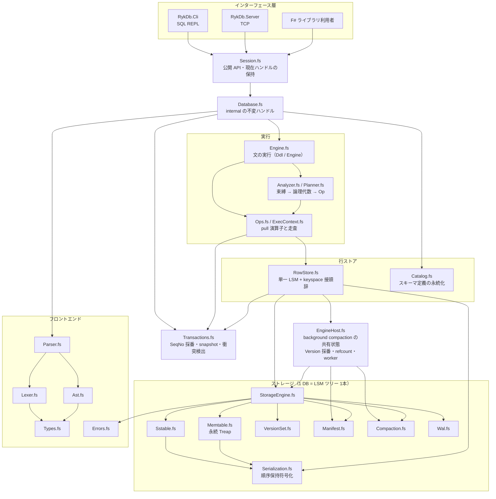
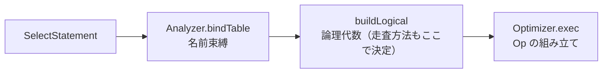

# アーキテクチャ

**.NET 10 / F# 10** で実装された、**LSM-Tree + MVCC + WAL** 組込み RDBMS の内部設計。
SQL の対応範囲は [`sql-reference.md`](sql-reference.md)、
実装時に踏んだ落とし穴は [`gotchas.md`](gotchas.md)、
コーディング規約は [`coding-conventions.md`](coding-conventions.md)、
ビルド・テスト・品質ゲートは [`development.md`](development.md) を参照。

---

## 目次

1. [全体像](#1-全体像)
2. [プロジェクト構成](#2-プロジェクト構成)
3. [フロントエンド](#3-フロントエンド)
4. [型と順序保持エンコーディング](#4-型と順序保持エンコーディング)
5. [実行層](#5-実行層)
6. [行ストア層](#6-行ストア層)
7. [MVCC](#7-mvcc)
8. [ストレージ層](#8-ストレージ層)
9. [データフロー](#9-データフロー)
10. [ファイルレイアウト](#10-ファイルレイアウト)
11. [インターフェース層](#11-インターフェース層)
12. [設計上の制約](#12-設計上の制約)

---

## 1. 全体像



### 設計原則

1. **不変性** — `StorageEngine` / `Version` / `Memtable` / `Catalog` などはすべて値。
   更新は「新しい値を返す」。読み取りはロックを取らず、snapshot は自然に固定される。
2. **失敗は値** — 例外を制御フローに使わず、すべて `Result<'T, DbError>` で返す
   （[`coding-conventions.md`](coding-conventions.md) §1）。
3. **keyspace の接頭辞分離** — テーブル・索引・カタログは論理 keyspace で分け、
   物理キーの接頭辞として 1本の LSM ツリーに載せる。
   複数 keyspace への書き込みも 1回の WAL バッチで原子的に commit する（§6.1）。
4. **バイト順 = SQL 比較順** — キーのエンコーディングが順序保持であることが、
   LSM の merge・索引・走査すべての前提（§4.2）。
5. **末尾再帰 / 明示スタック** — 要素数に比例する処理はスタックを積まない形で書く
   （[`coding-conventions.md`](coding-conventions.md) §3）。

### 採用している手法（サマリ）

| 領域       | 手法・アルゴリズム                                                                                        | 詳細                                                |
| ---------- | --------------------------------------------------------------------------------------------------------- | --------------------------------------------------- |
| ストレージ | LSM-Tree + **Leveled compaction**（LevelDB / RocksDB 方式）                                               | §8                                                  |
| memtable   | **永続 Treap**（優先度はハッシュ由来・決定的）                                                            | §8.1                                                |
| SSTable    | ブロック（**接頭辞共有**）+ Bloom filter + Footer v5（84バイト）                                          | §8.2                                                |
| 障害回復   | **WAL（論理ログ）** + MANIFEST / CURRENT の原子的更新                                                     | §8.4–8.5                                            |
| GC         | **版単位**の SeqNo 判定（ファイル単位では判定しない）                                                     | §8.6                                                |
| 並行制御   | **Session で読み取り並行・書き込み直列** + MVCC（Snapshot Isolation）+ first-committer-wins。DDL だけ排他 | §7                                                  |
| compaction | **background worker**（`Session.OpenWith`）。MANIFEST 追記と採番は installGate で直列化                   | §8.6–8.7                                            |
| キー符号化 | **順序保持エンコーディング**（型タグ・escape・タプル）                                                    | §4                                                  |
| 索引       | 複合キー（索引列 + 主キー）の prefix 走査                                                                 | §6                                                  |
| 実行       | **Volcano 方式の pull 演算子**（不変 `Op`）                                                               | §5.2                                                |
| 構文解析   | 手書き Lexer + 再帰下降 Parser（式規則は **CPS** で末尾再帰）                                             | §3                                                  |
| エラー処理 | `Result` ベース（`>>=` / `result { }` / `protect`）                                                       | [`coding-conventions.md`](coding-conventions.md) §1 |
| ハッシュ   | **FNV-1a 64bit** + **splitmix64**（Bloom filter・Treap の優先度）                                         | §4.2, §8.1                                          |

### 依存の向き

**上から下への一方向のみ**。
下位モジュールは上位を知らない。

| 層               | モジュール                                                       | 知っている層                                           |
| ---------------- | ---------------------------------------------------------------- | ------------------------------------------------------ |
| インターフェース | `Session.fs` `RykDb.Cli` `RykDb.Server`                          | 全部                                                   |
| 実行             | `Engine.fs` `Analyzer.fs` `Planner.fs` `ExecContext.fs` `Ops.fs` | `RowStore` `Catalog` `Transactions`                    |
| 行ストア         | `RowStore.fs` `Dml.fs` `Catalog.fs` `EngineHost.fs`              | `StorageEngine` `Compaction` `Manifest` `Transactions` |
| MVCC             | `Transactions.fs`                                                | `Memtable`(`Entry`) `Errors` `Types`                   |
| ストレージ       | `StorageEngine.fs` とその下                                      | `Errors` `Types` `Serialization`                       |
| フロントエンド   | `Lexer` `Parser` `Ast`                                           | `Types` `Errors`                                       |

> **Transactions と RowStore の依存方向**: `Transactions.fs` は `RowStore` を参照しない。
> 依存は **`Dml` / `RowStore` → `Transactions` → `Memtable`** の向きで、
> `Dml.fs` の DML ヘルパ（`insert` / `updateRow` / `deleteRow`）が `Transaction` のバッファへ行・索引を積む。
> commit 時に `TransactionManager.commit` の出力を `RowStore.commitToStore` に渡すのは `Engine`（§7.5）。

### なぜ不変（immutable）か

`StorageEngine` `Version` `Memtable` `Catalog` のすべてが**不変レコード**で、操作は「新しい状態を返す」形。
これは 3つの要求を同時に満たすための選択。

1. **読み取りでロックを取らない**。
   スナップショットを取得するだけで済むため。
2. **MVCC の snapshot が自然に固定される**。
   読み取り中に状態が書き換わらない。
3. **更新の書き忘れを型で防ぐ**。
   外部に公開するのは `Session` だけで、不変ハンドル `Database` は internal に閉じる。
   `Session` が現在のハンドルを保持するため、利用者が差し替えを忘れることはない。

ただし `Ops` の集約処理・ハッシュ結合・DISTINCT、`Op.toArray`、`ExtSort` の受け皿、
`Database.fs` のクライアント層などでは `ResizeArray` / `Dictionary` / `HashSet` を使う
（[`coding-conventions.md`](coding-conventions.md) §2）。

`EngineHost.fs` は「不変の `StorageEngine` の外側にある共有状態」で、
`ConcurrentDictionary` の CAS と `SemaphoreSlim` だけで Version の公開とファイルの refcount を管理する
（`mutable` / `while` / `ref` は使わない）。
`StorageEngine` は host を知らず、host 参照を持つのは `RowStore` だけ（§8.7）。

---

## 2. プロジェクト構成

`Directory.Build.props` は全プロジェクトに共通の設定を流す
（`TreatWarningsAsErrors` などのゲートは [`development.md`](development.md) §1）。

### モジュール一覧（`src/RykDb.Core/`）

| ファイル           | 役割                                                                                        |
| ------------------ | ------------------------------------------------------------------------------------------- |
| `Errors.fs`        | `DbError` / `ErrorKind` / `Result` 合成演算子（`>>=` / `result { }` / `protect`）           |
| `Types.fs`         | `SqlValue` / `DataType` / `TruthValue`（3値論理）/ `SqlLiteral` / `Bytes`（バイト列比較）   |
| `Serialization.fs` | 順序保持エンコーディング / `Writer` / `Cursor` / `KeyBuilder` / `Hashing`                   |
| `Memtable.fs`      | 永続 Treap の memtable（`apply` / `getVisible` / `rangeScan`）                              |
| `Wal.fs`           | 論理ログ WAL（Begin / Batch / Commit / Abort と redo）                                      |
| `BloomFilter.fs`   | SSTable 用 Bloom filter（double hashing）                                                   |
| `Sstable.fs`       | SSTable の構築・読み取り・k-way merge（ブロック / index / Bloom / Footer）                  |
| `VersionSet.fs`    | `Version`（レベルの不変スナップショット）と `VersionEdit`                                   |
| `Manifest.fs`      | MANIFEST / CURRENT の読み書き（原子的更新）                                                 |
| `Compaction.fs`    | Leveled compaction・版単位 GC・孤児ファイルの特定                                           |
| `StorageEngine.fs` | LSM ツリー 1本の公開層（open / put / flush / scan / compact / close）                       |
| `Ast.fs`           | 式 `Expr` / 文 `Statement` の判別可能共用体                                                 |
| `Lexer.fs`         | 手書きトークナイザ（読み取り位置を値として保持する）                                        |
| `Parser.fs`        | CPS 化した再帰下降パーサ（`MaxExpressionDepth = 200`）                                      |
| `Transactions.fs`  | SeqNo 採番・snapshot・write-write 競合検出                                                  |
| `EngineHost.fs`    | background compaction の共有状態（Version / 採番 / ファイル refcount / worker / install）   |
| `ProcessLock.fs`   | プロセス間ロック（`.rykdb.format` を排他で保持、`ProcessLock`）                             |
| `RowStore.fs`      | 単一 LSM と keyspace 接頭辞（`RowStore` 型 + `Keyspace` モジュール）                        |
| `Catalog.fs`       | `IndexSchema` / `TableSchema` / `Catalog` と出力 `Schema` / `OutputColumn` の型・モジュール |
| `Eval.fs`          | スカラー関数 `Scalar` と式評価器 `Eval`                                                     |
| `Op.fs`            | pull 演算子 `Op` / `Row`（`ExtSort` が `Op` を使うため先にコンパイル）                      |
| `ExtSort.fs`       | 外部マージソート `ExtSort` と一時ファイル `Spill`（ソートの溢らし・k-way merge）            |
| `Ops.fs`           | 演算子の組み立て `Ops`（フィルタ・ソート・結合・集約・射影・DISTINCT）                      |
| `Dml.fs`           | `RowKey` / `Dml`（`Transaction` のバッファへ行・索引を積む DML ヘルパ）                     |
| `ExecContext.fs`   | 実行時文脈 `ExecContext` と DML `DmlOps`（INSERT / UPDATE / DELETE）                        |
| `Analyzer.fs`      | `ScanMethod` / `JoinAlgorithm` / `Logical`、`Binder` / `Alias` / `Predicate` / `Analyzer`   |
| `Planner.fs`       | `Optimizer`（論理代数 → `Op`）と `Plan`（SELECT の実行）                                    |
| `DropCleanup.fs`   | DROP 後始末ジャーナル `DropCleanup` と起動時回復 `DropCleanupRecovery`                      |
| `Engine.fs`        | `StatementResult` / `DbState` / `Ddl` / `Engine`（文の実行）                                |
| `Database.fs`      | internal の不変ハンドル `Database`（transaction・状態遷移）                                 |
| `Session.fs`       | 公開 API `Session`（`Database` をカプセル化し、呼び出しを直列化）                           |

### F# のコンパイル順

```
Errors → Types → Serialization → Memtable → Wal → BloomFilter
       → Sstable → VersionSet → Manifest → Compaction
       → StorageEngine → Ast → Lexer → Parser → Transactions → EngineHost
       → ProcessLock → RowStore → Catalog → Eval → Op → ExtSort → Ops
       → Dml → ExecContext → Analyzer → Planner → DropCleanup → Engine → Database → Session
```

F# はファイルを**コンパイル順に評価する**ため、上から下へ一方向の依存になるよう `.fsproj` の `Compile` を手で並べる
（新しいファイルもこの順に追加する）。

---

## 3. フロントエンド

`Lexer.fs` → `Parser.fs` → `Ast.fs` → `Analyzer.fs` → `Planner.fs` という一方向のパイプライン。

### 3.1 Lexer — 状態スレッドの字句解析

- `LexState` は `{ Index; Line; Column }` の不変レコード。
  **前進すると新しい値を返す**ので mutable なインデックスを持たない。
- 予約語は `Lexer` の private `Keywords` Set、型名は `Parser.TypeNames`（`Parser.TypeTable` から導出）の Set に分ける
  （`INTEGER` などを予約語にすると列名に使えなくなるため）。
- Blob リテラル `X'0A1B'` の判定は**識別子より前**に置く。
  順序を逆にすると `'ABCD'` が文字列になる。
- コメントは `--`（行末）と `/* … */`（**入れ子可**）。

### 3.2 Parser — CPS 化した再帰下降

式の構文規則は互いを呼び合う（`parseExpr → parseOr → parseAnd → … → parsePrimary`）。
普通の再帰下降では、呼び出し後にも処理が残るため、相互再帰が非末尾再帰になる。
そこで「解析後に行う処理」を継続として引数に渡し、再帰呼び出しを末尾に置く。
CPS・継続の hoist・深さ制限の一般則は [`coding-conventions.md`](coding-conventions.md) §3 を参照。

サブクエリは式の中に `SELECT` が現れるため、式のパーサと SELECT のパーサ
（`parseSelectStatementC` / `parseSelectItemC` / `parseJoinsC` / `parseWhereC` / …）は
**同じ `let rec` グループ**の CPS 関数にする。

- 句を読む関数もすべて継続（`k: 'T -> PState -> Result<'r, DbError>`）を受け取り、
  次の句を呼ぶところをその継続に渡す。
  したがってグループ内の呼び出しはすべて末尾位置になり、
  `parseExprC` の `[<TailCall>]` を保ったままサブクエリを解析できる。
- 継続はラムダで渡す（`parseExprC (fun on st -> parseJoinsC acc k st) st`）。
  FS3569 はラムダ末尾を許容するので追加の hoist は要らないが、
  TailAudit はラムダ内を保守的に非末尾と数える（ベースラインで追認）。
- サブクエリの式は `enterExpr` で深さを数え、`MaxExpressionDepth` を上限とする。
- **グループの全メンバーに `: Result<'r, DbError>` の戻り型注釈を付ける**。
  推論に任せると、グループ内の相互参照で戻り値の型が別の型変数 `'r0` になり、FS0043 でグループ全体が型検査に失敗する。

回帰テスト: `末尾再帰: 大量の JOIN 句がパースできる` /
`末尾再帰: 大量の SELECT 項目・GROUP BY・ORDER BY がパースできる`。

### 3.3 Ast

判別可能共用体 `Expr` / `Statement`。
式は**列参照の修飾子を保持したまま**持ち、束縛（`Binder.qualify`）の段階で解決する。

`Expr.columnRefs` と `Expr.isAggregate` は**明示スタック**で走査する。
`go a @ go b` とすると再帰呼び出しが末尾位置に来ないうえ O(n²) になる。
`Expr.toDisplayString` も継続の連列表（`PrintStep`）で末尾再帰にしている。

組み立ては **`Expr.rewrite`**（`Ast.fs`）が担う。
葉の書き換え関数（`rewriteLeaf`）を受け取り、
内部のローカル関数 `plugChildren`（`children` の逆変換）で子を 1つずつ加工した式に戻すので、
深い式でもスタックを食わない。
`Expr.rewrite` は束縛（`Binder.qualify`）と、
集約後の読み替え（`Ops` の内部 `substituteAggs`）が共用している。
結果を返す書き換えは `Expr.rewriteWith`（失敗する葉の書き換え）を使う。

サブクエリは `Expr.Subquery` / `Expr.Exists` / `Expr.InSubquery` として持つ。
外側の束縛・集約の走査がサブクエリの内部へ入らないよう、
`Subquery` / `Exists` の子は空、`InSubquery` の子は左辺だけにしている。
実行計画時に `Plan` がこれらを `Expr.Value` / `Expr.InList` / 真偽値へ置き換える（§5）。

---

## 4. 型と順序保持エンコーディング

### 4.1 10 の型

`NULL` / `BOOLEAN` / `INTEGER` / `REAL` / `DECIMAL` / `TEXT` / `BLOB` / `DATE` / `TIMESTAMP` / `UUID`。

`SqlValue` は実行時の値を表し、`NULL` は他のすべての型と区別できる特別なケース。
`TruthValue` で SQL の 3値論理（`True` / `False` / `Unknown`）を表現する。

### 4.2 順序保持符号化（LSM 採用の最大の制約）

LSM はキーをバイト列として比較する。
そのため、符号化後のバイト順が SQL の値の比較順と一致しなければならない。これが設計の中心的な制約である。

型タグを SQL 照合順に単調増加させている。

| 型        |   タグ |     | 型          |   タグ |
| --------- | -----: | --- | ----------- | -----: |
| `Null`    | `0x00` |     | `Date`      | `0x30` |
| `Bool`    | `0x10` |     | `Timestamp` | `0x40` |
| `Int`     | `0x20` |     | `Text`      | `0x50` |
| `Real`    | `0x21` |     | `Blob`      | `0x60` |
| `Decimal` | `0x22` |     | `Uuid`      | `0x70` |

型タグの後は「型ごとのペイロード + 終端 `0x00`」が続く
（`Serialization.fs` の `OrderPreserving` が実装）。

| 型          | ペイロード                                                                                                   |
| ----------- | ------------------------------------------------------------------------------------------------------------ |
| `NULL`      | なし（タグ + 終端のみ）                                                                                      |
| `BOOLEAN`   | 1バイト（0 / 1）                                                                                             |
| `INTEGER`   | 8バイト BE。`v + 2⁶³` の単調写像（`mapInt64`）                                                               |
| `REAL`      | 8バイト BE。IEEE-754 ビットの順序写像（負は全ビット反転、正は符号ビット反転）。NaN は正の quiet NaN に正規化 |
| `DECIMAL`   | 符号（負数は反転）+ 指数 8バイト（順序写像）+ 桁列 29バイト（右詰め。負数は 9 − 桁で反転）                   |
| `DATE`      | `DateOnly.DayNumber`（0001-01-01 基準の日数）を `INTEGER` と同じ写像で                                       |
| `TIMESTAMP` | `DateTime.UtcTicks` を同じ写像で                                                                             |
| `TEXT`      | UTF-8 バイト列を escape（0x00 → 0x00 0xFF）                                                                  |
| `BLOB`      | 生バイト列を escape                                                                                          |
| `UUID`      | RFC 4122 の 16バイト BE 順                                                                                   |

- `TEXT` / `BLOB` は埋め込み `0x00` を `0x00 0xFF` に escape し、終端に `0x00` を置く。
  型タグはすべて `0xFF` 未満なので、escape 列は「並びがここで終わった」ことを示す働きをし、正しい大小関係になる。
- この escape により、**生のバイト列の前方一致 = 正しい接頭辞一致**になり、 range scan の下限と索引の prefix 走査に使える。
- 複合キーは escape 付きタプル符号化（`("a","bc") < ("ab","c")` を満たす）。

escape の正しさをバイト列で確認した例（フィールド `["ab", "z"]` と `["ab\0", "a"]`）:

```
["ab","z"]   = 50 'a' 'b' 00 50 'z' 00
["ab\0","a"] = 50 'a' 'b' 00 FF 00 50 'a' 00
              位置 4: 0x50 < 0xFF なので前者が小さい -> "ab" < "ab\0" で正しい
```

`Serialization.fs` は書き込み用の `Writer`（不変のチャンク列）と読み込み用の `Cursor`（読み取り位置を値として保持する）、
ハッシュ（FNV-1a + splitmix64）を持つ。

---

## 5. 実行層

### 5.1 Planner — 束縛 → 論理代数 → Op



パイプラインの実装は `Analyzer.fs` と `Planner.fs` の 3段。

1. `Analyzer.bindTable` — FROM / JOIN の各テーブルを `TableBinding`（スキーマ + 識別名）にする。
2. `Optimizer.buildLogical` — 式を `Binder.qualify` で束縛し、`Predicate.splitConjuncts` で WHERE を分解、
   `Analyzer.chooseScanMethod` で走査方法を決めて論理代数を組む。
3. `Optimizer.exec` — 論理代数を `Op` に変換する（`execScan` / `execJoin` など）。

#### サブクエリの解決（`Plan.planSelectC`）

式の中のサブクエリは、原則として論理代数を組む前に **1回だけ実行して定数へ置き換える**。
`Plan.planSelectC` / `resolveSelectC` / `resolveExprC` / `resolveLeafC` が相互再帰し、
サブクエリも同じ `ExecContext`（同じ snapshot / transaction）で実行する。

- `(SELECT ...)` — 1列だけ。
  0行なら `NULL`、1行なら `Expr.Value`、2行以上は `ConstraintViolation`。
- `IN (SELECT ...)` — 1列の値を `Expr.InList` へ展開する
  （`NULL` の 3値論理は `Eval` がそのまま扱う）。
- `EXISTS (SELECT ...)` — `Op.next` を 1回だけ呼んで真偽値にする。
- **相関サブクエリ**（外側の列を参照するもの）は、外側行を受け取る
  `Expr.CorrelatedSubquery`（`Run : SqlValue array -> Result<SqlValue, DbError>`）へ置き換える。
  外側クエリの入力スキーマをスコープ列として `resolveSelectC` まで引き回し、
  内側で解決できない列参照が外側スコープに一致したら相関と判定する
  （内側に同名のテーブルがある場合は標準どおり内側が優先）。
  実行時は外側の行の値で参照を `Expr.Value` へ置換し、
  内側の SELECT を外側行ごとに再計画・実行する（`runSubquery`）。
- 相関サブクエリの `Depths` は依存する外側スコープの深さ（1 = 直近）を持ち、
  入れ子の相関を外側クエリの相関として引き継ぐ。
- 相関参照を含む述語は **WHERE の押し下げ対象から外す**
  （子スコープの行で評価すると列位置が変わるため。`Expr.hasCorrelated` で判定）。
- 集約後の行を読む位置（集約クエリの `SELECT` / `HAVING` / `ORDER BY`）と
  `LIMIT` / `OFFSET` は外側行を持たないため、相関サブクエリを置くと `SyntaxError`。
  派生テーブル（LATERAL）も未対応。
- FROM / JOIN のサブクエリ（派生テーブル）は次の「派生テーブル」節で扱う。
- ヘッダだけは解決前の式から作る（解決後は値になり列名が `30` のようになってしまうため）。
- DML の値式・`WHERE` は `Engine` が `Plan.resolveDmlExprWith` で同様に解決する
  （UPDATE / DELETE は対象行のスキーマを渡すので、外側行を参照できる）。

この相互再帰は **CPS**（継続を引数で受け取り、末尾で呼ぶ）にしてある。
式の走査は `Expr.rewriteWithC`（葉の書き換えが継続を取る版）が明示スタックで回し、
葉（サブクエリ）の解決が終わったら継続を末尾で呼ぶので、
入れ子段数に依存せずスタックは積み上がらない（`Expr.rewriteWith` はその糖）。
リスト（項目 / JOIN / GROUP BY / ORDER BY）は `traverseC` が 1件ずつ継続で回す。
相関サブクエリの再実行は `planSelectCWith` に渡す `runSubquery`（外側行ごとの計画・実行）が担う。
サブクエリの入れ子は Parser の `MaxExpressionDepth`
（1段で複数単位を消費する。実測: 90段は実行でき、150段は `式の入れ子が深すぎます`）によっても制限される。
回帰テスト: `SqlReference: 相関サブクエリ` /
`SqlReference: 相関サブクエリの未対応形` /
`SqlReference: 深いサブクエリの入れ子（上限内）は実行できる` /
`末尾再帰: 深いサブクエリの入れ子もエラーになる（StackOverflow ではない）`。

#### 派生テーブル（FROM / JOIN のサブクエリ）

`FROM (SELECT ...) AS x` は**計画と実行を分ける**。
計画時に結果を作らない。

- Parser は `TableSource.Derived(SelectStatement, alias)` を作る（**別名必須**）。
- `Plan.resolveSourcesC` が FROM / JOIN の `Derived` を `Plan.planCoreCWith` で計画する。
  `planCoreCWith` は論理木までで止め、`PlannedQuery`（`Output` / `Header` / `Input` / `Context` / `Tree`）を返す。
  AST は実テーブル参照（別名）へ書き換え、
  計画結果は別名をキーにした Map で `Optimizer.buildLogicalWith` へ渡す。
- `Optimizer.buildLogicalWith` は派生の束縛を `Logical.Derived` にする。
  WHERE は内側へ押し下げず、派生ノードの上に `Filter` を付ける
  （集約 / DISTINCT / LIMIT を跨ぐと意味が変わるため）。
- `Optimizer.run` は `Logical.Derived` に来たら、
  計画が持つ入力スキーマと `ExecContext` で内側の木を評価し、
  `DerivedFrame` で外側の文脈へ戻す。
  内側のテーブル別名は内側の ctx にしか無いため、文脈の切り替えが必要。
- `Output`（参照名 + 別名修飾）と `Header`（表示名）は別に持つ。
  `SELECT t.id` の列名を `id` にして、外側から `x.id` で引けるようにするため
  （`Schema.referenceColumns`）。
- 型は直接の列参照だけ引き継ぐ。
  型が無い列はハッシュ / マージ結合のキーにならず入れ子ループになる。
- `Logical.Derived` は `scanOrder` で `None` に落ちるためマージ結合には選ばれない。

回帰テスト: `SqlReference: 派生テーブル（FROM / JOIN）` /
`Optimizer.buildLogical: FROM のサブクエリは Logical.Derived になる`。

#### 束縛（Binder）

- パーサは裸の名前を `Expr.Name` として作る。
  `Binder.qualify` が**一意に決まる場合だけ**修飾名（`t.age`）へ直し、
  曖昧な場合は修飾せずに残し、実行時に「列 'age' が曖昧です（該当: …）」というエラーを返す。
- `FROM t AS x` の別名は、テーブル名の解決用に実名と別名の両方で `ExecContext.Schemas` に登録される。
  列の修飾子は**別名**（`x.id`）になり、比較は大文字小文字を区別しない。
- WHERE は `Predicate.splitConjuncts` で AND を平坦化してから扱う。

#### 論理代数の構築（buildLogical）

1. `FROM` は省略できる（入力は 1行 0列の `Logical.Values`）。
   `JOIN` には `FROM` が必要で、Parser が `JOIN には FROM が必要です` にする。
2. WHERE を全テーブル連結のスキーマで束縛 → conjunct へ分解し、先頭テーブルを `buildScan`。
3. JOIN を FROM の順に**左深く**積む。
   右は `buildScan`（INNER は右ローカルの WHERE を pushdown、LEFT は null 供給側なので JOIN の上へ回す）。
   ON は「左の連結 + 右」のスキーマで束縛。
4. どのテーブルにも属さない conjunct（例 `a.v = b.v`）は JOIN の上の `Filter` にする。
5. 集約 → 並び替え → 射影 → DISTINCT → LIMIT の順に被せる。

補足:

- **集約の検出**は SELECT 項目と ORDER BY から（`Ops.aggCalls`）。
  GROUP BY があるか集約呼び出しがあれば `Aggregate` を作り、
  HAVING があればその上に `Having` を置く。
- **ORDER BY は列参照・式・序数（1 始まり）** が使える。
  式は行末に評価結果を加えてソートし、ソート後に評価結果を取り除く。
- **主キー順の ORDER BY は Sort を作らない**。
  単一テーブル・集約なし・DISTINCT なしで、ORDER BY の先頭が主キー全列を定義順・昇順で並べているなら、
  走査結果がそのまま順序になる（主キーは一意なので後続キーは順序に影響しない）。
  主キーの一部だけ・降順・索引走査（`IndexLookup` / `IndexRangeScan`）になる場合は作る。
  これにより `ORDER BY 主キー LIMIT n` の件数ヒントが走査まで降りる。
- **LIMIT / OFFSET は 0 以上の定数式**（行ごとの列参照・負数はエラー）。
  `LIMIT` は最外層に置き、`OFFSET` を先、`LIMIT` を後に適用する。

#### 最適化ルール（実装済みの範囲）

| ルール            | 内容                                                                                                                                                                                                           |
| ----------------- | -------------------------------------------------------------------------------------------------------------------------------------------------------------------------------------------------------------- |
| Filter pushdown   | WHERE の conjunct のうち「そのテーブルのみを参照するもの」を、そのテーブル直下の `Filter` へ押し下げる（`buildScan`）。LSM はレベル間で k-way merge するため、常に安全。ただし **JOIN の ON 句は押し下げない** |
| 主キー順 ORDER BY | 単一テーブル・集約なし・DISTINCT なしで、ORDER BY の先頭が主キー全列（定義順・昇順）なら `Sort` を作らない（走査が主キー順のため）。LIMIT の件数ヒントが走査まで降りる                                         |
| 走査方法の選択    | 下記「走査方法の選択」                                                                                                                                                                                         |
| 評価順の固定      | 集約 → 並び替え → **射影** → DISTINCT → LIMIT                                                                                                                                                                  |

> `DISTINCT` を射影の**前**に置いてしまうと `(id, g)` の組を重複排除してしまう。
> `LIMIT` は常に最外層に置き、`OFFSET` を先に `LIMIT` を後に適用する。

#### WHERE の置き場所（JOIN があるとき）

| 述語                                       | 置き場所                                                                     |
| ------------------------------------------ | ---------------------------------------------------------------------------- |
| 先頭テーブルに局所                         | そのスキャンの直下（`Filter`）                                               |
| INNER JOIN の右に局所                      | 右部分木の直下（`rTree` に含めて実行する）                                   |
| LEFT JOIN の右に局所                       | **JOIN の上**（null 供給側。入力側へ押し下げると NULL 拡張行の可否が変わる） |
| どのテーブルにも属さない（例 `a.v = b.v`） | JOIN の上                                                                    |

#### 走査方法の選択（`chooseScanMethod`）

```
WHERE に「列 = 定数」の等価述語があるか（AND を平坦化して全 conjunct を見る）
  ├─ 主キーの全列に型一致の等値条件がある → PkLookup（値を PK 順に並べる）
  ├─ 単一列索引と型一致の等値条件がある   → IndexLookup
  └─ それ以外                             → SeqScan
```

等価条件が無くても、下限のある範囲条件（`>` / `>=` / `BETWEEN`）や
`LIKE 'prefix%'`（`%` が末尾のみ・`_` なし）があれば範囲走査を使う
（`<` / `<=` だけの条件は下限が無いので `SeqScan` のまま）。
範囲走査はあくまで**走査範囲の絞り込み**で、厳密な境界判定は上位の `Filter` が担う。

- 定数側に使えるのは**リテラルだけ**（`-1` のような符号つきリテラルは可。式・関数は不可）。
- **等値一致（`IndexLookup`）は、索引の先頭から連続する `= 定数` が 1列以上あるとき**
  （全列でなくてもよい）。
  範囲条件がその次の列にある場合は、より多くの列を絞れる `IndexRangeScan` を優先する。
  複合索引の範囲は「範囲列より前の全列が `= 定数`、範囲列が下限付きの範囲条件」のとき `IndexRangeScan`
  （Leftmost prefix の範囲版）。
- `LIKE 'prefix%'` は `[prefix, prefix+1)` の範囲に変換する。
  `LIKE '%x'` や `_` を含むものは `SeqScan` + `Filter`。
- 主キーは全列の等値条件が揃ったときだけ `PkLookup` にする。
  部分一致は `SeqScan` で残りを `Filter` する。
- 主キー・索引は値のバイト列表現で引くため、**列の宣言型とリテラルの型が一致するときだけ**使う。
  型不一致は `SeqScan` に落とし、比較時に `TypeError` にする。

#### 結合アルゴリズム

`Optimizer` は `ON` 句から左×右の等値キーを取り出し、次の順で選ぶ。

1. **インデックス入れ子ループ**（`JoinAlgorithm.IndexNestedLoop`）:
   左部分木の見積りが 32行以下（`Limit` / 主キー等値 / `Values` = FROM 省略の 1行）で、
   右テーブルに結合キー全列を満たす索引があり、右部分木が `Scan` のとき。
   右は左行ごとに `ExecContext.byIndex` で引く。
2. **マージ結合**（`MergeJoin`）:
   等値キーがあり、左右の走査が**結合キー順**のとき。
   `Analyzer.scanOrder` が `SeqScan` / `RangeScan`（主キー列）、
   `IndexLookup` / `IndexRangeScan`（索引列）を昇順と判定し、
   `Filter` / `Limit` は順序を変えないので透過する。
   結合キーがその**先頭 |keys| 列**と一致するときだけ使う
   （キーでない列が間に挟まる走査はキー順にならない）。
   `ON` の等値条件の順が走査順と違っても、等値は対称なので走査順に並べ替えてよい。
   両側が 1行（`PkLookup` / `Values`）なら任意の順序でよい。
   右側を materialize せず、両側を 1行ずつ流す（`Ops.innerJoinMerge` / `leftJoinMerge`）。
3. **ハッシュ結合**（`HashJoin`）:
   等値キーがあり、上記以外。右側を `Dictionary<SqlValue array, ...>` のハッシュ表にする。
4. **入れ子ループ**（`NestedLoop`）:
   等値キーがない（非等値・複合条件）。

- キー列の型が一致する等値条件だけをキーにする（型不一致は入れ子ループ）。
- NULL キーは一致しない（ハッシュ/索引/マージとも）。
- 等値キー以外の `ON` 句（residual）は結合時に評価する。
- インデックス入れ子ループは右部分木が `Filter` のときは使わない
  （右への WHERE pushdown を落とさないため）。
  LEFT JOIN の右側述語は結合後に評価されるので `Scan` のまま使える。
- 結合順序は `FROM` に書かれた順（選択性による並べ替えも未実装）。

#### 論理代数 → Op（`Optimizer.exec`）

- `Scan` は `execScan` が `ScanMethod` に応じて `ExecContext.table` / `ExecContext.byPrimaryKey` / `ExecContext.byIndex` へ振り分ける。
- `Join` は左を「現在のスキーマから右テーブルを除いたもの」、
  右を「右テーブル 1つだけのスキーマ」で実行し、
  戦略に応じて `Ops.innerJoin` / `Ops.leftJoin`（入れ子ループ）、
  `Ops.innerJoinHash` / `Ops.leftJoinHash`（ハッシュ）、
  `Ops.innerJoinMerge` / `Ops.leftJoinMerge`（マージ）、
  `Ops.innerJoinIndexed` / `Ops.leftJoinIndexed`（インデックス）へ振り分ける
  （ON は左行 + 右行で評価）。
- `Filter` / `Sort` / `Project` は子の**出力スキーマ**（`outputOf`）を求めてから掛ける。
  集約の後は行の並びが「groupBy の値 + 各集約の結果」に変わるため、
  「入力スキーマ（テーブル定義）」と取り違えると `SELECT SUM(age)` が引数を評価できず `NULL` になる。
- `Having` は集約後の行を**位置で読み替えて**から評価する（`Ops.havingFilter`）。
- `Limit` は `Op.skip`（OFFSET）→ `Op.take`（LIMIT）の順。
  `limit = -1` が「LIMIT なし」、`limit = 0` は 0 行。
- 最後に `Engine.runSelect` が `Op.toArray` で行を集め
  （`Plan.runSelect` は列名と未消費の `Op` を返すだけ）、
  ヘッダは `Schema.projectHeader`（別名優先、`*` は列名）で組み立てる。
  `*` / `t.*` の列展開は `Schema.expandStar` に一本化している
  （ヘッダと射影の式が同じ列を共有するため）。
  `*` は修飾なしの列名、`t.*` は修飾つきの表示名で出す。

### 5.2 Ops — pull 演算子

#### なぜ pull 方式か

push（差し出し）だと「1行だけ欲しいのに全行計算した」ことになり、
`LIMIT 1` や `WHERE` の早期打ち切りが効かない。
pull は「次の 1行」を上流に要求するので、上流が自然に止まる。
F# の `seq { }` は内部に mutable な列挙子を持つので、本実装では使わず、
「残りの計算」を値として持ち回る不変な pull 演算子 `Op`（Volcano 方式 / イテレータモデル）で組む。

`Step` は**即値**（計算済みの 1行 + 続き）、`Compute` のみが遅延する。
`Compute` は「次に 1行を返す関数」なので、要求されるまで計算しない。
`Op.ofArray` は 1行ずつ `Compute` を繋ぐので、行数ぶんのスタックを積まない。

一方で、**入れ子ループ結合とハッシュ結合は Op を組み立てる時点で右側を materialize** する
（インデックス入れ子ループは左行ごとに右を引く。下表の「遅延」列を参照）。
**マージ結合は右側を materialize せず、両側を 1行ずつ流す**
（同じキーの行のグループだけを保持する）。
materialize は管理メモリ換算で **256MiB が上限**で、超過は `CapacityError`
（`Ops.toArrayWithBudget`。インデックス検索の結果も同じ上限）。
ソート・集約・DISTINCT は**入力行を抱えず**、
それぞれ外部マージ・アキュムレータ・符号化済みキーで処理する（§5.3）。

`Ops` モジュールの演算子は以下のとおり。

| 演算子                                           | 役割                                         |
| ------------------------------------------------ | -------------------------------------------- |
| `Op.ofArray` / `ofSeq` / `ofRow`                 | 材料化済み・遅延 seq・1行の源                |
| `Op.map` / `filter`                              | 1 対 1 / 1 対 0 の変換                       |
| `Ops.project`                                    | 射影（`*` / `t.*` の展開を含む）             |
| `Ops.sortBy`                                     | ソート（外部マージ。§5.3）                   |
| `Op.take` / `Op.skip`                            | LIMIT / OFFSET                               |
| `Ops.innerJoin` / `leftJoin`                     | 入れ子ループ結合                             |
| `Ops.innerJoinHash` / `leftJoinHash`             | ハッシュ結合                                 |
| `Ops.innerJoinMerge` / `leftJoinMerge`           | マージ結合                                   |
| `Ops.innerJoinIndexed` / `leftJoinIndexed`       | インデックス入れ子ループ                     |
| `Ops.aggregate`                                  | 集約（`groupBy` 値 + 各集約結果 の行を生成） |
| `Ops.distinct`                                   | 重複除去                                     |
| `ExecContext.table` / `byPrimaryKey` / `byIndex` | 走査                                         |

遅延の持ち方が演算子ごとに違う。

| 演算子                                         | 遅延                                                                          |
| ---------------------------------------------- | ----------------------------------------------------------------------------- |
| `Op.ofArray` / `ofRow`                         | `ofArray` は `Compute` で 1行ずつ（組み立て時に全行分のスタックを積まない）   |
| `Op.map` / `Op.filter` / `Op.take` / `Op.skip` | `Compute`。LIMIT / WHERE の早期打ち切りが効く                                 |
| `Ops.project`                                  | `Compute`（1行ずつ）                                                          |
| `Ops.sortBy` / `Ops.aggregate`                 | **Op 構築時**に全入力を消費するが、行は抱えない（§5.3）                       |
| `Ops.distinct`                                 | 符号化済みキーの `HashSet` を持ち回る（出現順を保持。バジェット上限あり）     |
| `Ops.innerJoin` / `leftJoin`                   | 右を materialize し、左を 1行ずつ流す入れ子ループ                             |
| `Ops.innerJoinHash` / `leftJoinHash`           | 右をハッシュ表に materialize する                                             |
| `Ops.innerJoinMerge` / `leftJoinMerge`         | 両側を 1行ずつ流す（同じキーの行のグループだけを保持。右の materialize なし） |
| `Ops.innerJoinIndexed` / `leftJoinIndexed`     | 左行ごとに `ExecContext.byIndex` で右を引く                                   |
| `ExecContext.*`                                | スキャン結果を `Op` として受け取る（snapshot は生成時に固定）                 |

`DISTINCT` は `ValueCodec` で符号化したバイト列をキーにし、
集約のグルーピングは `SqlValue array` の構造比較（`HashIdentity.Structural`）を使う
（どちらも「同じ値なら同じキー」。NULL 同士は等しい扱い）。

### 5.3 メモリを抑える 3つの手段

| 対象              | 手段                                                                                                                                                             | メモリの上限                                                       |
| ----------------- | ---------------------------------------------------------------------------------------------------------------------------------------------------------------- | ------------------------------------------------------------------ |
| `ORDER BY`        | 外部マージソート（`ExtSort`）。バジェット内はメモリ、超過分は一時ファイルの run へ退避して k-way merge。**主キー全列の昇順（単一テーブル）なら Sort を作らない** | 受け皿 1枚（既定 64MiB）+ run ごとの先頭 1行                       |
| `GROUP BY`        | 行を抱えずアキュムレータだけ更新（`Ops.aggregate`）                                                                                                              | グループ数 × アキュムレータ（上限 400万グループ）                  |
| `SELECT DISTINCT` | 符号化済みキーの `HashSet`                                                                                                                                       | 既定 256MiB。超過は `CapacityError`（OOM で死なない）              |
| `JOIN`            | 右側を materialize（入れ子ループ / ハッシュ結合。インデックス検索の結果も同様）。マージ結合は両側を流し、同じキーの行だけ保持                                    | 256MiB（右側 1つ、または 1キーのグループ）。超過は `CapacityError` |

- 上限の判定は**管理メモリの概算**で行う（`ValueCodec.managedRowBytes` / `Entry.managedBytes`）。
  `SqlValue`（参照型の DU）・string（UTF-16）・配列ヘッダ・Treap / Map ノードを含む。
  `ValueCodec.approximateBytes` / `SstEntry.approximateBytes` は**符号化サイズ**
  （SSTable のファイルサイズ見積り）で、メモリの判定には使わない。
- 同時に開く run は最大 **32本**。run が 32本を超える場合は 32本ずつ中間 run にマージし、
  最後に 32本以下を k-way merge する（file descriptor の枯渇を防ぐ multi-pass merge）。
- 一時ファイルは `%TEMP%/rykdb-sort-*` 。run が尽きた時点で消し、途中打ち切りで残ったものは
  次のソート開始時に 24時間を超えたものだけ回収する。
- ソートは全入力を消費してからでないと 1行も出せないため、`Ops.sortBy` は**呼び出し時に**入力を消化し、
  比較不能な型などのエラーも呼び出し時に返す（従来の契約と同じ）。
- なお、**JOIN の右側を materialize するのは入れ子ループ / ハッシュ結合とインデックス検索**。
  両入力がキー順に走査できる等値結合はマージ結合でストリーミングする。

#### 演算子の共通規約

- `Op.map` / `filter` / `take` / `skip` は「次を要求されたときだけ 1段進む」形で、残りの継続も自分自身へ繋ぎ直す
  （継続をそのまま渡すと変換が 1行だけに効くバグになる）。
- エラーは `Error` をそのまま返して列挙を打ち切る（例外は使わない）。
- `Op.toArray` は `ResizeArray` + `match` 直下の再帰で回す
  （`>>=` を重ねると末尾呼び出しが効かず 10万行でスタックオーバーフロー。[`coding-conventions.md`](coding-conventions.md) §3）。

#### 走査（`ExecContext`）

- `ExecContext` は `{ Store; Visible; Schemas; Catalog; Txn }`。
  `Visible`（snapshot の SeqNo）は Op を作るときに 1回だけ決まる。
  `Txn` は read-your-writes のために読み取りに適用する transaction。
- `ExecContext.table` = `Dml.scanByPrimaryKeyWithTxn`（`Dml.fs` の DML ヘルパ。主キー順の全走査）。
  `ExecContext.byPrimaryKey` = `Dml.getByPrimaryKeyWithTxn`（ポイント検索、無ければ空 Op）。
  `ExecContext.byIndex` = `Dml.scanByIndexPrefixWithTxn`（索引の prefix 走査。非一意索引でも全行を返す）。
  `rangeScan` / `byIndexRange` もそれぞれ `Dml.scanByPrimaryKeyRangeWithTxn` / `Dml.scanByIndexRangeWithTxn` を使う。
- **スキャンは遅延の `Op` として受け取る**（1行ずつ引くまでストレージを読まない）。
  `Optimizer` は `Limit` の件数ヒント（`OFFSET + LIMIT`）を `Project` だけ通して `Scan` へ降ろす。
  `ExecContext.table` / `rangeScan` / `byIndex` / `byIndexRange` はこれを `Dml` → `RowStore` → `StorageEngine.scanAt` まで渡す。
  `Filter` / `Sort` / `Aggregate` / `Distinct` / `Join` は行数を変える（または順序を作る）ため、ヒントを下位へ伝播させない。
  ただし `ORDER BY` が主キー全列の昇順で走査が主キー順のときは `Sort` ノード自体を作らないので、
  `ORDER BY 主キー LIMIT n` もヒントが降りる（上の「主キー順 ORDER BY」）。
  limit > 0 の `scanAt` は必要なファイルだけを開いて先頭 limit 件を返す（§8.2）。
- **transaction のバッファ重ね当て（`Dml` 内部の `overlayRows`）もストリーミング**。
  store の行と txn のスロットはどちらもキー昇順なので、突き合わせながら 1行ずつ合成する
  （従来は store の全行を配列化してから再ソートしていた）。

#### 集約・ソート・射影の内部

- 集約（`Ops.aggregate`）は全行を読み、グループキー → 行リストの表を作って**最初に現れた順**に 1行ずつ返す。
  出力は「GROUP BY の値 + 各集約の結果」の並び。
- `SUM` / `AVG` は `decimal` で累積する（`REAL` 混在時は `double`）。
  `COUNT(列)` は NULL を数えず、`COUNT(*)` は数える。
  空グループの `SUM` / `AVG` / `MIN` / `MAX` は `NULL`、`COUNT` は 0。
- `SUM` は数値列なら `DECIMAL`（`REAL` 混在時のみ `REAL`）、`AVG` は常に `REAL` を返す。
  `COUNT` / `SUM` / `AVG` / `MIN` / `MAX` の `DISTINCT` は重複排除する
  （`Ops.aggregate` の `addAcc` が `distinct` フラグで `Seen` を管理）。
- ソート（`Ops.sortBy`）は列参照なら「列インデックス + 向き」に解決して `ExtSort.sortRows`（外部マージ）で並べる。
  式のキーは行ごとに評価して行末に足し、ソート後に元の列だけを残す。
  `ORDER BY` の序数（1 始まり）は `Planner.applySort` が `SELECT` 項目の式へ置き換える。
  解決は修飾つき（`t.age`）を優先するので、集約後の出力（列名が `SUM(t.age)` になる）でも動く。
- 射影（`Ops.project`）は `*` / `t.*` を列参照へ展開する。
  入力が集約結果のときは `substituteAggs` で位置に読み替えてから評価する。

#### DML（`DmlOps`、`ExecContext.fs`）

DML は pull 演算子ではなく、`Transaction` を積み上げて件数を返す実行関数（§9.2）。

- `insert` — 列順・`DEFAULT` / `NULL` の充足・`SqlValue.coerce` による型強制を行い、
  行ごとに `Dml.insert` でバッファへ積む（最終確認は `TableSchema.validateRow`）。
- `update` — 全行をスキャンして WHERE を評価し、代入式は「現在の行」で評価して `Dml.updateRow` へ。
  **主キー列の書き換えは未対応**（`sql-reference.md` 参照）。
- `delete` — 全行をスキャンし、WHERE に合う行の**主キー + 全索引に tombstone** を書く。

いずれも書き込みは `Transaction` のバッファに溜まり、**commit 時にだけ** RowStore へ届く。

#### snapshot は Op 生成時に 1回だけ固定する

各演算子は実行中に「今この瞬間の DB の時刻」を見てはいけない。
途中で他トランザクションが commit すると、同じクエリの前半と後半で見えるデータが変わる（read committed になり、JOIN が壊れる）から。
よって `ExecContext.Visible` は Op を作る時点で確定させ、渡された値だけを使う。

### 5.4 式の評価

`Eval` モジュールがスカラー式を 3値論理つきで評価する。
集約呼び出しはここでは評価せず、`Ops.aggregate` / `Ops.project` が先に計算してから結果を定数として読み替える
（`Ops.substituteAggs`）。

**3値論理と NULL**

- 比較はオペランドに NULL があると `NULL`（UNKNOWN）を返す。
  `AND` は左が `FALSE` なら右を評価せず `FALSE`、`OR` は左が `TRUE` なら右を評価せず `TRUE`（短絡評価）。
- `WHERE` / `HAVING` は UNKNOWN を**偽**として扱う（`Eval.matches`）。
- `BETWEEN` は `>=` と `<=` の AND として 3値論理で評価する。
- `IN` は「一致する要素があれば TRUE、
  一致せず NULL（UNKNOWN）を 1 つでも見れば UNKNOWN、それ以外は FALSE」。
  空の `IN` は FALSE（`NOT IN` は真偽が反転）。
- `CASE` の WHEN は `TRUE` のときだけ THEN を返し、`NULL` / UNKNOWN は次の WHEN へ進む。

**演算と関数**

- 算術は NULL を伝播する。`0` による除算・剰余は `ConstraintViolation` エラー。
- 型決定: `INTEGER` x `INTEGER` → `INTEGER`、`DECIMAL` x `DECIMAL` → `DECIMAL`、片方が `REAL` なら `REAL`。
- `||`（`Concat`）は両辺の表示文字列を連結する（NULL は NULL）。
- `LIKE` は `%` / `_` の手書き照合
  （大文字小文字は区別。`LIKE ... ESCAPE '文字'` に対応し、エスケープ文字は 1文字。
  エスケープ文字の直後の `%` / `_` / 自身はリテラルになり、末尾のエスケープは `TypeError`。
  バックトラックしない 1パスの照合なので、`%` が多いパターンでも無限ループしない）。
- スカラー関数は `UPPER` / `LOWER` / `LENGTH` / `ABS` / `COALESCE` / `TRIM` / `ROUND`。
  未知の関数・引数個数の不一致はエラー（`ROUND` は `INTEGER` / `REAL` / `DECIMAL` に対応）。
- 集約のエラーは伝播する（数値以外に `SUM` を掛けると `TypeError`）。
- `AVG` は `SUM ÷ COUNT` を実行時に計算する（結果は `REAL`）。

---

## 6. 行ストア層

### 6.1 keyspace の接頭辞分離

テーブル・索引・カタログは**論理 keyspace** で分けるが、物理的には DB ごとに **1本の LSM ツリー**に載せる。
物理キーは `[varint(keyspace の UTF-8 長)][keyspace][論理キー]` で、keyspace はキーの前方一致する接頭辞になる。

| keyspace      | 中身                     | 論理キー                                       |
| ------------- | ------------------------ | ---------------------------------------------- |
| `t:<table>`   | テーブルの行（主キー順） | `KeyBuilder.ofValues 主キー列`                 |
| `i:<index>`   | 索引エントリ             | `KeyBuilder.ofIndexAndPrimary 索引列 主キー列` |
| `__catalog__` | スキーマ定義             | `table:<名前>` / `index:<名前>`                |

```
<root>/
  .rykdb.format      単一 LSM レイアウトのマーカー（プロセス間ロックを兼ねる）
  MANIFEST-000001    世代ごとの VersionSet 定義（DB 全体で 1本）
  CURRENT            有効な MANIFEST 番号
  000123.sst         データファイル（全 keyspace を含む）
  000002.wal         先行ログ（全 keyspace を含む）
```

長さを先頭に置くため、`t:a` と `t:ab` のように前方一致する keyspace 名でもキーは混ざらない。
走査は接頭辞の境界で停止し、返すキーから接頭辞を外すので、`Dml` からは従来どおり論理キーだけが見える。

**この方式の意味:**

- 複数 keyspace（テーブル + 索引 + カタログ）への書き込みが **1回の WAL バッチ**で原子化される
- WAL / memtable / compaction / Bloom filter が DB 全体で 1組になり、テーブル数に比例する固定費が消える
- keyspace ごとの prefix 走査は保たれ、論理キーの分離も維持される
- テーブル単位の障害隔離はない（1本の LSM が壊れれば DB 全体が影響を受ける）

### 6.2 行の削除

削除は **主キー + 全索引に墓碑（tombstone）** を書く
（論理 keyspace を分けた代償として必要な処理。書き忘れると何が起きるかは [`gotchas.md`](gotchas.md) §11.3）。

### 6.3 Catalog

カタログは `__catalog__` keyspace に「1キー = 1定義」で保存される。

```
テーブル: [colCount:varint] + 列定義 × colCount + [pkCount:varint] + 主キー列名 × pkCount
列定義:   [name:lenPrefixed][tag:1][flags:1][default:lenPrefixed]
索引:     [table:lenPrefixed][unique:1][colCount:varint] + 列名 × colCount
[flags]   bit0 = NOT NULL / bit1 = PRIMARY KEY / bit2 = UNIQUE
```

**SQL テキストではなく構造化した定義を保存する**理由は 2つ。

1. `DEFAULT` の式や制約をあとから変えられる。
   SQL テキストだと「定義が 1つ変わっただけで全部のパースをやり直す」になる。
2. 復元した型が `TableSchema` として**同じ形**になる。
   SQL テキストを保存すると、主キー・制約・型の解釈まで文法に依存する。
   DEFAULT だけは保存した表示文字列を式へ再パースする（再オープン後も既定値として使える）。

既存の LSM（Treap / SSTable / WAL / Compaction）を全部流用できるので、DDL 用の永続化層を別に書かなくて済む。
書き込みと commit の一貫性も既存エンジンからそのまま得られる。

- キーは `table:<名前>` / `index:<名前>`（索引定義は属するテーブル名を含む）。
- `TableDefinition`（永続化形）と `TableSchema`（実行用）を相互変換する。
- `SqlName.equal`（`Types.fs`）は `OrdinalIgnoreCase` — **SQL の識別子は大文字小文字を区別しない**。
  `Catalog.eqName` / `TableSchema.indexOf` / `Schema.expandStar` はすべてこれを使う。
- **注意** `Catalog.toSchema` は `Indexes = []` で埋まる。
  実行系には `Catalog.indexSchemasOf` 経由で載せ直す必要がある（忘れると索引検索が常に SeqScan になる）。
- **DDL は即時に効く**。
  `CREATE TABLE` はカタログを書き換えた時点で反映され、DDL が返した新しいハンドルでは次の文から見える。
  `Begin()` はカタログを読み直す。

---

## 7. MVCC

`Transactions.fs` が担うのは 3つ。

### 7.1 採番

コミット済みの論理時計を 1つに並べる。**「DB の時刻」** はこれ。

- 採番は `TransactionManager.NextSeqNo` が一元管理し、commit 時に `Transaction.toEntries` がバッファの各エントリへ 1つずつ SeqNo を振る（1 から単調増加）。
- 最後に振った番号が `LastCommitSeqNo`（= DB の現在時刻）になり、次の snapshot の値になる。
- 起動時は保存済みの SeqNo（`RowStore.lastSeqNo`）から `TransactionManager` を作り直す。
  **巻き戻すと、新しい書き込みが古い SeqNo として隠される**。

### 7.2 可視性

> snapshot とは「SeqNo が S 以下の書き込みだけ見える」こと。

実装では `StorageEngine.getAt` / `scanAt` に `visible: uint64 option` を渡し、SeqNo フィルタ 1つで絞り込む。
永続データ構造の versioning は使わない。

`visible = None` が「制限なし」を表す。
`Some s` のときだけ `SeqNo <= s` で判定し、`None` ならフィルタを省く（§7.2 の `visible`）。

### 7.3 競合検出

2つの transaction が同じキーに書いたら、**後から commit した方を失敗**させる（first-committer-wins）。
`LastCommitted : Map<keyspace:key, SeqNo>` を commit 時に更新し、
transaction の snapshot より大きい SeqNo の同一キーがあれば `ConflictError` にする。

競合キーの照合は `keyspace + ":" + base64(キー)` の文字列で行う。
`LastCommitted` はプロセス内の状態で、ディスクには残さない
（commit 済みのデータは再起動後も WAL / SSTable から読める）。
commit のたびに、その transaction を `Active` から外し、
**この commit の SeqNo を反映した後**の `activeSnapshot` を境界として `SeqNo < 境界` の版を捨てる
（生きている transaction の衝突判定に要る版だけ残す）。
active な transaction が無ければ境界は `commitSeq + 1` になり、commit 直後に空へ戻る
（`LastCommitted` が空なら `findConflicts` は全書き込みキーの `Set` を作らずに即 `[]` を返す）。

### 7.4 書き込みは commit 時にしかエンジンへ届かない

```
BEGIN
  ├─ Transaction.Buffers : Map<keyspace, Map<key, SqlValue array option>>
  └─ （読みはバッファを見る → read-your-writes）
COMMIT
  ├─ TransactionManager.commit → 競合検出 → WriteBatch
  ├─ TransactionManager.activeSnapshot → GC 境界
  └─ RowStore.commitToStore
       └─ 全 keyspace のエントリを接頭辞付きで 1本の StorageEngine.writeBatch へ
            ├─ Wal.append (Begin/Batch/Commit)
            └─ Memtable.apply
```

これにより次の 3つが同時に保証される。

- commit order の一意性
- abort した transaction の書き込みが DB に一切残らない
- 自分の書き込みを commit 前に読める

Buffers は**管理メモリの概算**（`Transaction.slotBytes`。キー配列・行配列・各値を含む）を管理し、
既定 256MiB を超えると DML の行追加時点（または commit 時の最終検査）で `CapacityError` を返す。
巨大 transaction が WAL やメモリを無制限に消費しないための上限。
DDL 自体は transaction 上限を外すが、`CREATE INDEX` の backfill と
`DROP TABLE` / `DROP INDEX` の後始末は 8192行ずつのチャンクに分けて commit する。
DROP はカタログ削除前に `.drop-cleanup` ジャーナルを書き、後始末が終わったら消す。
起動時にカタログへ存在しない keyspace だけをジャーナルから再消去する。
`CREATE TABLE` は作成前に同名の table / 暗黙索引 keyspace を空にする。
複数行 `UPDATE` は最終状態検査のため対象行をメモリに集めるが、
旧行 + 新行の概算が上限を超えた時点で `CapacityError` にする。

読み取りは lock を取らず（`StorageEngine` が不変だから）、書き込みの直列化はこのモジュールの中だけに閉じている。
論理 keyspace が違えば MVCC の競合キーも別だが、物理ツリーと WAL は DB 全体で共有する。

### 7.5 commit の原子性と ActiveSnapshot

物理ツリーが 1本なので、1トランザクションがテーブル・索引・カタログのどれに書いても、
`RowStore.commitToStore` は全エントリを接頭辞付きの **1つの `Entry array`** にまとめ、
`StorageEngine.writeBatch` へ 1回だけ渡す。
WAL には `Begin / Batch / Commit` が 1回の `Wal.append` で書かれるため、
「テーブルは書けたが索引は書けていない」状態は発生しない。

WAL 追記が成功した時点を commit point とする。
その後の memtable flush が失敗しても、WAL に commit 済みバッチが残っているため
`RowStore` はエラーにせず memtable を保持したまま成功を返す
（ここで `Error` を返すと `TransactionManager` が進まず、同じ SeqNo の再利用で
commit 済みデータと食い違う）。flush の失敗自体は次の `Close` などで再試行する。

`TransactionManager.activeSnapshot` は active な transaction の **最小 snapshot** を返す
（無ければ `LastCommitSeqNo + 1`）。
さらに `ActiveSnapshotRegistry`（`Transactions.fs`）が、
**同じ DB を開いている全ハンドルの active snapshot** をプロセス内で集約する。
commit 時の GC 境界は両者の最小値で、これが各 `StorageEngine.ActiveSnapshot` に設定され、
compaction の GC は「この SeqNo より古い版」だけを捨てる。
replay 中は 0（全版を残す）を使う。

登録は `Database.Begin()`（および `Execute` の暗黙・明示 transaction）で行い、
commit 成功・rollback・`Close` で解除する。
1つの登録は同じ transaction の state を持つ**複数のハンドルで共有**される
（`tx.Execute` のたびに新しいハンドルが返るため）。
そこで登録はハンドルの生存トークンを数え（`ActiveRegistration`）、
`Database` がフィールドで持つ `RegistrationLease` が **最後の 1本の GC で自動的に解除**する。
これにより、commit / rollback / Close されずに捨てられたハンドルでも、
参照が切れて GC されれば DDL が `ConflictError` のまま止まらない。
参照が残っている間は「版を余分に残す」側に倒れるので、データを失う方向には働かない。
トークンは `obj()` の参照等価（Core は `mutable` / `ref` を 0件に保つ規約のため、連番カウンタを使わない）。
同じ DB を相対パスと絶対パスで開いても同じ束に入るよう `Path.GetFullPath` で正規化する。
複数プロセスからの同時アクセスは `.rykdb.format` の排他で拒否する（§7.9）ので、プロセス内の表で十分。
登録・解除・最古値の走査はプロセス内の Gate で直列化する
（空になった bucket の削除と register の追加が競合して登録が消えるのを防ぐ）。

### 7.6 `Session` の transaction モデル

`Session.Execute` は任意の SQL を実行し、暗黙の transaction で自動的に commit する。
`Begin()` 以降は `Commit()` / `Rollback()` するまで同じ transaction を使う。

> **注意** SQL 文としての `BEGIN` / `COMMIT` / `ROLLBACK` は transaction を制御する
> （`Session.Execute` が 1文ずつ `Database.Execute` へ渡す）。
> `Engine.runStatement` には到達しない。
> 明示 transaction はライブラリ API の `session.Begin()` / CLI の `.begin` `.commit` `.rollback` を使う。

`Session` は内部に現在の `Database` ハンドルを 1本だけ保持し、`lock` で呼び出しを直列化する。
`Database` は internal なので、利用者が古いハンドルを使い回したり、`Execute` の戻り値を無視したりする経路はない。
複数文を 1回の `Execute` に渡した場合も 1文ずつ実行し、各文が成功するたびに現在のハンドルを更新する。
そのため途中の文が失敗しても、それ以前に成功した文の状態（と `BEGIN` 後の開いた transaction）は失われない。

### 7.7 同時実行制御 — 並行性は値、Session は読み取り並行・書き込み直列、DDL だけ排他

`Session` 層を除く通常の読み書き経路に `lock` / `Monitor` / `Interlocked` はない。
同時実行制御は次の 4層の組み合わせで成り立っている。

| 層                 | 役割                           | 詳細                                                                                                                                                                                                                                                                                                                                     |
| ------------------ | ------------------------------ | ---------------------------------------------------------------------------------------------------------------------------------------------------------------------------------------------------------------------------------------------------------------------------------------------------------------------------------------- |
| 1. 不変レコード    | **読み取りがロックを取らない** | `StorageEngine` / `RowStore` / `DbState` はすべて値。読むときは掴んだスナップショットをそのまま見る（§1「なぜ不変か」）                                                                                                                                                                                                                  |
| 2. `Session`       | **公開 API の並行性の単位**    | SELECT のみの `Execute` は `stateGate`（入口・出口の短い区間）だけで複数スレッド／複数接続から並行実行できる。書き込み・`Begin` / `Commit` / `Rollback`・`Close` は `writeGate` で直列化し、現在の `Database` ハンドルは `stateGate` の下で更新する。`StorageEngine` 内部の WAL / flush / close は DB ディレクトリ単位の Gate で保護する |
| 3. MVCC + 競合検査 | **commit の一意性**            | 採番と first-committer-wins の競合検査が `TransactionManager.commit` の 1経路を通る（§7.1–7.5）                                                                                                                                                                                                                                          |
| 4. keyspace 接頭辞 | **論理的な分離**               | `t:` / `i:` / `__catalog__` は 1本の LSM 上で接頭辞により分離される。物理ツリーは共有するため、テーブル間の並列性は提供しない（§6.1）                                                                                                                                                                                                    |

重要な含意は 2つ。

1. **同じ DB（root）は 1本の `Session` で共有する**。
   独立した 2つの `OpenWith` はできない（§7.9）。
   複数スレッド／複数接続で 1本の `Session` を共有でき、
   **SELECT だけのバッチは並行実行**、書き込み・transaction 操作・`Close` は直列化される。
   読み取りは呼び出し入口でハンドル捕捉と `AcquireSnapshot`（Version 全ファイルの pin）を**同じ短いロック区間で**行い、
   実行中はロックを取らない（MVCC スナップショット読み）。
   捕捉と pin を分けると、間に commit + flush + compaction が入ったとき
   古い snapshot に必要な版が GC され得るので分けない。
   `Close` は実行中の読み取りが終わるのを待ってから閉じる。
   transaction は Session 全体で 1つ。複数接続で共有すると未 commit の行も見えるので、
   複数スレッドで 1つの transaction を共有しないこと。
2. **commit の直列化は「その経路を単一に通る」という規約**であり、
   `Session` の `lock` は公開 API の呼び出しを守るが、
   internal の `Database` を直接使うテストでは規約が前提になる。

外周はすべて逐次処理。

- **compaction は `Session.OpenWith` では background worker、`Database.OpenWith` では同期**（§8.6 / §12.2）。
  worker は merge を gate の外で行い、
  install（MANIFEST 追記・Version 公開）だけを `EngineHost` の installGate で直列化する。
  reader は Session 呼び出し単位で Version 全ファイルを pin する。
- **WAL は `FileMode.Append, FileShare.Read`** のみ（`Wal.fs`）。
  `writeBatch` / `maybeFlush` / `close` は DB のディレクトリ単位の Gate で直列化する。
  異なる DB の書き込みは並行に進められる（Gate 表はプロセス内で共有）。
  **プロセス全体の 1本の Gate にしない**（無関係な DB まで待たせない）。
- **TCP サーバは接続ごとに Task** — accept ごとに `handleClient` を起動し、1つの `Session` を共有する（§11.3）。
  読み取りは接続間で並行、書き込みは Session 内で直列。
- **プロセス間は `.rykdb.format` で排他**する（root 直下、`FileShare.None`。§7.9）

### 7.8 DDL の排他（`RootGate`）

`CREATE INDEX` の backfill は「テーブルを走査して索引エントリを書く」ので、
途中に他の書き込みが入ると**索引に載らない行**ができる（または消えた行のエントリが残る）。
そこで **DDL だけはプロセス内で排他**にする（`RootGate`、`Transactions.fs`）。

| 操作                                    | ゲート                               |
| --------------------------------------- | ------------------------------------ |
| DDL（CREATE / DROP TABLE / INDEX）      | **排他**（`RootGate.withExclusive`） |
| 文の実行と commit（暗黙 transaction）   | 共有（`RootGate.withShared`）        |
| `Database.Begin()` の登録とカタログ読込 | 共有（短時間だけ保持）               |

DDL は次を順に行う。

1. 排他を取る（実行中の文があれば終わるまで**待つ**）。
2. `ActiveSnapshotRegistry` を見て、**同じ root で実行中の transaction があれば `ConflictError`** を返す。
   待たないのは、commit されないまま残った transaction で DDL が永久に止まらないため。
3. 既存索引エントリの tombstone → 8192行ずつ backfill を commit → カタログ保存。

排他を持っている間は新しい文と `Begin()` がブロックされるので、
DDL の後に始まる transaction は必ず**新しいカタログ**を読む。
古いカタログの transaction は step 2 で弾かれるので、
「索引を作ったのに、その索引を知らない transaction が後から commit する」経路がない。

ゲートは root（正規化した絶対パス）単位の `ReaderWriterLockSlim` で、
同じスレッドの再帰を許す（DDL の内部 commit は排他を持ったまま共有を取る）。
ロックはプロセス内の表に残る（開いた DB の数だけ。数はふつう小さい）。
**トランザクションを commit / rollback せずに捨てても、ハンドルへの参照が切れて GC されれば登録は外れる**
（`RegistrationLease` の finalizer。§7.5）。
ただし GC の時期は不定なので、`Rollback()` / `Close()`（または `use` による `Dispose()`）で確実に終わらせること。
ハンドルへの参照が残っている間は、その root の DDL は `ConflictError` のまま。

### 7.9 プロセス間の排他（`.rykdb.format`）

WAL / MANIFEST はプロセスを跨いだ排他を持たないので、2つのプロセスが同じ DB を書くと壊れる。
そこで `RowStore.openStore` は root の **`.rykdb.format` を `FileShare.None` で開いたまま保持**し
（`ProcessLock`、`ProcessLock.fs`）、排他のための専用ファイルを作らずに
レイアウトの検証とプロセス間ロックを兼ねる。
開けなければ `IoError`（`データベース <root> は別のプロセスが開いています（.rykdb.format）`）で失敗する。
`ensureFormat` はこの開いたストリームを読み書きする（別 fd で開き直すと自分のロックに弾かれる）。

- **`.rykdb.format` の排他により、同じ root はプロセス内外で1つしか開けない**。
  - 別プロセスが開いている → `IoError`（`データベース <root> は別のプロセスが開いています（.rykdb.format）`）。
  - 同じプロセスが既に開いている → `IoError`
    （`データベース <root> は同じプロセスで既に開かれています。Close してから開き直してください`）。
    `Session.OpenWith` のたびに別の `RowStore`（別 memtable / WAL ビュー）ができ、
    一方の commit が他方から見えず、**古い行をエラーなく返す**おそれがあるため、開けない方が安全。
  - これで「同じ root を開いた複数のハンドルが互いに見えない」という不整合は起きない。
    1つのハンドルの中では MVCC の snapshot で一貫性が保たれる。
- **クラッシュ再現だけは例外的に二重オープンする**: `RowStore.openStoreTakingOver` で
  取得した store を internal の `Database.OpenWithStore` に渡す（テスト専用）。
  ハンドルを失った状況を作って WAL 再生 / 未 commit の切り捨てを検証する。
- **最新のハンドル**の `Close()` でロックを解放する（二重 `Close()` は無害）。
  古いハンドルの `Close()` は no-op にする
  （生きている新しいハンドルのロックを外すと、同じ root を別 store で再オープンできてしまう）。
  全ハンドルを Close しないままプロセスが終了しても、OS がロックを解放する。
- 強制力は OS のファイル共有に依存する（同一マシン・同一ファイルシステムが前提）。
  ネットワークファイルシステムでは保証されない。

---

## 8. ストレージ層

`StorageEngine` が **LSM ツリー 1本**を公開する層。
`RowStore` は `IStorageEngine`（`NextSeqNo` / `ActiveSnapshot` / `GetAt` / `ScanAt` /
`WriteBatch` / `WithNextSeqNo` / `WithActiveSnapshot` / `MaybeFlush` / `Close`）越しに扱う。
テストではこれをメモリ実装に差し替え、ディスク I/O なしで上位層を検証する。

| 既定値                        | 値                        |
| ----------------------------- | ------------------------- |
| `DefaultMemLimitBytes`        | 64MiB（管理メモリの概算） |
| `BloomFalsePositiveRate`      | 0.01                      |
| `Levels.Count` / `Levels.Max` | 7 / 6                     |

### 8.1 Memtable — 永続 Treap

memtable は追記のみなので、レベルごとの insertion buffer として使う。
構造は「キー昇順・同一キーは SeqNo 降順」で探索・全順序走査できる平衡二分探索木。

**なぜスキップリストではなく Treap なのか**。
永続スキップリストも書けるが、パスコピー（探索パスだけを複製する方式）では次の問題がある。

1. 挿入点の「前」ノードが探索パス上に無く、level 0 の鎖が壊れる。
2. head は全レベルに現れるので、レベルごとに別々にコピーすると採用する側だけが未更新になる。
3. 前ノードも複製すれば O(n) になり、スキップリストの意味を失う。

Treap は根から再構築するのでこの問題は構造的に発生しない。
優先度は乱数ではなく**ハッシュから決める**
（決定的で、シードの取り違えが起きない）。

> ポイント検索に `rangeScan` を使うと O(n) になる話は [`gotchas.md`](gotchas.md) §4.1 を参照。

走査は結果を溜めない。左→自身→右を 1本の作業リスト（`Work`）に積んで回り、
それを `Seq.unfold` の状態として持ち回る遅延 seq を返す（`scanFrom`）。
`rangeScan` はそれをそのまま返し、`toArray` だけが `Seq.toArray` で実体化する。
余分なメモリは作業リスト＝木の高さ分（期待 O(log n)）だけで、`limit` を付ければ必要な分しか辿らない。

- **不変条件**: 「キー昇順・同一キーは SeqNo 降順」。
  `compareKeys` がこの全順序を定義する。
- **優先度**: `mix(mix(FNV-1a(key) ^ (SeqNo × 0x9E3779B97F4A7C15)))`。
  乱数シードを使わないため、同じ入力からは常に同じ木になる（決定的）。
- **更新**: `split` / `insertNode` はたどったノードを明示スタックに積み、引き返しながら組み直して末尾再帰にする
  （[`coding-conventions.md`](coding-conventions.md) §3）。
- **走査**: `scanFrom` が左→自身→右を作業リスト（`Work`）に並べた遅延 seq を返す
  （状態は `struct (Work list * int)`＝作業リストと出した件数。結果の蓄積も `List.rev` も無い）。
- **ポイント検索**: `getVisible` が「snapshot 以下で SeqNo 最大の版」を O(log n) で返す。
  ポイント検索に `rangeScan` を使うと O(n) になるため使わない。

### 8.2 SSTable

```
[Block 0][Block 1]...[Block N-1]
[Meta block]        min_key / max_key（長さ付き）
[Bloom filter]
[Index block]       ブロックごとに (最終キー, オフセット, 長さ)
[Footer v5 84bytes] 各セクションの位置・長さ・エントリ数・メタデータ/Footer チェックサム
```

各ブロックはエントリ列と末尾のチェックサムだけを持つ。

```
[entry]*
[checksum:4]

entry = [shared:varint][nonShared:varint][valueLen:varint][key の非共有部分][value]
```

先頭エントリは `shared = 0`、以降は直前エントリとの共通接頭辞長を `shared` に入れる。

同じ接頭辞を持つ連続エントリは共有して圧縮する。
可変長キーのため slotted page / overflow ページの仕組みは不要。

**並び**は「キー昇順・同一キーは SeqNo 降順」（`SstEntry.compare`）。
検証時の注意は [`gotchas.md`](gotchas.md) §11.5 を参照。

定数と実装の要点:

| 項目                     | 値・内容                                                                                                                                                               |
| ------------------------ | ---------------------------------------------------------------------------------------------------------------------------------------------------------------------- |
| ブロックのエントリ数     | `EntriesPerBlock = 128`                                                                                                                                                |
| チェックサム             | **FNV-1a 32bit**（CRC32C ではない）                                                                                                                                    |
| ブロックのチェックサム   | 各ブロック末尾に 4バイト（ブロック本体が対象）                                                                                                                         |
| メタデータのチェックサム | Meta / Bloom / Index の連続した全バイトを `metadataChecksum` で検証する                                                                                                |
| Footer のチェックサム    | Footer 先頭 80バイト（`magic`〜`metadataChecksum`）を対象。部分読みでも検証する                                                                                        |
| Footer                   | `magic(8) version(4) maxSeqNo(8) indexOff(8) indexLen(8) bloomOff(8) bloomLen(8) metaOff(8) metaLen(8) entryCount(8) metadataChecksum(4) footerChecksum(4)` = 84バイト |
| `maxSeqNo`               | ファイル内の最大 SeqNo。open 時の NextSeqNo 復元と GC の参考に使う（GC の判定はエントリ単位。§8.6）                                                                    |
| Bloom filter             | 件数と誤検出率から m と k を決める double hashing（`h1 + i × step`、step は奇数）。ビット列は packed（1ビット = 1ビット）。読む側は `BloomFilter.mightContain`         |
| ポイント検索の順路       | Bloom filter → index block（`LastKey` の二分探索）→ 該当ブロックだけ（`next` を呼ぶまでブロックを読まない）                                                            |

ファイルは `Sstable.writeTo` が v5 形式をブロック単位でストリームへ書き出す
（`Sstable.build` はテスト用に `MemoryStream` 経由で同じ処理を呼ぶ）。
入力は `seq` で **1回だけ列挙**し、
キー順の検証・先頭/末尾キー・`maxSeqNo`・Bloom 用のキーは書き出しと同時に集める
（memtable の flush が全件を `SstEntry` 配列にしない）。
失敗時（キー順違反・書き込み失敗・空の入力）は
`FileMetaData.writeSstable` が部分ファイルを消してからエラーを返す。
`StorageEngine` は**部分読みだけ**を使う。

- **部分読み**（`Sstable.openPartial`）: Footer / meta / Bloom / index だけを読み、
  `SstPartial`（パス + インデックス）を返す。データブロックは `rangeScanPartial` /
  `lookup` が必要になったときだけ `FileStream` で読む。
  `openPartial` は Footer/meta/Bloom/index を **1回の open** で読み、
  `rangeScanPartial` は最大 **8ブロック**を 1回の open でまとめて読む
  （バッチ内の不要なブロックは解析・検証しない）。
  `lookup` は 1ブロックだけ読む。

各ブロックは末尾に 4バイトのチェックサムを持ち、
Footer は `metadataChecksum`（Meta / Bloom / Index）と自身のチェックサムを持つ。
部分読みでも、Footer と実際に読んだブロックの破損は `CorruptionError` として検出できる
（読まなかったブロックは検証されない）。
全体チェックサムは部分読みでは検証できないため持たない。

パース済みの `SstPartial` は `SstPartialCache` が**弱参照**で保持する
（キーは「パス + サイズ + mtime」。
ファイル番号は単調増加で中身は書き換わらないため安全に共有でき、GC が回収できるのでメモリを圧迫しない）。
同じファイルの 2回目以降の検索・走査は Footer/index の再読み込みを省略できる。
（不変 engine は読み取り中に状態を持てないため、キャッシュはモジュール内のサイドテーブル）。
キーはファイル世代ごとに増える（flush / compaction で SSTable が作り直される）ため、
`put` がキー数 512 ごとに**死んだ弱参照だけ**を掃除する
（生きた参照は実行中の走査が使うので残す）。

`openDatabase` は `FileMetaData.MaxSeqNo` から NextSeqNo を、
WAL 再生で得た最大 txnId + 1 から NextTxnId を復元するため、
起動時に SSTable のデータブロックを読まない。

`scanAt` は未オープンのファイルを「返し得る最小キー」の昇順キューに持ち、
ヒープの最小キー以下になった時点で 1ファイルずつ開く（部分読み）。
開く順序を守らないとキー順が崩れるため、`limit` の有無にかかわらず必要になったら必ず開く。
ヒープは最初に 1回だけ組み、以降は「取り出したソースの続きを積み直す」だけなので、
1行あたりのコストは O(log ファイル数)（行ごとにソース列から作り直さない）。

`scanAt` の戻り値は **`SstScan`（`next` を呼ぶまでブロックを 1個も読まない pull）**。
`limit > 0` は可視・最新・非 tombstone のエントリを `limit` 件出力した時点で終端になる
（未オープンのファイルの下限は最後に返したキーより大きいので、先頭 `limit` 件には寄与しない）。
`limit <= 0`（全件走査）も同じ pull で、必要になったファイル・ブロックだけを順に開く。
そのため、`limit` で到達しない後続ファイル・ブロックの破損・欠落はそのクエリでは検出されない。
全件走査でも、破損したファイル・ブロックに到達した `next` が `Error` を返し、
集約・ソート・DISTINCT など全件を消費する SQL 演算子は最終結果を返さずエラーになる。

走査は `SstScan`（`next` を呼ぶまでブロックを 1個も読まない遅延 pull）で行い、
`rangeScanPartial` は `LastKey` の二分探索で `startKey` を含み得る最初のブロックへ飛ぶ
（ブロックの解析失敗は、そのブロックが必要になった `next` が `Error` を返す）。
下限の適用は `Memtable.rangeScan` と同じく「読む側」が担い、merge 後に絞り直さない（§8.1）。

### 8.3 VersionSet

`Version` は「レベルごとのファイル集合の**不変スナップショット**」。

- `FileMetaData.mightContain key` は Bloom より粗い判定（`Smallest ≤ key ≤ Largest`）。
- `filesForPointLookup` はポイントルックアップ用のファイル順（新しい順）を返す。
- **ファイル追加・削除は新しい `Version` を返す**ので、読み取り中に状態が書き換わらない。

`VersionEdit` は Version の変更履歴で、直列化されて MANIFEST に書かれる。
**`NextFileNumber` は MANIFEST に残らない**
（`applyAll` は `Version.Empty` から作り直すので 1に戻る）。
復旧時には `maxFileNumberOnDisk + 1` で必ず上へ進める必要がある
（巻き戻すとデータを失う話は [`gotchas.md`](gotchas.md) §4.4 / §11.2）。

レベル構成と容量上限（`CompactionOptions.Defaults`）:

| レベル | 役割                                   | 容量上限                               |
| ------ | -------------------------------------- | -------------------------------------- |
| L0     | flush の出力先（キー域の重なりを許す） | 4ファイル（`L0CompactionTrigger`）     |
| L1〜L5 | 1ファイル = 1キー域                    | 10MiB / 100MiB / 1GiB / 10GiB / 100GiB |
| L6     | 最下位                                 | 1TiB                                   |

`pickCompaction` は L0 のファイル数が `L0CompactionTrigger` 以上なら L0 を、
L1 以降は「そのレベルの総バイト数 > 上限」の最初のレベル L を選び、出力先を L+1 にする。
実際の入力は `Compaction.compact` 内の `selectInputs` が、レベル L の先頭 `MaxInputFiles = 32` ファイルを seed とし、
L と L+1 のキー域が重なるファイルを閉包が取れるまで追加して確定する
（`MaxInputFiles` は seed の目安で、閉包が 32 を超えることがある）。
これにより出力のキー域は入力外のファイルと重ならず、最下位での tombstone 削除も安全になる。
出力ファイルは件数ではなく `OutputFileTargetBytes`（既定 4MiB）を目標に、**キーの切れ目**で分ける
（`Compaction.compact` 内の `pump`。概算バイトなので厳密なサイズではない。1つのキーの版が複数ファイルに跨らない）。
ポイント検索のファイル順は「新しいレベルのほうが先（L0 が最新）、同レベルではファイル番号の降順」（`filesForPointLookup`）。

### 8.4 Manifest — 唯一 atomic 更新を要するファイル

```
CURRENT           「1行の有効な MANIFEST 番号」
MANIFEST-000001   VersionSet の変更履歴（4MiB 超でスナップショットへローテーション）
```

`MANIFEST` の 1レコードは `[checksum:u32LE][VersionEdit 本体]` のフレームを base64 にした 1行で、
checksum は本体全体の FNV-1a。
途中のレコードが、base64 として完全な行であっても壊れていれば `CorruptionError` にして開かない
（SSTable を孤児にしないため）。
**末尾の書きかけ**（後ろに有効な行が無い）だけはクラッシュ時の追記とみなして読み飛ばす。

`MANIFEST` が 4MiB を超えると、現在の Version 全体を新しい番号の manifest へ書き、
`CURRENT` を切り替えてから旧ファイルを削除する。起動時に読む履歴の長さを抑えるため。

`CURRENT` の更新は「`CURRENT.tmp` へ書き込んでから `File.Move(上書き)` で置き換える」原子的な書き換え
（`Manifest.writeCurrent`）。書きかけの `CURRENT` が残らないので、クラッシュ後も
`CURRENT` は旧番号か新番号のどちらか、**有効な** manifest を指す。
一時ファイルの内容は `Flush(true)` でディスクに書き込むが、**ディレクトリの fsync は行っていない**ため、
電源断後に保証されるのは rename が反映されたかどうかまでである。

`Manifest.openOrCreate` が返すのは「**有効な** manifest 番号」であり、`+1` してはいけない。
`+1` すると別ファイルを指し、追記先がずれて復旧が空になる。

復旧時は `applyAll` が `Version.Empty` から VersionEdit 列を再適用して Version を作り直すため、
`NextFileNumber` は 1 に戻る。
`openDatabase` が `maxFileNumberOnDisk + 1` まで進め直すのはこのため（§8.3）。

### 8.5 WAL — 論理ログ

ページイメージではなく更新内容を記録する。

```
Begin(txnId) / Batch(txnId, entries) / Commit(txnId) / Abort(txnId)
```

1レコードのファイルレイアウト:

```
[payloadLength:u32LE][checksum:u32LE(FNV-1a)][payload]
```

- ヘッダー／payload が末尾で不完全 → 書きかけ（torn write）なので打ち切る
- 完全なフレームの checksum 不一致、未知タグ、payload 破損 → `CorruptionError`

追記は末尾へ順に書かれるため、末尾の不完全なフレームは無視できる。
完全なフレームの破損は末尾の torn write と区別できないため、データ欠落を見逃さないよう open を失敗させる。

- **1レコード（フレーム）ずつ書き出し、最後に `Flush(true)` でディスクへ反映する**
  （全フレームを 1本の配列へ連結しない。大きな transaction でピークが約 2倍にならない）。
  Begin / Batch / Commit は各フレームが checksum（FNV-1a）で守られ、
  未 commit の Batch は再生時に捨てられるので、
  途中で落ちてもコミット済みトランザクションが中途半端にならない。
- open 時は WAL を 1フレームずつストリーミングで読み（WAL 全体をメモリへ載せない）、
  `Wal.foldCommitted` が「Commit まで到達した Batch」だけを再生する。
  コミット済み Entry は配列に溜めず、そのまま Memtable へ挿入する。
  未コミットと `Abort` は捨てる。
- flush / close の後は `rotate` する（旧ファイルを先に全部消してから、新番号で再作成）。
  **削除 → 作成の順**でないと、作ったばかりのファイルが削除対象に入る。
- 複数 keyspace にまたがる commit も、全エントリを 1つの WAL バッチに入れる（§7.5）。
  途中で落ちても `Wal.foldCommitted` は Commit まで到達したバッチだけを再生する。

### 8.6 Compaction — Leveled + GC

```
L0  … flush の出力先。複数のファイルでキー域が重なる
L1〜 … 1ファイル = 1キー域で互いに重ならない（RocksDB/LevelDB と同じ）
```

1回の compaction:

1. 過剰レベル `L` を選ぶ（`Compaction.compact` 内の `pickCompaction`）
2. `L` の全ファイル + `L+1` でキー域が重なるファイルを**入力**にする
3. 入力は**ファイル全体を読まず**、部分読みリーダーの `SstScan` でブロック単位に開き、
   `SstMerge` で 1件ずつ k-way merge する（各ファイルは既にソート済みなので O(N log k)）
4. **同一キーの版を SeqNo が新しい順にまとめる**
   （並びは「キー昇順・同一キーは SeqNo 降順」なのでグループ先頭が最新版）
5. **GC**: 最新版と「最古の active snapshot が見る版」を残し、それ以外の古い版を破棄する
   （tombstone は出力が最下位レベルのときだけ破棄する）
6. 出力は**1ファイル分（`OutputFileTargetBytes`）だけをメモリに持ち**、
   キーの切れ目でファイルを切り替える
   （1つのキーの版が複数ファイルに跨らない）
7. MANIFEST に記録し、入力ファイルを削除

メモリ使用量は「ファイルごとの現在のブロック（部分読みは最大 8ブロックずつ）+ 現在の出力ファイル 1本」に比例し、
**入力全体のサイズには比例しない**。
入力はファイル単位で開くため、同時に開くスキャナの数は入力ファイル数と同じになる（通常は初期選択の `MaxInputFiles` 以下だが、キー域の重なりを閉包として追加すると超えうる）。
途中で読み取りエラーになると書きかけの出力ファイルが残るが、
MANIFEST に載らないので孤児として退避される（§12.2 / gotchas §11.11）。

GC は**版（エントリ）単位**で行う。ファイル単位の SeqNo 判定は**しない**
（snapshot S の読み手は `SeqNo <= S` の版を見るので、**SeqNo が小さい版こそ**まだ読まれ得る）。
`ActiveSnapshot` は `TransactionManager.activeSnapshot` が返す最古の active snapshot で、active が無ければ次の SeqNo。
0 は「全版を残す」を意味する（replay 時など）。

| 条件                                   | 措置                                                                                |
| -------------------------------------- | ----------------------------------------------------------------------------------- |
| 同一キーの最新版                       | **必ず残す**                                                                        |
| 最新版以外で `SeqNo > ActiveSnapshot`  | 残す（将来の snapshot から見える）                                                  |
| 最新版以外で `SeqNo <= ActiveSnapshot` | **最新の 1件だけ**残す（最古の snapshot が見る版）。残りは捨てる                    |
| 最新版が `ActiveSnapshot` 以下         | 最新版が全 snapshot から見えるので、それより古い版は全て捨てる                      |
| tombstone                              | 出力が最下位レベル（`DropTombstonesBelowLevel = Levels.Max`）に達したときだけ捨てる |

ファイル単位の回収は「**Version が参照していないファイル**」だけ。
（`quarantineOrphans`: MANIFEST 反映前にクラッシュして残ったファイルは削除せず、`<root>/.orphans/` へ退避する。
MANIFEST の読み落としで消してしまう事故を避けるため）。
`FileMetaData.MaxSeqNo` は書き込み時に記録し、open 時の NextSeqNo 復元と GC の参考に使う
（削除の根拠にはしない）。

> **`VACUUM` は不要**。スペース回収はコンパクション時の自動 GC が行う。

**MANIFEST を先に、ファイル削除を後にする**のが重要。
（逆順にするとデータを失う経緯は [`gotchas.md`](gotchas.md) §11.4）。

**compaction の失敗は flush を取り消さない**。
`maybeFlush` は flush 成功後に compaction が失敗してもflush 後の engine を返し、
`LastCompactionError` に診断を残す（次回の flush 時に再試行される）。
WAL への書き込みが成功した時点で commit は成立しているため、ここで `Error` を返してはならない
（呼び出し側が SeqNo を再利用し得る。gotchas §11.51）。

### 8.7 background compaction（`EngineHost.fs`）

`Session.OpenWith` で開いた DB は、flush 後の compaction を 1本の worker で行う。
`Database.OpenWith` は従来どおり同期 compaction（内部 API とテスト用）。

**なぜバックグラウンド化するか**。
flush + compaction を含む書き込みは、compaction の分だけ commit のテールレイテンシが伸びる。
Debug・単一スレッド・20万行（1,000行ずつ、memtable 上限 256KiB）の実測:

| compaction | commit p50/p95/max ms | idle ms |  L0/L1/L2 |
| ---------- | --------------------: | ------: | --------: |
| 同期       |    8.4 / 45.8 / 188.7 |       0 | 0 / 5 / 9 |
| background |     8.8 / 17.1 / 36.6 |   1,284 | 0 / 1 / 4 |

`Compaction.compact` 単体では 10万行 約 0.74秒、100万行 約 7.5秒かかる。
バックグラウンド化で p95 は約 6割、max は約 8割減る（p50 は host の gate 分でわずかに増える）。
worker は同じディスク / CPU を使うため合計時間は減らないが、**ユーザースレッドが待たなくなる**ことが目的。
compaction を一切しない対照は p95 2.6ms / max 7.1ms だが、
L0 が増えて読み取りのコスト（read amplification）と引き換えになる。

**構成**

- `EngineHost` が MANIFEST に反映済みの `HostState`（Version / ManifestNumber /
  NextFileNumber / ActiveSnapshot / LastCompactionError / Generation）を
  `ConcurrentDictionary` の単一セル + `TryUpdate` の末尾再帰 CAS で保持する。
- **MANIFEST 追記とファイル番号採番は installGate で直列化**する。
  flush も worker install も同じ gate の内側で `Manifest.logAndApply` を呼ぶ。
  番号は host の単調カウンタから確保する（flush と compaction で衝突させない）。
- **読み取りは Session 呼び出し単位で Version 全ファイルを pin** する
  （複数文の `Execute` は**文ごと**に取り直す。途中の flush で Version が進むため）。
  worker は install 後に入力を retired にし、refcount が 0 になったものだけを削除する。
  `SstPartial` / `SstScan` 自体には pin を配線していない。
- install 時は現在 Version を再読し、
  (1) 入力がまだ Version に存在するか、
  (2) 開始時より古い snapshot が登録されていないか
  を確認する。
  不成立なら出力を削除し、**GC 境界を下げて publish したうえで**再試行する
  （境界を戻さないと同じ判定で破棄し続ける）。
- worker の起動はカタログ読込と DROP 後始末の後（`RowStore.startBackground`）。
  先に動かすとリカバリの走査中に入力ファイルが消え得る。
- flush / compaction の失敗は commit を失敗させない（§9.2 / gotchas §11.51）。
- close は cancel → worker 起床（無条件 signal）→ worker join → engine refresh → flush → WAL 削除 → ProcessLock 解放の順。
  出力ファイル境界で `shouldStop` を確認するため、進行中の merge は途中で止められる。
- クラッシュ復旧の不変条件は同期版と同じ
  （出力 SST を fsync → MANIFEST → 入力 retire → 実削除、未参照ファイルは `.orphans/` へ退避）。

**残る制約**

- Session 呼び出しごとに Version 全ファイルを pin するため、ファイル数 O(n) のコストがある。
  L0 が多数ある場合は Version 単位 refcount への移行を検討する。
- worker は 1 DB 1本で、周期実行（タイマー）はしない。
  トリガは DB オープン時と flush 後。
- キャンセルは出力ファイル境界でのみ確認する。
  巨大な 1 出力や長いブロック読み取り中は close が待つ。
- `LastCompactionError` は internal。
  必要なら Session に診断 API を追加する。
- `Op.take` の早期終了による `SstScan` / FileStream リークは既存問題
  （粗い pin のため安全性には影響しない）。

---

## 9. データフロー

### 9.1 読み取り（`SELECT`）

```
SQL 文字列
  → Lexer.tokenize          トークン列
  → Parser.parseStatements  Statement list
  → Analyzer.bindTable      名前束縛（修飾子を解決）
  → Optimizer.buildLogical  論理代数
  → 物理化                 走査方法・結合アルゴリズムを決定
  → Ops / Optimizer         Op の木
  → Engine.runSelect        Op.toArray で結果行
```

走査の探索順は **memtable → L0（新しい順）→ 各レベル（新しい順）**。
各ステップで Bloom filter と `FileMetaData.mightContain` で枝刈りする。

### 9.2 書き込み（`INSERT` / `UPDATE` / `DELETE`）

```
1. Engine が DmlOps 経由で DML を Transaction の更新に変換
2. Transaction.Buffers に積む（まだ DB には見えない）
3. commit 時:
   ├─ TransactionManager.commit → 競合検出（first-committer-wins）
   ├─ Transaction.toEntries    → WriteBatch
   └─ RowStore.commitToStore（内部の writeBatchesWithSnapshot）
        └─ 全 keyspace のエントリを接頭辞付きで 1回の StorageEngine.writeBatch へ
             ├─ Wal.append (Begin/Batch/Commit)
             └─ Memtable.apply
4. memtable が MemLimitBytes に達したら flush → L0 の SSTable（`RowStore.applyBatches` が `WriteBatch` 後に `MaybeFlush` を呼ぶ。memtable が上限未満なら何もしない）
5. レベルが閾値を超えたら compact する。
   `Session.OpenWith` では flush 後に `EngineHost.Signal` で background worker を起こし、
   `Database.OpenWith` では `maybeFlush` が同期的に `compactOnce` を呼ぶ。
   flush / compaction の失敗は commit を失敗させない
   （memtable を残して次回再試行するか、flush 後の engine に `LastCompactionError` を記録する。gotchas §11.51）
```

flush / compact は `RowStore` が `WriteBatch` 後に `IStorageEngine.MaybeFlush` を呼んで実行する
（memtable が上限未満なら何もしない）。
また、`WriteBatch` の前に `TransactionManager.activeSnapshot` を `IStorageEngine.ActiveSnapshot` へ設定する。

### 9.3 DB を開くとき

```
Session.OpenWith root
  → Database.OpenWith root           internal の不変ハンドルを作る
  → RowStore.openStore root          root を作成し、.rykdb.format を排他で開く
      ├─ ensureFormat                開いた .rykdb.format を検証 / 新規作成
      └─ StorageEngine.openDatabase  ルート直下の LSM ツリーを開く
           ├─ Manifest.openOrCreate  CURRENT を読む / なければ作る
           ├─ dropMissingFiles       MANIFEST が参照するファイルが無いなら除去
           ├─ quarantineOrphans      MANIFEST が参照しない SSTable を .orphans/ へ退避
           ├─ Wal.foldCommitted      コミット済みの Batch を memtable へ再生
           └─ NextFileNumber をディスク上の最大番号 + 1 へ進める
  → Catalog.load                     __catalog__ 接頭辞からスキーマを読む
  → TransactionManager.create
  → DropCleanupRecovery.recover      カタログに無い keyspace の DROP 後始末を再開
  → RowStore.lastSeqNo               ディスク上の最大 SeqNo を採る
```

### 9.4 閉じるとき

`Session.Close()` は進行中の transaction を rollback してから、
内部の `Database.Close()` を呼ぶ。
`Database.Close()` は `StorageEngine.close` を行い、
memtable を flush してから WAL を削除する。
これを省くと、再起動後にデータが読めなくなる。
戻り値は close のエラー。
`Session` は「閉じた」状態を記録するため、Close 後の `Execute` / `TableNames` /
`Begin` / `Commit` / `Rollback` は `InternalError` を返す（二重 Close は安全）。
実際に flush / WAL 削除 / `ProcessLock` 解放を行うのは**最新の internal ハンドル**だけで、
古いハンドルの `Close()` は no-op（§7.9）。
`Session` は `IDisposable` なので、`use session = ...` / `Dispose()` でも Close できる
（§7.5 の登録解除も同じ経路）。

---

## 10. ファイルレイアウト

```
<root>/
├── .rykdb.format            ← レイアウトのマーカー（プロセス間ロックを兼ねる、§7.9）
├── .drop-cleanup            ← 未完了 DROP の後始末対象（§11.10）
├── MANIFEST-000001          ← VersionSet の変更履歴（DB 全体）
├── CURRENT                  ← 有効な MANIFEST 番号（1行）
├── 000002.wal               ← 先行ログ（全 keyspace を含む）
├── 000003.sst               ← データファイル（全 keyspace を含む）
├── 000004.sst
└── .orphans/                ← MANIFEST 非参照ファイルの退避先
```

| ファイル        | 役割                                                            |
| --------------- | --------------------------------------------------------------- |
| `MANIFEST-%06d` | VersionSet の変更履歴（4MiB 超でローテーション）                |
| `CURRENT`       | 有効な MANIFEST 番号（1行）                                     |
| `%06d.wal`      | 先行ログ                                                        |
| `%06d.sst`      | データファイル                                                  |
| `.rykdb.format` | 現在のキー配置（`rykdb-prefixed-v1`、プロセス間ロックを兼ねる） |
| `.orphans/`     | MANIFEST 非参照ファイルの退避先（削除しない）                   |

`.rykdb.format` は開いている間 `FileShare.None` で保持され、プロセス間ロックを兼ねる（§7.9）。

---

## 11. インターフェース層

3つのインターフェースが**すべて `Session.fs` だけ**を見る。
`Database` は internal で、`Session` の内部実装に閉じている。

### 11.1 ライブラリ API

```fsharp
open RykDb.Core

// Result から値を取り出すための説明用ヘルパー。
let ok =
    function
    | Ok v -> v
    | Error e -> failwith (DbError.toDisplayString e)

let session = ok (Session.OpenWith "./mydata")

ok (session.Execute "CREATE TABLE t (id INTEGER PRIMARY KEY, v INTEGER)")
|> ignore
ok (session.Execute "INSERT INTO t VALUES (1, 10), (2, 20)") |> ignore
let result = ok (session.Execute "SELECT id, v FROM t ORDER BY id")
result.Rows        // [|[|Int 1L; Int 10L|]; [|Int 2L; Int 20L|]|]
result.Columns     // [|"id"; "v"|]
ok (session.Close())
```

> **重要**: 公開 API は `Session` だけ。
> `Database` は internal の不変ハンドルで、`Session` が各文の成功後に現在のハンドルを更新する。

### 11.2 CLI REPL

```bash
dotnet run --project src/RykDb.Cli -- ./mydata                # 対話モード
dotnet run --project src/RykDb.Cli -- -f script.sql ./mydata  # スクリプト実行
```

対話モードでは `.tables` / `.begin` / `.commit` / `.rollback` / `.help` / `.exit`（`.quit`）が使える。
エラーは表示するだけで終了しない。

### 11.3 TCP サーバ

```bash
dotnet run --project src/RykDb.Server -- -p 7090 ./mydata
```

1接続 = 1クライアント。
接続ごとに `Task` を起動して並行に処理する。
1行のテキストを 1行ずつ交換する。

**並行性（§7.7 参照）**:

- accept ループは接続ごとに `Task` を起動する。
  接続内の文は while で逐次。
- `serve` は 1つの `Session` を全接続で共有する。
  SELECT だけの文は接続間で並行実行され、書き込み・transaction 操作は Session 内で直列化される。
- 明示 transaction は Session 全体で 1つ。
  開始した接続が所有者になり、**切断時に rollback するのは所有者だけ**
  （他接続の transaction を巻き戻さない）。
  所有権は `Session.ExecuteTracked` の `SessionTransactionChange` で判定する。
- 他の接続が transaction 中でも、その接続の文は同じ transaction に参加する
  （1 Session = 1 論理接続の意味論）。
  transaction は接続を跨ぐので、必要ならクライアント側で transaction を使う接続を 1本に限る。
- 停止時は listener を止め、接続中のクライアントを閉じて `ReadLine` を解放し、
  ハンドラの完了を待ってから `Session.Close()` する
  （`Session.Close` は実行中の読み取りの drain も行う）。
- データ行の中のバックスラッシュ・改行・CR は `\\` / `\n` / `\r` にエスケープして返す
  （`RykDb.Client` が読み取り時に元へ戻す）。
  TEXT に生の改行が入っていても 1応答 = 1行を保つ。
- 応答は **ヘッダ + 行を 1行ずつ書き出す**（`sendRows`）。
  結果全体を 1本の文字列へ結合しないので、
  大結果でも「行ごとの文字列」と「結合結果」の二重のメモリを持たずに済む。
  行の書き出し中だけ `AutoFlush` を切り、最後に 1回だけ流す
  （1行ごとの Flush を避ける）。

| 応答                                       | 意味                                                             |
| ------------------------------------------ | ---------------------------------------------------------------- |
| `OK <行数>\t<列1>,<列2>,…` + `<値>,<値>` … | 成功（SELECT は0行でも列名を返す。DML は列名なしの `OK <行数>`） |
| `ERR <メッセージ>`                         | 失敗                                                             |
| `HALT`                                     | 終了                                                             |

ヘッダーの列名は `Uri.EscapeDataString` でパーセントエンコードする
（カンマ・改行を含む別名でも区切りが壊れない）。
`RykDb.Client` は受信時にデコードする。
値は `SqlLiteral.toSqlLiteral` の形（引用符つき）のまま返すので、クライアント側でそのまま SQL の入力に使える。

対話例:

```
> SELECT id, name FROM t ORDER BY id
< OK 2\tid,name
< 1,'alice'
< 2,'bob'
> .tables
< OK 1\ttables
< 't'
> .exit
< HALT
```

セッションコマンド: `.exit` / `.quit` / `.ping` / `.tables`

`Server.fs` は `serve` のみを公開している（`handleClient` は `private`）。
テストは `Program.fs` ではなく `Server.serve` を直接呼べる。

---

## 12. 設計上の制約

### 12.1 採用しなかったもの

| もの                  | 理由                                                                                              |
| --------------------- | ------------------------------------------------------------------------------------------------- |
| B-Tree                | LSM を採用したため。range scan と書き込みの線形化が方針                                           |
| 永続スキップリスト    | パスコピーでは level 0 の鎖が壊れる（§8.1）                                                       |
| ページイメージ WAL    | 論理ログのほうが安全（§8.5）                                                                      |
| ブロック圧縮 / 暗号化 | スコープ外                                                                                        |
| lock-free データ構造  | 公開 API は 1 本の `Session` で読み取りを並行・書き込みを直列に扱い、内部は不変値で足りる（§7.7） |

### 12.2 既知の制約

- **background compaction は 1 DB 1本の worker**（§8.6）。
  `Session.OpenWith` では flush 後の compaction を worker が行い、commit は compaction を待たない。
  `Database.OpenWith` は従来どおり同期 compaction。
  読み取りは Session 呼び出し単位で Version 全ファイルを pin し、
  worker は retired かつ refcount 0 のファイルだけを削除する。
  周期実行（タイマー）はせず、トリガは DB オープン時と flush 後。
  入力はブロック単位で読み、出力も 1ファイル分しかメモリに持たない（§8.6）ので、
  入力サイズに比例するメモリは使わない。
- **`scanAt` は pull（`SstScan`）を返し、1行ごとに必要なブロックだけを読む**。
  呼び出し時点では SSTable を開かず、破損・欠落はそのファイルが必要になった時点の `next` で返る。
  全件走査でも結果を溜めないため、テーブル全体のエントリを一度に持つことはない。
  エラーの検出時点は列挙に移ったが、全件を消費する SQL 演算子は最終結果を返す前に必ずエラーになる
  （`LIMIT` で到達しない後続の破損は従来どおり検出しない）。
- **ソート・集約・DISTINCT は入力全体を保持しない**（§5.3）。
  ソートは一時ファイルへ退避する外部マージ、集約はアキュムレータのみ、DISTINCT は符号化キーの集合。
  ただし **JOIN の右側は入れ子ループ / ハッシュ結合では実体化する**
  （両入力がキー順に走査できる等値結合はマージ結合で流す）。
- **最終結果は `Op.toArray` で配列化する**
  （`Engine.runSelect` が行う。`Plan.runSelect` の戻り値は列名と未消費の `Op`）。
- **相関サブクエリは外側行ごとに内側を再計画・実行する**（入れ子ループ）。
  外側行数 × 内側の走査コストがかかる。
  集約後の `SELECT` / `HAVING` / `ORDER BY`、`LIMIT` / `OFFSET`、派生テーブル（LATERAL）では使えない。
- **範囲走査は主キー / 索引の前置等値列 + 次列の範囲条件に限る**（下限のある条件のみ）。
  `>` / `<` / `BETWEEN` / `LIKE` のうち、`LIKE` は索引を要求しない。
- **ORDER BY のソート省略は単一テーブル・主キー全列の昇順だけ**。
  主キーの一部だけ・降順・索引走査になる条件・集約・`DISTINCT`・結合では全件をソートする。
- **`CREATE UNIQUE INDEX` は backfill 後に索引を走査して重複を検査する**（直前の索引値だけ保持）。
- **DDL はプロセス内で排他**（`RootGate`）。
  `CREATE INDEX` の backfill 中は他の文が待つ。
  同じ root で実行中の transaction があれば DDL は `ConflictError` を返す（§7.8）。
- **並行読み取りは Session 内の SELECT に限る**。
  明示 transaction 中の読み取りは直列化される（read-your-writes を保つため）。
  1つの `Session` を複数接続で共有すると transaction も共有される（§11.3）。
  登録はハンドルの GC で外れるが、参照が残っている間は `ConflictError` が続く。
- **トランザクションの分離レベルは Snapshot Isolation（repeatable read）固定**。
  分離レベルの指定（`BEGIN ISOLATION LEVEL ...` / `SET TRANSACTION ...`）、
  `SAVEPOINT` / `ROLLBACK TO SAVEPOINT` / `RELEASE SAVEPOINT`、読み取り専用トランザクションは未対応
  （`sql-reference.md` §12/§14）。
- **同じ root はプロセス内で 1つしか開けない**（§7.9）。
  2回目の `Session.OpenWith` は `IoError`。
  別プロセスが開いていても `IoError`。
  クラッシュ再現テストに限り、`RowStore.openStoreTakingOver` と `Database.OpenWithStore` で例外的に二重に開く。
- **TCP サーバは接続ごとに `Task` で並行処理し、`Session` は接続間で共有される**（§11.3）。
  SELECT は接続間で並行、書き込みは Session 内で直列。
  明示 transaction の所有権は開始した接続にあり、切断時 rollback は所有者だけが行う。
- **同一 `Session` を複数スレッドで使うと、SELECT だけの呼び出しは並行、その他は直列化される**（§7.7）。
  ただし 1つの transaction を複数スレッドで共有しないこと。
  書き込みを本気で並列化したいときは DB を分ける。
- **MVCC の古い版は compaction まで回収されない**
  （GC は最古の active snapshot から見えない版を捨てる。ファイル単位では判定しない）。
- 結合アルゴリズムは `ON` の等値キー・左の見積り・**両入力の走査順**で自動選択する（§5.1）。
  等値キーでも列型が違う場合は入れ子ループになる。
- **明示 transaction の状態はプロセス内のみ**（`Session` が保持する `Database` の `Manager`）。
  未コミットの書き込みは WAL に残っていても再生されない。
- **ActiveSnapshot はプロセス内のすべてのハンドル分をまとめて扱う**（`ActiveSnapshotRegistry`）。
  別ハンドルの長い transaction も GC 境界に反映される。
  他プロセスはそもそも開けない（§7.9）ので、見えない transaction は存在しない。
- **ActiveSnapshot の登録はハンドル単位のリースで解放する**（`RegistrationLease`）。
  commit / rollback / `Close()` / `Dispose()` で即時に外れ、未処理のまま捨てても
  最後のハンドルの GC で外れる（DDL が永久に `ConflictError` にならない）。
- **複数 keyspace への commit は 1回の WAL バッチで原子化される**（§7.5）。
  `Commit` まで到達したバッチだけが再生され、途中で切れたバッチは未反映として捨てられる。
- **ファイルの作成・削除はディレクトリエントリに依存し、標準機能ではディレクトリを fsync できない**
  （P/Invoke を使わない方針のため）。
  複数 keyspace の commit は 1回の WAL バッチで原子化したが、
  **新規 WAL / SSTable / MANIFEST ファイルの作成と、`rotate` の削除は電源故障で欠ける可能性が残る**。
  プロセスのクラッシュ後の再起動であれば再作成・再生成で吸収できるが、電源故障の直後に再起動すると欠落しうる。
  完全な耐久にはディレクトリ同期が必要で、それは標準機能の範囲を超える
  （§12.1 の「採用しなかったもの」に相当する制約）。
