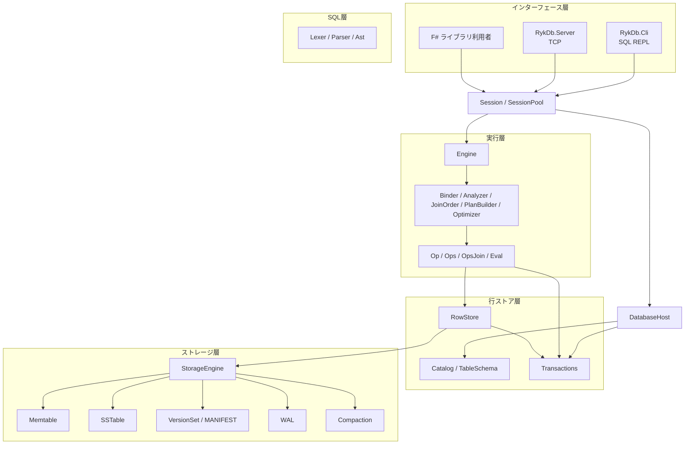
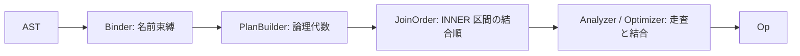

# アーキテクチャ

RykDbは、.NET 10とF# 10で実装した組込みRDBMSである。
ストレージにはLSM-Tree、並行制御にはMVCC、障害回復にはWALとMANIFESTを使用する。

実装上の背景は次の文書を併せて参照する。

- [SQL対応範囲](sql-reference.md)
- [コーディング規約](coding-conventions.md)
- [開発ガイド](development.md)
- [不変条件](invariants.md)
- [既知の落とし穴と対策](gotchas.md)

## 目次

1. [全体像](#1-全体像)
2. [プロジェクト構成](#2-プロジェクト構成)
3. [SQL層](#3-sql層)
4. [型と順序保持エンコーディング](#4-型と順序保持エンコーディング)
5. [実行層](#5-実行層)
6. [行ストア層](#6-行ストア層)
7. [トランザクション](#7-トランザクション)
8. [ストレージ層](#8-ストレージ層)
9. [データフロー](#9-データフロー)
10. [ファイルレイアウト](#10-ファイルレイアウト)
11. [インターフェース層](#11-インターフェース層)
12. [設計判断と既知の制約](#12-設計判断と既知の制約)

---

## 1. 全体像

RykDbは、SQLの構文解析からストレージへの永続化までを一方向の層構造で組み立てる。
上位層は下位層の公開APIを呼ぶが、下位層は上位層を参照しない。



### 設計原則

1. **不変性を基本にする**
   `StorageEngine`、`Version`、`Memtable`、`Catalog`などのロジック層は、不変値を受け取って新しい値を返す。
   可変状態は、接続、ホスト、バックグラウンドワーカーの境界に閉じ込める。

2. **状態とロジックを分離する**
   入力と状態が同じなら、計画・実行・ストレージの決定はスレッドのスケジュールに依存しない。

3. **失敗を値として扱う**
   制御フローに例外を使わず、失敗は原則として`Result<'T, DbError>`または内部ホットパス用の`DbResult<'T>`で返す。

4. **末尾再帰を用いる**
   要素数に比例する反復、式の走査、パーサー、合成はスタックフレームを積まない形で実装する。

5. **論理keyspaceを物理LSMツリー上で分離する**
   テーブル、索引、カタログは論理キー空間を分け、物理キーに接頭辞を付ける。
   複数keyspaceへの書き込みは1回のWALバッチと1回のストレージバッチで原子的にコミットする。

6. **符号化バイト列の順序をSQL比較順に合わせる**
   型タグ、整数、浮動小数点数、文字列、タプルの符号化が、LSMのキー比較と範囲走査の前提になる。

7. **単一プロセスでの利用を前提にする**
   同じDBディレクトリを同時に開けるプロセスは1つだけとする。
   プロセス間のファイル排他は`.rykdb.format`で実装する。

### 採用している手法

| 領域                 | 手法                                                                      |
| -------------------- | ------------------------------------------------------------------------- |
| ストレージ           | LSM-Tree、leveled compaction、論理keyspace接頭辞                          |
| memtable             | 永続Treap。優先度は決定的ハッシュ                                         |
| SSTable              | ブロック、接頭辞共有、Bloom filter、Footer、部分読み                      |
| 一貫性               | CRC32C。SSTableブロック・Footer、MANIFEST・CURRENT、WALフレーム           |
| 障害回復             | 論理WAL、MANIFEST、二世代CURRENT(A/B)                                     |
| 耐久性               | WAL追記とグループコミットfsync。複数keyspaceを1バッチで原子コミット       |
| ガベージコレクション | エントリ単位のSeqNo判定。tombstoneは最下位レベルで回収                    |
| 並行制御             | Sessionで読み取りを並行化、書き込みを直列化、MVCCとfirst-committer-wins   |
| 排他                 | DDLはRootRuntime、DBは`.rykdb.format`のFileShare.None（プロセス間）       |
| compaction           | バックグラウンドworker。MANIFEST追記は排他ゲート、ファイル番号はCASで予約 |
| 符号化               | 型タグ、escape付きタプル、varint、順序保持エンコーディング                |
| ハッシュ             | FNV-1a 64bitとsplitmix64（Bloom filter・Treapの優先度）                   |
| 索引                 | 複合キーと主キーのprefix走査。索引値は空、非被覆列は主キーlookup          |
| 最適化               | Filter pushdown、Selinger DP・bushy、統計、Sort省略、LIMITヒント          |
| 実行                 | 不変`Op`によるpull型演算子。列マスクで不要列を復号しない                  |
| 結合                 | インデックス入れ子ループ、マージ、ハッシュ、入れ子ループ                  |
| ソート               | 外部マージソート。runへの退避とfan-in 32のmulti-pass k-way merge          |
| 外部処理             | JOIN・DISTINCT・GROUP BY・INをSpillとValueSetへ退避                       |
| 式評価               | 3値論理、計画時の準備値、CPS、手書きLIKE照合                              |
| 構文解析             | 手書きLexerと再帰下降Parser。式はPratt、SELECTはCPS                       |
| エラー処理           | `Result`／`DbResult`と`protect`。失敗を値として扱う                       |

### 依存の向き

依存は上位層から下位層へ一方向に流れる。

| 層               | モジュール例                                          | 知っている層                                        |
| ---------------- | ----------------------------------------------------- | --------------------------------------------------- |
| インターフェース | `Session`、CLI、Server                                | 全層                                                |
| 実行             | `Engine`、`Binder`、`PlanBuilder`、`Optimizer`、`Ops` | RowStore、Catalog、Transactions                     |
| 行ストア         | `RowStore`、`Dml`、`Catalog`、`VersionCoordinator`    | StorageEngine、Compaction、VersionSet、Transactions |
| トランザクション | `Transactions`                                        | Memtable.Entry、Types、Errors                       |
| ストレージ       | `StorageEngine`と配下                                 | Types、Serialization、Errors                        |
| SQL              | Lexer、Parser、Ast                                    | Types、Errors                                       |

特に、`Transactions`は`RowStore`を参照しない。
依存方向は`Dml / RowStore -> Transactions -> Memtable.Entry`である。
`Dml`が行と索引を`Transaction`へ積み、`Engine`がコミット時に`TransactionManager.commit`の結果を`RowStore.commitToStoreWith`へ渡す。

### 不変性の役割

不変レコードは読み取り時のロックを不要にし、MVCCスナップショットを自然に固定する。
公開される接続の入口は`Session`と`SessionPool`だけとし、storeのopen/closeとcommitted stateは`DatabaseHost`が管理する。

使用可能な可変状態は用途ごとに限定する。
集約、DISTINCT、ハッシュ結合などの作業領域には、演算子の構築時に作ったコレクションだけを保持する。

---

## 2. プロジェクト構成

`Directory.Build.props`が全プロジェクトの共通設定を定義する。
ビルド・テスト・品質ゲートは[development.md](development.md)を参照する。

### 主要モジュール

| モジュール                                                                | 役割                                          |
| ------------------------------------------------------------------------- | --------------------------------------------- |
| `Errors`、`Types`                                                         | `DbError`、`SqlValue`、型、3値論理            |
| `Writer`、`Cursor`、`Serialization`、`KeyCodec`                           | 不変書き込み、カーソル、順序保持符号化        |
| `Memtable`、`Wal`                                                         | 永続Treapと論理ログ                           |
| `SstScan`、`SstableFormat`、`SstableWriter`、`SstableReader`              | SSTable形式、書き出し、部分読み、ブロック走査 |
| `VersionSet`、`Compaction`                                                | レベル構成、版履歴、圧縮                      |
| `StorageEngine`                                                           | LSMツリーの公開層                             |
| `Ast`、`Lexer`、`Parser`                                                  | SQL構文木、字句解析、構文解析                 |
| `Transactions`、`ProcessLock`                                             | MVCC、プロセス間排他                          |
| `RowStore`、`TableSchema`、`Catalog`、`Schema`                            | 行、スキーマ、論理keyspace                    |
| `Eval`、`Scalar`                                                          | 式評価とスカラー関数                          |
| `Op`、`Ops`、`OpsSort`、`OpsDistinct`、`OpsAggregate`、`ExtSort`、`Spill` | pull演算子、ソート、集約、退避                |
| `OpsJoin`、`OpsJoinHash`、`OpsJoinMerge`、`OpsJoinShared`                 | 結合                                          |
| `Binder`、`Analyzer`、`JoinOrder`、`PlanBuilder`、`Optimizer`、`Plan`     | 名前解決、結合順、論理代数、物理計画          |
| `Dml`、`ForeignKey`、`ExecContext`、`DmlOps`                              | DMLと参照整合性                               |
| `Engine`、`DatabaseHost`、`Session`                                       | 文実行、共有状態、接続API                     |

### F#コンパイル順

F#はファイルをプロジェクトの列挙順に評価する。
依存が下位から上位へ進むよう、`.fsproj`の`Compile`項目でコンパイル順を明示する。

```text
Errors -> Types -> Writer -> Cursor -> Serialization -> KeyCodec -> Memtable -> Wal
    -> BloomFilter -> SstScan -> SstableFormat -> SstableWriter -> SstableReader -> VersionSet
    -> Compaction -> StorageEngine -> Ast -> Lexer -> ParserExpr -> Parser
    -> Transactions -> ProcessLock -> VersionCoordinator -> RowStore
    -> TableSchema -> Catalog -> Schema -> Scalar -> Eval -> Op -> Spill -> ExtSort
    -> OpsJoinShared -> OpsJoinMerge -> OpsJoinHash -> OpsJoin
    -> OpsShared -> OpsSort -> OpsDistinct -> OpsAggregate -> Ops
    -> Dml -> ForeignKey -> ExecContext -> DmlOps -> Binder
    -> Analyzer -> JoinOrder -> PlanBuilder -> Optimizer -> ValueSet -> Plan
    -> DropCleanup -> EngineState -> EngineAnalyze -> EngineDdl -> Engine
    -> DatabaseHost -> Session
```

---

## 3. SQL層

SQL処理は次のパイプラインで進む。

```text
Ast -> Lexer -> ParserExpr -> Parser -> Binder
    -> Analyzer -> JoinOrder -> PlanBuilder -> Optimizer -> Plan
```

### 3.1 Lexer

`LexState`は`{ Index; Line; Column }`の不変レコードである。
前進操作は新しい状態を返し、スキャン中の可変インデックスを持たない。
`Position`と`TokenItem`はstruct DUとして、トークンごとのヒープ確保を抑える。

予約語は`KeywordSpellings`に限定し、`FrozenDictionary<string, string>`で引く。
比較は大文字小文字を区別しない。ASCII識別子は直接引けるが、非ASCII識別子は互換経路で大文字化して引く。

型名は予約語にしない。
Lexerは型名を識別子として返し、パーサーの型テーブルが型を解釈する。
このため、列名や別名として`INTEGER`などを使える。

識別子、数値、文字列、引用識別子、バイナリリテラルは終端までスキャンしてから切り出す。
文字列は二重区切り`''`または`""`を畳む。
コメントは行コメント`--`と入れ子可能なブロックコメント`/* ... */`をサポートする。

スキャンの再帰はモジュールレベルの`let rec`と`[<TailCall>]`で実装する。
ローカルクロージャをトークンごとに作らない。

### 3.2 Parser

式とSELECTは継続渡しの再帰下降パーサーで読む。
文やDMLの大部分は通常の値を返す関数で実装する。

式の優先順位はPratt方式、またはprecedence climbingで処理する。
継続は`Expr * PState -> Result<'r, DbError>`として渡し、必ず末尾位置で呼ぶ。
継続はヒープ上の値として保持するため、式やサブクエリの深さにスタックを依存させない。
深さ上限は設けない。

- 中置演算子は左結合でループ処理する。
- 比較、`IS`、`IN`、`BETWEEN`、`LIKE`は非結合として扱う。
- 前置演算子は`NOT`と単項`+`/`-`。
- サブクエリと式の相互再帰は継続を末尾で呼ぶ。
- `?`は字句解析時に出現順の`Token.Param`になる。
  `parseStatementsWith`が引数の値へ置換し、以後はリテラルと同じ経路で実行する。
- `*`と`t.*`は別名を取らない。修飾子には列名または`*`だけが許可される。

トークン分類には、予約語判定用の通常関数とゼロ割当のアクティブパターンを使う。
リテラルと識別子の分解には`LiteralExpr`と`NameToken`を使う。

### 3.3 AST

式は`Expr`判別共用体、文は`Statement`判別共用体で表す。
式は束縛前の修飾子を保持し、`Binder.qualify`で解決する。

列参照の収集と集約判定は明示スタックで走査する。
`Expr.rewrite`は葉の書き換え関数と内部ノードの再構築を分離し、深い式でもスタックを増やさない。
子ノードの列挙と再構築は`Expr.mapChildrenState`に集約する。

サブクエリは次の形で表す。

- `Expr.Subquery`
- `Expr.Exists`
- `Expr.InSubquery`
- `Expr.CorrelatedSubquery`

外側の束縛や集約がサブクエリ内部へ混入しないよう、子ノードの列挙は構文上のスコープに従って制御する。
計画時に`Plan`がサブクエリを定数、値集合、相関実行へ置き換える。

---

## 4. 型と順序保持エンコーディング

### 4.1 型

RykDbが扱う型は次のとおりである。

- `NULL`
- `BOOLEAN`
- `INTEGER`
- `REAL`
- `DECIMAL`
- `TEXT`
- `BLOB`
- `DATE`
- `TIMESTAMP`
- `UUID`

実行時の値は`SqlValue`で表す。
`NULL`は型を持たず、式評価では`TruthValue`の`Unknown`へ結び付ける。

### 4.2 順序保持符号化

LSMはキーをバイト列として比較する。
したがって、符号化後のバイト列の順序をSQLの比較順と一致させる必要がある。

型タグはSQLの照合順に単調になるよう割り当てる。

| 型          |   タグ |
| ----------- | -----: |
| `NULL`      | `0x00` |
| `BOOLEAN`   | `0x10` |
| `INTEGER`   | `0x20` |
| `REAL`      | `0x21` |
| `DECIMAL`   | `0x22` |
| `DATE`      | `0x30` |
| `TIMESTAMP` | `0x40` |
| `TEXT`      | `0x50` |
| `BLOB`      | `0x60` |
| `UUID`      | `0x70` |

各型のペイロードは次の方法で符号化する。

| 型          | 符号化                                              |
| ----------- | --------------------------------------------------- |
| `BOOLEAN`   | 1バイト                                             |
| `INTEGER`   | 8バイトBE。`v + 2^63`を符号なし順序へ写像           |
| `REAL`      | 8バイトBE。負数は全ビット反転、正数は符号ビット反転 |
| `DECIMAL`   | 符号、指数、桁列を順序写像                          |
| `DATE`      | `DayNumber`を整数と同じ写像で符号化                 |
| `TIMESTAMP` | UTC ticksを整数と同じ写像で符号化                   |
| `TEXT`      | UTF-8バイト列を`0x00`を含む形でescape               |
| `BLOB`      | 生バイト列をescape                                  |
| `UUID`      | RFC 4122の16バイトBE                                |

`TEXT`と`BLOB`は埋め込みの`0x00`を`0x00 0xFF`へ変換し、末尾にも`0x00`を置く。
この終端方式により、前方一致とテキスト比較を正しく表現できる。

複合キーは型ごとの値をタプルとして連結する。
たとえば`("a","bc") < ("ab","c")`がバイト列上でも成り立つ。

`TEXT`の比較はUTF-8の符号化順（Unicodeコードポイント順）に合わせる。
.NETの`StringComparer.Ordinal`はUTF-16コード単位順で補助文字の扱いが逆転するため、比較キーに使わない。

書き込みには不変の`Writer`、読み込みには値として保持する`Cursor`を使う。
ハッシュにはFNV-1a 64bitとsplitmix64を使う。

---

## 5. 実行層

### 5.1 計画



計画は次の段階で進む。

1. `Analyzer.bindTable`がFROM/JOINのテーブルを`TableBinding`へ束縛する。
2. `Binder.qualify`が列参照を解決し、WHEREは`Predicate.splitConjuncts`でANDごとに分解する。
3. `Analyzer.chooseScanMethod`が主キー・索引・範囲走査を選択する。
4. `PlanBuilder.buildLogicalWith`が論理代数を組み立て、INNER区間は`JoinOrder`が並べ替える。
5. `Optimizer.exec`が論理代数を`Op`へ変換する。

#### サブクエリ

式中のサブクエリは原則として論理計画の前に解決する。
同じ`ExecContext`、同じsnapshot、同じtransactionを使用する。

- `(SELECT ...)`は1列だけを受け付ける。
  0行は`NULL`、1行は定数、複数行はエラーになる。
- `IN (SELECT ...)`は結果を`ValueSet`へ格納し、`Expr.InSet`として評価する。
- `EXISTS (SELECT ...)`は`Op.next`を1回だけ呼ぶ。
- 相関サブクエリは外側の行ごとに内側の計画を再実行する。
  外側スコープの列は実行時に定数へ置換する。

相関サブクエリを含む述語は、WHEREの下位へ押し下げない。
GROUP BYまたは集約関数を使うクエリのSELECT・HAVING・ORDER BY、LIMIT・OFFSET、
および派生テーブル（LATERAL）は相関サブクエリを受け付けない。

サブクエリを解決する前の式からヘッダーを作る。
解決後は列名を示す式ではなく定数になるためである。
DMLの式は`Plan.resolveDmlExprWith`で同じ方法を使う。

#### 派生テーブルとUNION ALL

FROM/JOINのサブクエリは派生テーブルとして計画する。
各枝は独立した入力スキーマと`ExecContext`で実行する。

`UNION ALL`は枝ごとにSELECTを計画し、`Logical.UnionAll`として連結する。
列数は全枝で一致させる。
出力スキーマは先頭枝を基準にする。
`UNION`、`INTERSECT`、`EXCEPT`は未対応である。

#### 論理代数

論理代数の組み立て順序は次のとおりである。

1. FROM、または省略時の1行0列の`Logical.Values`
2. JOIN
3. WHERE
4. GROUP BY / 集約
5. HAVING
6. ORDER BY
7. 射影
8. DISTINCT
9. LIMIT
10. OFFSET

FROMを省略した場合でも、式評価の基準になる1行を用意する。
JOINを使う場合はFROMが必要である。

集約はSELECT項目、ORDER BY、HAVINGから検出する。
GROUP BYがあるか集約呼び出しがある場合に`Aggregate`を作り、HAVINGがあればその上に`Having`を置く。
ORDER BYは列参照、式、1始まりの序数を受け付ける。

単一テーブルで集約・DISTINCT・JOINがなく、走査が主キー順（`SeqScan` / `PkLookup` / `RangeScan`）で、
ORDER BYの先頭が主キー全列の定義順・昇順と一致する場合は`Sort`を省略する。

LIMITとOFFSETは定数式で、負数はエラーになる。
OFFSETを先に適用し、LIMITを後に適用する。

#### 最適化ルール

| ルール           | 動作                                                    |
| ---------------- | ------------------------------------------------------- |
| Filter pushdown  | 単一テーブルだけを参照するWHERE述語をスキャン直下へ移動 |
| JOIN ONを保護    | LEFT JOINを跨ぐ述語や相関述語はJOIN上に残す             |
| 主キー順ORDER BY | 主キー全列の昇順ならSortを省略                          |
| 評価順固定       | 集約、Sort、射影、DISTINCT、LIMITの順を維持             |
| LIMIT伝播        | OFFSETとLIMITを走査へ件数ヒントとして渡す               |

`DISTINCT`を射影より前に置くと、選択式ではなく元の列の組を重複排除してしまう。
したがって`DISTINCT`は射影後に適用する。

WHERE述語の配置は参照範囲で決まる。

| 述語                                    | 配置                 |
| --------------------------------------- | -------------------- |
| 単一テーブルを参照                      | スキャン直下のFilter |
| INNER JOINの右側だけを参照              | 右部分木のFilter     |
| LEFT JOINの右側だけを参照               | JOIN上のFilter       |
| 複数テーブルを参照し、左を跨ぐINNERだけ | INNERのONへ昇格      |
| LEFT JOINを跨ぐ述語                     | JOIN上のFilter       |

#### 走査方法

走査方法はWHEREの等価・範囲述語から決定する。

1. 主キー全列が型一致の等値条件を満たす場合は`PkLookup`。
2. 単一列索引または複合索引の先頭連続列が型一致の等値条件を満たす場合は`IndexLookup`。
3. 単一列の主キーに下限付き範囲がある場合は`RangeScan`。
4. 索引の先頭列、または先頭連続列の等値の次の列に下限付き範囲がある場合は`IndexRangeScan`。
5. それ以外は`SeqScan`。

定数側にはリテラルだけを使える。
式と関数は走査条件に使えない。

`LIKE 'prefix%'`で末尾以外に`%`と`_`がない場合は`[prefix, prefix+1)`の範囲走査へ変換する。
`%`を含む他のLIKEは`SeqScan`とFilterで評価する。

主キーまたは索引は、宣言型とリテラル型が一致する場合だけ使用する。
型が一致しない述語は`SeqScan`へ落とし、式評価時に型エラーへする。

#### 結合アルゴリズム

`Optimizer`はON句と昇格したWHERE述語から等値キーを取り出す。

| 優先度 | アルゴリズム             | 条件                                                           |
| -----: | ------------------------ | -------------------------------------------------------------- |
|      1 | インデックス入れ子ループ | 左の見積りが32行以下で、右を主キーまたは索引の左端一致で引ける |
|      2 | マージ結合               | 左右の走査順が結合キー順になり、連言の位置の対応も一致する     |
|      3 | ハッシュ結合             | 等値キーがあるが、マージ結合条件を満たさない                   |
|      4 | 入れ子ループ             | 等値キーがない                                                 |

キー列の型が一致する等値だけを結合キーにする。
NULLキーは一致しない。
等値以外のON述語は結合時のresidualとして評価する。
インデックス入れ子ループは右部分木を実行しない。
右が`PkLookup` / `IndexLookup`のときは、走査が吸収した等値を`Expr`に再構成してresidualへ戻す。
再構成できないとき（索引定義が見つからないなど）はINLを選ばず、ハッシュ / マージ / 入れ子ループへ回す。
再構成した述語の列は右側の列マスクへ追加する（`Unloaded`と比較しないため）。

ハッシュ結合は結合キーの順序保持符号化バイト列をキーにする。
符号化により、`compareValuesV`と同じ等値比較を使える。
たとえば、`INTEGER 1`と`DECIMAL 1.0`は同じキーになる。
INNERでは推定行数の小さい側をbuildし、大きい側を1回だけ流す。
左をbuildした場合に左が退避したときは、右をbuildする通常の経路へフォールバックする。
LEFTは左行を保存する必要があるため常に右をbuildする。

結合順序はSelinger DP（左深）で決める。

- LEFT JOINを境界として、INNER JOINの連続区間だけ並べ替える。
- LEFT JOINが無い問い合わせでは、INNER区間の先頭テーブルもDPで選ぶ。
  ON述語は参照先が揃った結合へ昇格する（述語を落とさない）。
- 区間のテーブル数が12以下ならDP、超える場合・ONの依存先が不明な場合・推定が無限の場合は
  従来の貪欲法へフォールバックする。
- 状態は部分集合ごとの `(cost, rows, order)`。
  中間行数は `rows * rows_t * 0.1^結合述語本数`（統計なし）で、直積は `rows * rows_t`。
- コストは等値結合を `build*1.0 + probe*1.0 + 出力`、直積を `左 * 右 + 出力` の行訪問で見積もる。
- 出力順の違う計画は部分集合ごとに最大8件まで残す（interesting orders）。
  - `INL` は左の走査順を保ち、`マージ結合` は結合キー順に揃え、`ハッシュ結合` は順序を保証しない。
  - 後続のマージ結合のために、一時的に高い計画を残せる。
- 同点はFROMで先に現れたテーブルを優先する。

`ANALYZE [TABLE] [テーブル名] [SAMPLE n]` は行数、列NDV、NULL数、数値列の最小/最大、
索引のprefix NDVをカタログへ保存する。
テーブル名を省略すると全テーブルを対象にする。
`SAMPLE n` はreservoir samplingで最大n行を標本にする（行数は全体を数える）。
統計がある場合、`Analyzer.estimateRowsWith` は次の値を使う。

- `SeqScan` は実測行数。
- `PkLookup` は1。`IndexLookup` は索引prefix NDVの逆数、範囲走査は数値範囲または1/3。
- 等値結合は `(1 - NULL率_左) * (1 - NULL率_右) / max(NDV_左, NDV_右)`。
  同じテーブル対の複合等値で索引prefixがあれば、そのprefix NDVを使う。
  統計が揃わない部分は既定の0.1で穴埋めし、全体が不明なら従来の `min(左, 右)`。
- `Filter` は等値なら MCV（頻出値の実測割合、無ければ NDV）、
  数値範囲なら min/max と等頻度ヒストグラム、`BETWEEN`/`IN`/`LIKE`/`IS NULL` を見る。
  ヒストグラムは `ANALYZE` が最大 1024標本から選ぶ 32個の等頻度境界で、保存形は並びのまま
  （値以下の境界の割合を CDF とする）。
  MCV は 2回以上現れた値を多い順に最大 32個残し、
  MCV に無い値は NULL と MCV の割合を除いた残りを均等に割る。

統計はDMLで自動更新しない（手動 `ANALYZE` のみ）。
代わりに、COMMIT した DML が触った行数を `TableStats.Changes` に積む。

- 実行中の行数は `ExecState.StatsDeltas`（接続ローカル）に持ち、
  `ExecState.commitTransaction` が同じ transaction に `Catalog.putStatsInTxn` で畳み込む。
  ROLLBACK した分は捨てる
  （統計の書き込みもロールバックされる）。
- `ANALYZE` は `Changes = 0` で統計を作り直し、未反映の行数も捨てる。
- `EXPLAIN` は 0 より大きいテーブルを `Stats stale: t(+12)` として示す。
- 保存形は tag 4（従来の末尾に `Changes` と平均行幅を追加）。
  tag 1〜3 は `Changes` / `RowBytes` を 0 として読む。

`ALTER TABLE` はテーブルの統計を削除する。
`ANALYZE` はテーブル名を省略すると全テーブルを対象にする。
`TableStats.AnalyzedAt` に収集時刻（UTC）を保持する。

カタログの統計は「旧 prefix + 末尾の tag 付き extras」で保存する。

- 旧 prefix だけで終わる形式は、NULL 数 0・範囲なし・ヒストグラムなしとして読む。
- tag 1 は列 extras（NULL数・min/max・ヒストグラム）と索引 prefix NDV。
- tag 2 は tag 1 に `AnalyzedAt`（UTC ticks、0 は不明）を加えたもの。
- tag 3 は tag 2 に `Changes`（ANALYZE 以降の更新行数）、
  tag 4 は tag 3 に `RowBytes`（平均行幅）、
  tag 5 は tag 4 に列ごとの頻出値（MCV）を加えたもの。
- 未知の tag は `CorruptionError`。

統計がない場合は `PkLookup`を1、`IndexLookup`を2、範囲走査を100、全走査を1000とする。

結合順のDPは辺ごとの選択性（NDV）、`IndexColumns`、行幅、走査順も見る。

- 結合キーにするのは、両側が同じ型の列参照である等値だけ
  （`Analyzer.isJoinKeyEquality`。実行時の `chooseJoinAlgorithmWith` の `tryPair` と同じ）。
  型が違う等値は residual としてだけ評価し、入れ子ループとして見積もる。
- 左が32行以下で右が走査（`Scan` か `Filter` の連なり）で、
  右の索引（主キーを含む）の先頭列が結合キーならINLのコストを使う。
  `JoinOrderItem.Lookupable` が偽なら INL にしない
  （実行時は右部分木を実行しないため）。
  `IndexStats.PrefixNDV` が小さい索引を選び、一意索引はprobe単価を下げる。
- 左右の走査順が結合キーで揃っていればマージ結合のコストを使う。
  右の走査順の先頭から結合辺がある限り一致する複合キーも対象にする。
  ただし左が走査のときだけ候補にする
  （実行時は左部分木の `scanOrder` を使うため、結合を重ねた左ではマージ結合を選ばない。
  `PlanState.ScanInput`）。
- 等値キーが 1本も無い辺だけなら、ハッシュ結合ではなく入れ子ループとして見積もる。
- 行幅は `ANALYZE` の `TableStats.RowBytes`（行ごとの管理メモリ概算の平均）を使う。
  統計が無いときは列の型別サイズで見積もる。
- ハッシュ結合はbuild側の行数×行幅が作業メモリを超えると、
  `Analyzer.spilledBuildRows`（はみ出した割合 × build 行数）を書き出し・読み直しの 2回とし、
  `Spill.Partitions` 本のパーティション固定費を加えたスピルペナルティを加える。
  bushy の分割コストも同じ式を使う。
- 複数索引の選択は prefix NDV が小さい索引を優先する。
- `PlanBuilder` は左深木を基本に組み立てる（`Bushy` のときは1段の分割木）。
  `Logical.Join` の右は結合の部分木も許容し、`Optimizer` は `outputOf` で
  部分木の出力スキーマを作業リストで求め、INL を無効化して実行する（bushy の土台）。

診断・A/B用に `ExecContext.JoinOrder`（`Dp` / `Greedy` / `Bushy`）で戦略を切り替えられる。
`Session.PrepareSelectWith(JoinOrderStrategy.Greedy, stmt)` は貪欲計画を、
`Bushy` は1段の分割計画を返し、結果はDPと同じになる（回帰テストで固定）。

`Bushy` の範囲は次のとおり。

- `FROM` 先頭から始まる INNER 区間で、テーブル数 3〜6 のときだけ使う。
- 全分割 `S = L ⊎ R` を試し、両側が依存関係で閉じていて結合述語が跨るときだけ候補にする。
- 両側はそれぞれ左深の最良計画（先頭テーブル候補ごとに DP を回して求める）。
- 分割の方が安いときだけ `Branch` を作り、右（または左）が部分木になる。
- 使わなかった述語は INNER なので結合木の上に `Filter` として残す。

#### LEFT JOIN を跨ぐ繰り上げ

`PlanBuilder` は、`LEFT JOIN` より後ろに書かれた INNER を、
先頭の INNER 区間へ繰り上げてから結合順を決める。
繰り上げる条件は次のとおり。

- INNER の ON が修飾名だけで書かれ、参照が先頭 INNER 区間（と繰り上げ済みの INNER）で閉じている。
- 先頭区間の表を少なくとも 1 つ参照する（直積になる INNER は繰り上げない）。

参照が閉じていない INNER（`LEFT` の右の表を見るもの）はその場に残り、
次の INNER 区間として並べ直す。
繰り上げても各表の出現回数は変わらない（`A ⟕ B` の行ごとに INNER が掛かるだけ）ので、
意味を保ったまま結合順の探索範囲を広げる目的で常に行う。

#### 論理代数からOpへ

`Scan`は走査方法に応じて、主キー、索引、範囲、全走査の実行関数へ振り分ける。
結合は実際の出力レイアウトと右テーブルのスキーマを別々に扱う。

`EXPLAIN ANALYZE` は `ExecContext.RowCounts`（ノード参照 -> 出力行数）を有効にし、
`Optimizer.countOutput` が `Scan` と `Join` の `Op` を `Op.map` で包んで数える。
計測しない通常の実行では `RowCounts = None` なので包まない。
推定は `EXPLAIN` と同じ規則で出すため、`explainWithCounts` が実測だけを差し込む。

`Filter`と`Sort`は子の出力スキーマで列位置を解決する。
`Project`は`*`の展開にFROM順の論理スキーマ、列位置の解決に実際の行レイアウトを使う。
JOINを並べ替えても`SELECT *`の列順はFROM順を保つ。
集約後の行は「GROUP BY値 + 集約結果」のレイアウトになる。
集約後の式（`SELECT`・`HAVING`・`ORDER BY`）は、GROUP BY式と集約呼び出しを
スロット参照へ**計画時に1回だけ**置き換えてから評価する（行ごとに式を書き換えない）。
`ORDER BY COUNT(*)`・集約の別名・序数・`GROUP BY`式（`ORDER BY age + 1`）も同じ経路で解決する。
置換後に残った列参照は専用スキーマで解決できず、構築時に`NameError`になる。
対応付けは表示文字列ではなく、識別子を大小無視に畳み、リテラルに型タグを付けた正規化キーで行う。
表示が同じでも型が違う式（`1` と `1e0`）を取り違えない。

`UPDATE` / `DELETE`も`SELECT`と同じ規則で`WHERE`から候補行の走査方法を選ぶ
（主キー・索引・範囲）。
候補走査は十分条件にだけ使い、行の可否は`WHERE`の再評価で決める
（範囲の閉区間など、広めに返しても結果は変わらない）。

各ノードの出力スキーマは`OutputSchemaMemo`で1回の実行につき1パスだけ求める
（左深い結合木でもスキーマ計算が O(n²) にならない）。

`LIMIT`は`Op.skip(OFFSET)`の後に`Op.take(LIMIT)`を適用する。
最終的な行の配列化は`Engine.runSelect`が行う。

### 5.2 Opとpull方式

`Op`は次の1行を要求されるまで計算しないpull型演算子である。

- `OpStep = OpDone | OpError | OpRow`
- `OpRow`は計算済みの1行と続きの`Op`を持つ。
- `Op.next`は上流の次の行を要求する。

push型ではLIMITやWHEREによる早期終了が効きにくい。
pull型なら上流が要求された分だけ計算する。
F#の`seq { }`は列挙子を内部状態として持つため使わず、
`Op`と`OpStep`で残りの計算を値として保持する。

ソート・集約・DISTINCTは作業メモリの上限まで保持し、
超過分は外部ソート・退避ファイル・符号化済みキーで処理する。

演算子の代表例は次のとおりである。

| 演算子                | 動作                                   |
| --------------------- | -------------------------------------- |
| `Op.ofArray`          | 材料化済み配列を行として返す           |
| `Op.map`、`Op.filter` | 1対1または1対0の変換                   |
| `Ops.project`         | 列参照、`*`、`t.*`を展開               |
| `Ops.sortBy`          | 外部マージソート                       |
| `Ops.aggregate`       | グループとアキュムレータを更新         |
| `Ops.distinct`        | SQL の等値に揃えた符号化キーで重複排除 |
| `OpsJoin`             | 結合戦略を実行                         |

演算子はエラーを即時に伝播し、列挙を終了する。
構築時に作る作業用コレクションだけを演算子の中に保持する。

#### DMLと制約検査

INSERT/UPDATE/DELETEは行を`Transaction`のバッファへ積み、commit時にまとめて反映する。
制約検査は文単位で準備し、行ごとにカタログを引き直さない。

- 外部キーの子側検査は`ForeignKey.prepareChildChecks`で子スキーマと列位置、maskを1回だけ作る。
  検査は**行を書いた後**の状態で行うので、自分自身を参照する行を挿入できる
  （同一文の後続行はまだ見えない）。
- 親の削除検査は`ForeignKey.prepareParentDeleteChecks`で準備する。
- INSERTのUNIQUE検査は文の開始時に`DmlOps.UniqueGuard`を 1つ作る。
  `BaseSlots`は文開始時の索引スロットを 1回だけ`Transaction.slotsOf`で変換したもので、
  行ごとの`Map.toList`＋再ソート（`O(txn log txn)`）を避ける。
  `Added`は文内で確定した「UNIQUEキー→主キー」の不変`Map`で、後続行との重複を`O(log n)`で見つける。
  ストア側のprefix走査は`Dml.scanByIndexPrefixWithSlots`に`BaseSlots`を渡す。
- UPDATEのUNIQUE検査は「値が変わった行の新しい値」だけを索引prefixで引く。
  代入対象に索引列が無い索引は検査しない。
  同一文で同じ値になる行は、値が変わらない行も含めた集合で検出する。
  全索引を1回走査する方式は、統計が無く小さい更新で大きい索引を読む退行を避けられないため採らない。

### 5.3 メモリと外部処理

作業メモリの既定値は次のとおりである。

| 項目                                     |  既定値 |
| ---------------------------------------- | ------: |
| 結果行数                                 | 100万行 |
| 結果バイト数                             |  256MiB |
| JOIN / DISTINCT / GROUP BY / IN 作業領域 |  256MiB |
| ソートバッファ                           |   64MiB |

上限を超える処理は一時ファイルへ退避する。

- JOINの入力はハッシュテーブルまたはrunへ退避する
  （INNERハッシュ結合は小さい側をbuildする）。
- ハッシュ結合は結合キーのハッシュでパーティション分割し、必要なら再分割する。
  読み終えたパーティションのrunはその場で削除する（早期終了時は`ScanScope`が後始末する）。
  パーティションは1本ずつ遅延処理し、先頭の1行を返す前に全パーティションのハッシュ表を作らない
  （LIMITで残りを構築しない）。
  収容判定は `Op.toArrayLimited` で直接読み、収まらないときだけ再分割する
  （判定のために spool して捨てない）。
- マージ結合は両側を行単位で流し、同じキーのグループだけ保持する。
  グループが退避したときは、メモリに収まっている側を内側にして、退避した側を外側に 1回だけ流す
  （`LEFT` は左行の一致フラグを持ち、一致しない左行を最後に NULL 拡張する）。
- DISTINCTは符号化キーを退避し、初出連番を保持して元の順序へ戻す。
  キーは `KeyBuilder` で作り、DECIMAL の末尾 0 と REAL の -0.0 / NaN を正規化する
  （ハッシュ結合のキーと同じ等値）。
- GROUP BYはアキュムレータを退避し、グループごとに再集約する。
  退避時のグループキーも `KeyBuilder` で符号化し、メモリ経路（構造的等価）と揃える。
  退避後の畳み込みでも、既存グループの `Seen` などの状態増分を毎行計上する。
  出力はパーティションを1本ずつ畳んで遅延して返し、全グループを配列にmaterializeしない。
- 集約内の`COUNT(DISTINCT)`や`SUM(DISTINCT)`は、`Seen` に「正規化キー→元の値」を持ち、
  runには元の値を書いて外部ソートで重複を除く（型・スケールを保って再集計する）。
  `Seen` の使用量はバケット横断で作業メモリに計上し、1 run あたり最低 64 値をまとめる。
  run は1本のストリームとして順に読み、全runを同時にopenしない。
- `IN (SELECT ...)`はソート済み配列、超過時は退避ファイルとブロック索引を使う。
  OnDiskの索引はDisposeで`ScanScope`から登録を外す。

インデックス入れ子ループは検索結果をmaterializeしない。
左行ごとに右テーブルを検索し、必要な行だけを返す。

開いたrunと退避ファイルは`MemoryBudget.Scope`へ登録する。
LIMITで途中終了した場合、エラー、または`RowReader.Dispose`で、登録された資源をまとめて閉じる。

ソートは全入力を消費してから行を返す。
呼び出し時に比較不能な型などを検出する。
run の k-way merge は開いた run を配列で持ち、選んだ run の先頭行だけを差し替える
（行ごとにリストを分割・連結しない）。

### 5.4 式評価

`Eval`が算術、比較、CASE、CAST、スカラー関数を評価する。
集約呼び出しは`Eval`ではなく`Ops.aggregate`で計算し、集約後の行へ定数として読み替える。

列参照は演算子の構築時に`Eval.prepare`で解決する。
準備済みの不変値は、列位置とリテラルLIKEのトークン列を保持する。
解決できなかった参照は`Prepared`が保持し、演算子の構築時に`Eval.checkPrepared`で検査する。
行を1つも評価しない入力（0行）でも`NameError`になり、ヘッダだけを出してエラーになることもない。
集約後の射影・HAVING・ORDER BYは、GROUP BY列と集約呼び出しをスロット参照へ
置き換えた後の式で検査・評価する。
置換は計画時に1回だけで、評価は行の列位置を引くだけになる。

`DISTINCT`と`GROUP BY`の同一性は符号化キーの一致で判定する。
キーは`SqlValue.keyNormalize`でSQL等値の表現差（整数値のDECIMAL・往復可能なREAL・
深夜0時UTCのTIMESTAMP）を揃えてから符号化する。
REALの丸めが絡む値はREALのまま残す（等値が推移的でなくなるのを避ける）。
GROUP BYの出力値は先頭出現の元の値を使い、型とスケールを保つ。

比較述語の型も計画時に検査する。
列の宣言型・リテラル・`Expr.Value`・`CAST`から型が決まる比較だけを見て、
`compareValuesV`が型エラーにする組み合わせ（INTEGERとTEXTなど）を
行の有無に関係なく`TypeError`にする。

`LIKE`の定数パターンは計画時にコンパイルし、`ESCAPE`の誤りも0行でエラーにする。
`COALESCE`は`CASE`と同じ遅延評価で、最初の非`NULL`が見つかった後の引数を評価しない。
`ORDER BY`の型検査は比較可能性の型クラスごとに代表値を持ち、
非有限`REAL`と`INTEGER`のように推移的でない組合せも検出する。
演算・関数・集約の結果は型を決めないので実行時の判定に委ねる。
JOINのONは並べ替え用の解析で修飾に失敗しても述語を落とさない。
実行時の`buildJoin`がもう一度修飾して同じエラーを返す（無言の直積にしない）。

評価機は継続を明示的なスタックとして保持する。
状態にはstruct DUを使い、ホットパスでは`DbResult<'T>`を使う。
公開境界で`Result<'T, DbError>`へ変換する。

列マスクにより、不要な列は復号しない。

- 全列が不要な`COUNT(*)`などは値本体を読まない。
- 不要列は`SqlValue.Unloaded`で埋める。
- 素早く失敗させるため、`Unloaded`を比較・型判定・符号化の入力に使うと内部エラーになる。
- 行幅はスキーマ幅を維持し、空マスクを空配列へ縮約しない。
- 索引スキャンは索引列と主キーをキーから復号し、被覆外の列だけ主キーlookupで取得する。

比較オペランドに`NULL`がある場合は3値論理の`Unknown`になる。

- `AND`は左が`FALSE`なら右を評価しない。
- `OR`は左が`TRUE`なら右を評価しない。
- WHEREとHAVINGは`Unknown`を偽として扱う。
- 真偽の解釈は`Eval.truthOfValue`に一本化する。
  `BOOLEAN`はそのまま、`INTEGER`は`0`が`FALSE`・非`0`が`TRUE`、それ以外の型は`Unknown`。
  `NOT` / `AND` / `OR` / `CASE WHEN` / `IS [NOT] TRUE/FALSE/UNKNOWN` も同じ規則を使う。
- `BETWEEN`は`>=`と`<=`のANDとして評価する。
- `IN`は一致があれば真、一致なしで`NULL`があれば未知、それ以外は偽になる。
- `CASE`は`TRUE`になったWHENだけを選ぶ。

算術は`NULL`を伝播する。
ゼロ除算は`ConstraintViolation`になる。
整数同士の演算は整数、片方がREALならREAL、小数同士はDECIMALになる。

`LIKE`は手書き照合で、`%`と`_`、`ESCAPE`をサポートする。
最後の`%`だけを覚える貪欲法で、指数的なバックトラックをしない。

スカラー関数には`UPPER`、`LOWER`、`LENGTH`、`ABS`、`COALESCE`、`TRIM`、`ROUND`がある。
集約エラーは呼び出し元へ伝播する。

---

## 6. 行ストア層

### 6.1 keyspaceの接頭辞分離

テーブル、索引、カタログを論理keyspaceで分けるが、物理LSMツリーはDBごとに1本だけである。

物理キーは`[keyspaceのUTF-8長さ][keyspace][論理キー]`で構成する。

| keyspace      | 内容         | 論理キー                        | 値                     |
| ------------- | ------------ | ------------------------------- | ---------------------- |
| `t:<table>`   | テーブル行   | 主キー列                        | 行全体                 |
| `i:<index>`   | 索引エントリ | 索引列と主キー                  | 空                     |
| `__catalog__` | スキーマ定義 | `table:<name>` / `index:<name>` | テーブルまたは索引定義 |

索引エントリの値を空にし、行全体を複製しない。
索引スキャンはキーから索引列と主キーを復号し、必要な列だけ主キーlookupで取得する。

長さを接頭辞に含めることで、`t:a`と`t:ab`のような前方一致する名前を混同しない。
走査は接頭辞境界で停止し、論理キーだけを呼び出し元へ返す。

索引キーの構築では、列名から位置への解決を文単位で1回だけ行う
（`Dml.prepareIndexAccess`）。
`INSERT` / `UPDATE` / `DELETE` はこの準備済み `IndexAccess` を共有し、
行ごとの `TableSchema.requireIndexOf` を避ける。

### 6.2 行の削除

削除は物理キーへtombstoneを付ける。
更新は旧行の削除と新行の追加として表現できる。

テーブル本体の削除では主キーのtombstoneを作り、索引ごとに旧索引キーのtombstoneを作る。
compactionはtombstoneを最下位レベルで回収する。

### 6.3 Catalog

`Catalog`はテーブルと索引のスキーマを保持する。
スキーマ変更後の値は新しい`Catalog`として返し、読み取りは不変スナップショットから行う。

カタログは`__catalog__`keyspaceへ永続化する。
起動時はカタログをロードし、テーブル定義、主キー、索引、外部キーを再構築する。

保存は変更のあった定義と消えた定義の差分だけを書く。
変わっていない定義は書き直さない（エンコード後のバイト列で比較する）。
消えた定義はtombstoneで落とす。

外部キーは即時RESTRICTで検査する。

- 子のINSERT、INSERT SELECT、UPDATEは外部キーの親行を確認する。
- 親のDELETEは参照中の子行を確認する。
- 親の主キー更新は未対応である。

検査は**行を書いた後**のtransaction状態で行う。
自身の主キーを参照する行を挿入でき、同一文の先行行は参照できるが、
後続行はまだ書かれていないので参照できない。
子スキーマ、列位置、maskは文単位で1回だけ準備する（`ForeignKey.prepareChildChecks`）。

親の`DELETE`が複数行に渡るときは、削除対象の親キーを集合にして子を1回だけ走査する
（`ForeignKey.checkParentDeletes`）。
単行は索引プレフィックス + `LIMIT 1` の従来経路を使う。
UNIQUE の更新後検査も、一致行を全件配列化せず先頭の更新対象外行で打ち切る。

---

## 7. トランザクション

`Transactions`は採番、可視性、競合検出を担当する。

### 7.1 採番

コミット済みの論理時計がDBの時刻になる。
`TransactionManager.NextSeqNo`が採番を一元管理する。

COMMIT時にtransaction内の各エントリへ順番にSeqNoを割り当てる。
最後に割り当てた番号が`LastCommitSeqNo`となり、次のsnapshotの基準になる。

起動時はストレージから復元した最大SeqNoから採番を再開する。
巻き戻すと古い書き込みを新しい番号で隠す可能性があるため、採番を巻き戻さない。

カタログの保存はTransactionを介さずengineの`NextSeqNo`から直接採番する。
失敗したDDLの後始末もManagerを経由せずengineへ書くことがある。
そのため書き込みの前に`TransactionManager`をengineの高水位へ合わせる
（`TransactionManager.synchronize`）。
合わせないと次の採番が過去のSeqNoを再利用し、同じキーに同じSeqNoの版ができる。

### 7.2 可視性

snapshotは「SeqNoがS以下の版だけを可視とする」不変な状態である。

`visible = None`は制限なし、`Some s`は`s`以下のSeqNoだけを見る意味になる。
永続データ構造自体に書き換え履歴を持たせず、検索時のSeqNoフィルタで可視性を決める。

明示transactionのsnapshotはBEGIN時に固定する。
ストアが新しいcommitted stateへrebaseされた後も、同じSeqNoで読んでrepeatable readを保つ。

### 7.3 競合検出

同じ物理キーを複数transactionが更新した場合、後からコミットした方を`ConflictError`にする。
これはfirst-committer-wins方式である。

競合キーは`keyspace + ":" + base64(キー)`で表す。
UNIQUE索引は論理予約キー`@unique:<索引名>:<base64(索引値)>`を使う。

予約キーは物理エントリを書かず、commit時に`LastCommitted`へ登録する。
予約は参照カウントで管理し、txn内で値が消えたら解放する。
commitの競合検査には最終状態に残る予約だけを使うため、
INSERT後に別の値へ更新・削除した値は競合しない。
`NULL`を含むUNIQUE値は予約しない。

競合時の`ConflictError`は、競合したキーの件数と先頭3件の内訳を示す。
物理キーはkeyspace（`t:<表>`、`i:<索引>`）、UNIQUEの予約は`UNIQUE <索引名>`と表示する。

### 7.4 書き込みの状態

transactionは、行と索引の更新をバッファに保持する。

```text
BEGIN
  Transaction.Buffers
  Transaction.Reservations
  Transaction.Snapshot

COMMIT
  競合検査
  SeqNo採番
  WriteBatch生成
  1回のWALバッチ
  1回のMemtable.apply
```

実行中はtransactionのバッファを優先するため、未コミットの自分の更新を読み取れる。
COMMITが成功するまで、更新はストレージへ見えない。

### 7.5 コミットの原子性

物理LSMツリーは1本である。
テーブル、索引、カタログのエントリを接頭辞付きの単一配列へまとめ、
`StorageEngine.writeBatch`へ1回渡す。

WALは`Begin / Batch / Commit`を1回の追記呼び出しで記録し、最後にfsyncする
（フレームは個別に書く）。
したがって、テーブルだけがコミットされ索引だけが残らないという中間状態を作らない。

WAL追記が成功した時点でCOMMIT成立とする。
その後のmemtable flushが失敗しても、WALから再生できるため`Error`にはせず、
memtableを保持して次回再試行する。

WAL追記が失敗した場合、engineの状態は進めない。
次の追記は`WalState.Size`で書きかけの末尾を切り捨ててから書くため、
同じtransactionを再COMMITできる。

WAL追記が成功してもfsyncが失敗した場合、commitは**適用済み**だが永続化は保証されない。
`DatabaseHost.serialized`はrunの結果を捨てずに`(値, 永続化エラー)`として返し、
`Commit`は`CommitOutcome.CommittedUnsynced`へ変換する。
`Session`は接続をtransaction外へ進めてからエラーを返す
（適用済みを捨ててErrorだけ返すと、接続ローカルが「transaction中」のままhostと分断する）。
fsyncの失敗は`CommitDurability`が記憶し、以後のすべての操作が同じエラーで失敗する。
BEGIN / ROLLBACK・失敗した文はWALを進めないためfsyncを待たない。

### 7.6 Sessionのtransactionモデル

`Session.Execute`は明示transactionがない場合、各文を暗黙transactionとして自動コミットする。
`Begin()`以降は、明示の`Commit()`または`Rollback()`まで同じtransactionを使う。

接続ごとの状態は`TxnState`に保持する。
共通のcommitted stateは`DatabaseHost.Committed`に保持する。
文の実行時だけ、両者を`ExecState`へ合成する。

- BEGINは共有のTransactionManagerでtransactionを作る。
- COMMITは競合検査と採番を行う。
- ROLLBACKはバッファと予約だけを破棄する。
- COMMITがwrite-write競合または書き込みバッファの上限超過で失敗した場合、
  transactionをabortして接続をtransaction外へ戻す
  （再試行してもcommitできないため。`CommitOutcome.RolledBack`）。
- COMMITのfsyncが失敗した場合も接続をtransaction外へ戻す。
  commitは適用済みなので、`CommitOutcome.CommittedUnsynced`で適用済みを伝えてからエラーを返す。
- ROLLBACKはtransactionが無ければ何もしない（自動rollback済みでも後始末を失敗させない）。
- 複数文のバッチは文ごとに実行し、成功した文の状態だけを残す。

途中の文が失敗しても、それ以前に成功した文と明示transactionは失われない。

### 7.7 同時実行制御

読み取りは不変snapshotを掴むだけなのでロックを取らない。
書き込みはホストのgateで直列化する。

| レイヤー       | 制御                                        |
| -------------- | ------------------------------------------- |
| 不変レコード   | snapshot参照はロック不要                    |
| `Session`      | transaction状態と読み取り数を接続ごとに管理 |
| `DatabaseHost` | 複数Session間で書き込みを直列化             |
| MVCC           | snapshot可視性と競合検査                    |
| keyspace       | 論理空間を接頭辞で分離                      |

SELECTだけのバッチは接続間で並行実行できる。
`Begin`、書き込み、COMMIT、ROLLBACK、Closeは直列化する。

読み取り時はcommitted stateとVersion pinを1回で取得する。
stateの取得とpinの取得を分けると、間にcompactionが入り必要な版が回収されるためである。

### 7.8 DDLの排他

CREATE INDEXはテーブルを走査して索引エントリを作る。
backfill中に通常の書き込みが入ると、索引の追加漏れや削除漏れが起きる。

DDLはDBごとの`RootRuntime`で排他する。

1. 排他ゲートを取得する。
2. 実行中transactionがある場合はDDLを拒否する。
3. 古い索引エントリのtombstoneを作る。
4. 8192行ずつbackfillをコミットする。
5. カタログへ索引定義を保存する。

排他中は新しい文とBEGINがブロックする。
DDL完了後に始まるtransactionは必ず新しいカタログを見る。

### 7.9 プロセス間排他

マルチプロセスでの同時更新はサポートしない。
1つのDBディレクトリを開けるプロセスは同時に1つだけとする。

`RowStore.openStore`は`.rykdb.format`を`FileShare.None`で開いたまま保持する。
別プロセスから開く場合も同じプロセスから二重に開く場合も、`IoError`になる。

WALとMANIFESTはプロセス間排他を持たない。
排他がないと、複数プロセスのmemtableとWALが競合し、データを壊し得る。

クラッシュ再現テストだけは、internalの再取得APIを使って二重オープンを再現する。

### 7.10 放棄された transaction の回収

接続がCloseされずに捨てられた場合、そのtransactionは二度とcommitできない。
放置すると`TransactionManager.Active`に残り、
`activeSnapshot`が下がって `LastCommitted`が以後のcommitのキーを保持し続ける
（メモリリーク）。

- `RegistrationLease`のfinalizerはsnapshot登録を外し、未解放なら`DatabaseHost`へ`TxnId`を通知する。
- finalizerはキューに積むだけで、`writeGate`などのロックを取らない。
- 次の書き込み（`DatabaseHost.serialized`）が`writeGate`の内側でキューを回収し、
  `TransactionManager.abortId`で`Active`から外してmanagerを公開する。
- `abortId`は冪等で、既にcommit/abort済みのTxnIdは無視される。
- 明示的に解放済み（commit / rollback / Close）のリースは通知しない。

回帰: `DatabaseHost: 放棄された transaction は次の書き込みで manager から回収される` /
`DatabaseHost: commit せずに捨てた transaction も GC されれば登録が外れる`。

---

## 8. ストレージ層

`StorageEngine`がLSMツリー1本を公開する。
`RowStore`は`IStorageEngine`経由で、
memtable、SSTable、WAL、Version、compactionへアクセスする。

既定値は次のとおりである。

| 項目                 |      既定値 |
| -------------------- | ----------: |
| memtable上限         |       64MiB |
| Bloom filter誤検出率 |          1% |
| レベル数             | 7（L0〜L6） |

### 8.1 Memtable

memtableは永続Treapである。
全順序は「キー昇順、同一キーはSeqNo降順」である。

スキップリストではなくTreapを使う理由は、永続スキップリストの挿入パスをコピーする場合、
level 0の鎖とheadの更新を正しく処理しづらいためである。
Treapは挿入パスのノードを明示スタックに積み、引き返しながら再構築する。

優先度は乱数ではなく、キーとSeqNoをハッシュした決定的な値で決める。

走査は左→自身→右を作業リストへ積む遅延`Seq`で行う。
余分なメモリは木の高さ分だけである。
ポイント検索は`rangeScan`ではなく、`getVisible`でO(log n)とする。

### 8.2 SSTable

SSTableはブロック単位の形式である。

```text
[Block 0][Block 1]...[Block N-1]
[Meta block]
[Bloom filter]
[Index block]
[Footer v6]
```

ブロック内のエントリは直前エントリとの共通接頭辞を共有する。

```text
entry =
  shared varint
  nonShared varint
  valueLen varint
  keyの非共有部分
  value

[entry]*
[block checksum:4]
```

ブロックは128エントリを目安に分割する。
チェックサムはCRC32Cで、slicing-by-8を使う。

書き出し（`SstableWriter.writeTo`）は入力の`seq`を1回だけ列挙し、
ブロックとBloom filterを同時に構築する（キー列を溜めない）。
Bloom filterのビット数は`expectedEntries`の見積りから決める。
実件数がこれを超えてもfalse negativeは出ない（誤検出率が上がるだけ）。

| 項目         | 内容                                                           |
| ------------ | -------------------------------------------------------------- |
| Footer       | magic、version、maxSeqNo、各セクション位置、件数、チェックサム |
| Bloom filter | 件数と誤検出率からmとkを決定、double hashing                   |
| Index        | ブロックごとの最終キー、オフセット、長さ                       |
| Meta         | 最小キー、最大キー                                             |
| ポイント検索 | Bloom filter、Indexの二分探索、該当ブロック                    |

`Sstable.openPartial`はFooter、Meta、Bloom filter、Indexだけを読み込む。
データブロックは必要になったときだけ開く。
IndexはmetadataChecksumで守られるが、チェックサムごと作り直されたファイルに備え、
open時に「各ブロックの範囲がfooterStart以内・重なりなし・`LastKey`が昇順」を検証し、
違反は`CorruptionError`にする
（壊れた索引が二分探索・範囲読みの前提を壊し、静かな誤答やブロック長の巨大割当になるのを防ぐ）。

- ポイント検索は通常1ブロックだけ読む。
- 範囲検索は最大8ブロックをまとめて読む。
- compactionは値を復号せず、値本体のスライスだけを渡す。

ポイント検索の順序は次のとおりである。

1. Bloom filterで存在し得ないか判定する。
2. Index blockの`LastKey`を二分探索する。
3. 該当ブロックを読み、可視版を探す。
4. 可視版がブロック末尾にない場合のみ、同じキーを含む次のブロックを読む。

SSTable全体のチェックサムは持たない。
実際に読んだブロックとFooter、Meta、Bloom filter、Indexのチェックサムだけ検証する。

`StorageEngine.openDatabaseWith`はSSTableのデータブロックを起動時に読まない。
次のSeqNoはFooterの`maxSeqNo`から復元する。

`limit > 0`の走査は可視かつ非tombstoneのエントリをlimit件返した時点で終了する。
後続ファイルの破損は到達しない限り検出しない。

走査はtombstoneを返さない。
ポイント検索は最新版が削除なら `Value = None`を返し、
`RowStore.getAtMasked`がNoneにする（INV-34）。

### 8.3 VersionSet

`Version`は各レベルのファイル集合を不変スナップショットとして保持する。
ファイル追加・削除は新しい`Version`を返す。

`FileMetaData.mightContain`は最小キーと最大キーで粗く枝刈りする。
ポイント検索では、L0はキー域が重なるため範囲内の全ファイルを番号降順で並べ、
L1以降は最小キーの二分探索で候補を絞る。

`VersionEdit`は変更履歴で、MANIFESTへ直列化する。
復旧時は`NextFileNumber`をディスク上の最大番号+1へ進める。
巻き戻すとファイル名とSSTableを再利用し、データを上書きする可能性がある。

レベル容量は次のとおりである。

| レベル |                      容量 |
| ------ | ------------------------: |
| L0     | 4ファイルでcompaction開始 |
| L1     |                     10MiB |
| L2     |                    100MiB |
| L3     |                      1GiB |
| L4     |                     10GiB |
| L5     |                    100GiB |
| L6     |                      1TiB |

### 8.4 MANIFEST

MANIFESTには、`CURRENT`の二世代スロットと世代ごとの`MANIFEST-xxxxx`がある。

```text
CURRENT.A         有効なMANIFEST名 + CRC
CURRENT.B         有効なMANIFEST名 + CRC
MANIFEST-000001   VersionEditの履歴
```

`CURRENT.A`と`CURRENT.B`のうち、CRCが正しく新しいMANIFESTを指す方を有効とする。
一方が壊れていても、もう一方から復旧できる。

MANIFESTレコードはCRC32Cと`VersionEdit`本体をBase64化した1行で構成する。
途中の壊れたレコードは`CorruptionError`になる。
末尾の不完全な行だけはクラッシュ時の追記とみなし、読み飛ばす。

MANIFESTが4MiBを超える場合は、現在のVersion全体を新しいMANIFESTへスナップショットする。
成功してから、現在有効でない方の`CURRENT`スロットへ新しいMANIFEST名とCRCを書いてfsyncする。
renameを使わないため、CURRENTの耐久性がrenameに依存しない。
ディレクトリのfsyncは行わない。

古いMANIFESTはすぐには削除しない。
起動時に最新4世代を残し、それより古いMANIFESTと、
そのMANIFESTだけが参照しているSSTableを回収する（`Manifest.collectGarbage`）。
どのMANIFESTからも参照されないSSTableは削除せず`.orphans/`へ退避する。

通常追記では、末尾が改行で終わっていない場合は最後の完全な行まで切り詰めてから追記する。

MANIFESTローテーションは追記前に行う。
失敗時は元のMANIFESTが有効なまま残るため、進行中の変更が反映されていないと判断できる。

ローテーションが成功した後でWALの切り替えが失敗した場合も、新しいMANIFEST番号をengineへ返す。
古い番号のまま次の追記へ進むと、`CURRENT`の指さないMANIFESTへ書いてしまい、
再オープンでそのSSTableがVersionから消える（データ損失）。
`Manifest.append`は対象ファイルが存在しない場合、空ファイルを作り直さず
`NotApplied`として返す（番号の陳腐化を検出する）。

### 8.5 WAL

WALはページイメージではなく論理更新を記録する。

```text
Begin(txnId)
Batch(txnId, entries)
Commit(txnId)
Abort(txnId)
```

WAL v2のファイルは、先頭に16バイトのヘッダー（magic・version・header CRC）を持つ。
各フレームは`payloadLength`、payload CRC、ヘッダーCRC、payloadで構成する。

- ファイルヘッダーが途中で切れている → 書きかけのWALとして扱い、フレームを読まない。
- ファイルヘッダーのCRC不一致 → `CorruptionError`。
- フレームヘッダーが途中で切れている → torn writeとして切り詰める。
- フレームヘッダーのCRC不一致 → `CorruptionError`（長さ破損をtorn writeと誤認しない）。
- payloadが途中で切れている → torn writeとして切り詰める。
- payloadのCRC不一致、未知タグ、破損payload → `CorruptionError`。

追記はフレームごとに行う。
メモリ上で全フレームを結合しないことで、大きなtransactionのピークメモリを抑える。

起動時はWALをストリーミングで読み、`Commit`まで到達したBatchだけをmemtableへ再生する。
`Abort`と未コミットのBatchは捨てる。

複数keyspaceにまたがる更新も1つのBatchへ入れる。
commitのfsyncはグループ化する。
待機中のcommitは最大WAL位置まで登録し、先頭の待機者が1回だけ`Flush(true)`する。

flush後のWAL rotateは、新しいWALを作成するだけで旧WALを削除しない。
旧WALは、新しいWALやSSTableの名前が失われたときの復旧元として残す。
起動時は残っているWALをすべてファイル番号順に再生し、
復旧済みVersionのSSTableに含まれるSeqNo以下のエントリは適用しない。
最新3本を残し、SSTableに反映済みの古いWALを起動時に回収する。
新しいWALの作成に失敗しても旧WALとengineの位置が残るため、次のwriteで回復できる。
flushの失敗は`StorageRuntime.LastFlushError`に残す。

### 8.6 Compaction

compactionは次の手順で行う。

1. 超過レベル`L`を選ぶ。
   L0はファイル数、L1以降はバイト数の超過度（比）が最大のレベルを選ぶ（同点なら小さいレベル）。
   最小レベル固定だとL0が常に閾値超えのときL1以降が飢餓するため。
2. `L`の先頭から最大32ファイルをseedにする。
3. `L`と`L+1`でキー域が重なるファイルを閉包で追加する。
4. 部分読みの`SstScan`でブロックをk-way mergeする。
5. 同一キーの版をSeqNo降順でまとめる。
6. snapshotが必要な版だけ残して古い版を回収する。
7. 約4MiBを目標にキーの切れ目で出力ファイルを分割する。
8. MANIFESTへ出力を記録する。
   入力ファイルはすぐには削除せず、次の起動時の検証後に回収する。

入力の削除を遅らせるのは、出力のファイル名が電源断で失われたときに、
前のVersionへロールバックして入力から復旧するためである。
古いMANIFESTが入力を参照している間は、`.orphans/`へも退避しない。

L0はキー域が重なるが、L1以降は1ファイル=1キー域である。
出力は入力外のキー域と重ならないため、最下位レベルでのtombstone回収が安全になる。

GCはエントリ単位で行う。
ファイル単位の最大SeqNoだけを基準に古い版を捨てない。

| 状態                              | 処理                                      |
| --------------------------------- | ----------------------------------------- |
| 同一キーの最新版                  | 常に残す（最下位レベルのtombstoneを除く） |
| 古い版で`SeqNo > ActiveSnapshot`  | 残す                                      |
| 古い版で`SeqNo <= ActiveSnapshot` | 古いsnapshotが参照し得る1版だけ残す       |
| 最新版が`ActiveSnapshot`以下      | より古い版は全て捨てる                    |
| tombstone                         | 最下位レベルに到達したときだけ捨てる      |

MANIFESTへ反映する前にクラッシュして残った出力ファイルは孤児として扱い、
削除せず`.orphans/`へ退避する。

### 8.7 バックグラウンドcompaction

`Session.OpenWith`はフラッシュ後のcompactionをバックグラウンドworkerで行う。
テスト用の`Session.OpenWithSync`は同期compactionを使う。

バックグラウンド化の目的は、ユーザースレッドがcompactionの完了を待たないことにある。
バックグラウンド化してもディスク処理の合計量は減らないが、p95とtail latencyを抑える。

`VersionCoordinator`はMANIFEST反映済みの`PublishedState`、
ファイルごとのpin/retired状態、worker状態を保持する。

MANIFEST追記とVersion公開は`installGate`で直列化する。
ファイル番号は単一セルのCASで予約する。

SELECTのみのバッチごとにVersionをpinする。
pinはVersion単位の参照数で管理し、同じVersionへの複数leaseはファイル数に比例しない。
走査は`SstScan`自身がVersionのleaseを持ち、Sessionのread leaseより長く保持しても
compactionにファイルを消されない。
正常終了時は`ScanScope`から登録が外れる。
`SstScan.withResource`は返す続き（continuation）すべてに同じ後始末を付け、
自然終端・破棄・エラーのどこで止まってもleaseを1回だけ解放する。
point lookupは`RowStore.getAtMasked`が短いVersion leaseを取り、ファイル削除と競合しない。
leaseの pin / release は CAS だけで完結し、MANIFEST 追記の `installGate` を取らないため、
index lookup が行ごとに走ってもロック競合しない。
SELECTバッチの`AcquireCall`も`installGate`を取らない。
状態を読んでpinし、同じ状態のままか（参照等価）を確かめてから使う。
installは「publish → retire」の順なので、pin後に状態が変わらなければファイルは消えない。
変わっていれば解放してやり直す（flushは`installGate`を保持するが、SELECTは待たない）。

書き込み文（DML / DDL / BEGIN / COMMIT）も、実行前に`RowStore.acquireSnapshot`で
最新Versionへ載せ替え、文の実行中はleaseでpinする。
`install`はcoordinatorのVersionだけを進め、確定状態の`RowStore`は最後のcommit時点の
Versionを指したまま残る。
載せ替えないと、次のDMLの走査がcompactionの`retire`と`sweep`で削除済みのファイルを開いてしまう
（`DatabaseHost.serialized`が防ぐ）。
workerはinstall後に入力ファイルをretireし、refcountが0になったファイルだけ削除する。

compactionの失敗は`LastCompactionError`に残し、次のwrite（flushが起きなくても）または
明示的な`Signal`で再試行する。
失敗してもMANIFESTの状態とファイル番号は巻き戻さない。

Closeは次の順で行う。

1. compaction workerを停止してjoinする。
2. 最新の`PublishedState`をengineへ反映する。
3. memtableをflushする。
4. WALをfsyncする（削除は次の起動時の復旧検証後に回す）。
5. ProcessLockを解放する。

停止確認は出力ファイル境界に加えて、同一キーグループを畳む途中の`gather`でも行う。
巨大な1ブロックの読み取り中だけは待つ。

キャンセルは出力ファイル境界で確認する。
巨大な出力ファイルや長いブロック読み取り中のcloseは待つ可能性がある。

---

## 9. データフロー

### 9.1 読み取り

```text
SQL文字列
-> Lexer
-> Parser
-> Binder
-> PlanBuilder
-> Analyzer / Optimizer
-> Op
-> Engine.runSelect
-> 結果行
```

走査順はmemtable、L0の新しい順、L1以降はレベル順である。
Bloom filterと最小キー・最大キーの比較で候補ファイルを枝刈りする。

### 9.2 書き込み

```text
1. EngineがDMLをTransactionへ変換する
2. Transaction.Buffersへ行と索引を積む
3. COMMIT時に競合検査とSeqNo採番を行う
4. 全keyspaceのエントリを単一WriteBatchへまとめる
5. WALへBegin/Batch/Commitを追記する
6. Memtableへ適用する
7. memtableが上限を超えたらflushしてL0へ出力する
8. レベルが閾値を超えたらcompactionする
```

memtableが上限未満ならflushしない。
バックグラウンドcompactionを使う場合は、flush後にworkerへシグナルを送る。

flushやcompactionの失敗はCOMMIT自体を失敗させない。
memtableを保持して次回再試行するか、flush後のengineとcompactionエラーを別々に返す。

### 9.3 DBを開くとき

```text
Session.OpenWith
-> DatabaseHost.OpenWithBackground
-> RowStore.openStoreWithBackground
-> ProcessLockを取得
-> レイアウトマーカーを検証
-> MANIFESTを復元
-> SSTableの欠落を検査
-> 孤児ファイルを退避
-> WALを再生
-> Catalogをロード
-> TransactionManagerを作成
-> 未完了DROPを復旧
-> バックグラウンドworkerを開始
-> DatabaseHostを作成
```

MANIFESTに載っていないSSTableは孤児として`.orphans/`へ退避する。
MANIFESTに載っているSSTableが欠落している場合は`CorruptionError`になる。

### 9.4 DBを閉じるとき

`Session.Close`は実行中の読み取りが終わるまで待ち、接続のtransactionをrollbackする。
所有者のSessionは続けて`DatabaseHost.Close`を呼び、compaction workerの停止、
memtableのflush、WALのfsyncと削除、ProcessLockの解放を行う（詳細は§8.7）。

Close後のExecute、BEGIN、COMMIT、ROLLBACKはエラーになる。
二重Closeはno-opである。

---

## 10. ファイルレイアウト

```text
<root>/
├── .rykdb.format
├── .drop-cleanup
├── MANIFEST-000001
├── CURRENT.A
├── CURRENT.B
├── 000002.wal
├── 000003.sst
├── 000004.sst
└── .orphans/
```

| ファイル         | 役割                           |
| ---------------- | ------------------------------ |
| `.rykdb.format`  | レイアウト版とプロセス間ロック |
| `.drop-cleanup`  | 未完了DROPの後始末対象         |
| `MANIFEST-xxxxx` | VersionSetの変更履歴           |
| `CURRENT.A`      | 有効なMANIFEST名とCRC（2世代） |
| `xxxxx.wal`      | 論理ログ                       |
| `xxxxx.sst`      | データファイル                 |
| `.orphans/`      | MANIFEST非参照ファイルの退避先 |

---

## 11. インターフェース層

CLI、TCPサーバ、ライブラリはすべて`Session`または`SessionPool`を経由する。
`DatabaseHost`、`TxnState`、`ExecState`は公開境界の外側にある。

### 11.1 ライブラリAPI

公開APIは`Session`、`SessionPool`、`SessionOptions`、`RowReader`。
使用例は[README](../README.md)の「ライブラリ API」を参照する。

- `SessionOptions`で結果上限、作業メモリ、ソートバッファ、退避先を指定できる
  （既定値は§5.3）。
- `TryOpenReader`は単一SELECTを1行ずつ読み、結果上限を適用しない。
- `Execute`は複数文を順に実行する。結果を返す文が1つだけならその結果、
  それ以外は`RowsAffected`の合計を返す。

### 11.2 CLI REPL

```bash
dotnet run --project src/RykDb.Cli -- ./mydata
dotnet run --project src/RykDb.Cli -- -f script.sql ./mydata
```

対話モードには`.tables`、`.begin`、`.commit`、`.rollback`、`.help`、`.exit`、`.quit`がある。
通常のSELECTは`TryOpenReader`で1行ずつ表示する。
ファイル実行は最初のエラーで終了する。

### 11.3 TCPサーバ

```bash
dotnet run --project src/RykDb.Server -- -p 7090 ./mydata
```

サーバは1接続1Taskで処理する。
全接続で1つの`SessionPool`を共有し、接続ごとに専用の`Session`を作る。

応答形式は次のとおりである。

| 応答                   | 意味                          |
| ---------------------- | ----------------------------- |
| `OK <行数>\t<列名>...` | 成功                          |
| `STREAM\t<列名>...`    | ストリーミングSELECT開始      |
| `ERR <メッセージ>`     | エラー                        |
| `END`                  | ストリーム終了                |
| `HALT`                 | 接続終了（`.exit` / `.quit`） |

`.stream <SQL>`は単一SELECTを`TryOpenReader`で開き、行を蓄積せずに返す。
複数文、非SELECT、明示transaction中は通常の`OK`または`ERR`へフォールバックする。

列名はカンマや改行を含んでも壊れないようパーセントエンコードする。
データの改行、CR、バックスラッシュはエスケープして1行応答を維持する。

---

## 12. 設計判断と既知の制約

### 12.1 採用しなかったもの

| 方式                   | 理由                                             |
| ---------------------- | ------------------------------------------------ |
| B-Tree                 | LSM-Treeとleveled compactionを採用               |
| 永続スキップリスト     | 挿入パスとlevel 0の鎖をコピーする実装が複雑      |
| ページイメージWAL      | 更新内容を記録する論理WALを採用                  |
| ブロック圧縮・暗号化   | 現在の実装スコープ外                             |
| lock-freeデータ構造    | 不変値、短いgate、プロセス内直列化で十分         |
| マルチプロセス同時更新 | ファイル排他、stale lock、部分書き込み検出が複雑 |

### 12.2 現在の制約

#### 12.2.1 性能と資源

- background compactionは1DB1workerで、周期実行はしない。
- VersionのpinはVersion単位の参照数で管理する。
  同じVersionへの並行leaseはO(1)だが、最初のleaseはファイル数に比例する。
- JOINの右側、DISTINCT、GROUP BYは上限までメモリへ保持し、超過分を退避する。
- 相関サブクエリは外側行ごとに内側を再計画するため、外側行数と内側走査コストの積がかかる。
- `ANALYZE` を実行していないテーブルは統計が無く、走査方法から得る粗い見積りになる。
- 統計は行数・列NDV・NULL数・数値min/max・等頻度ヒストグラム・頻出値・索引prefix NDV・平均行幅で、
  列間の相関とI/Oは見積もらない。
- `ANALYZE` の進捗通知とキャンセルは `SessionOptions` 経由で行う。
- 統計はDMLで自動更新しない（`SAMPLE n` も含め手動 `ANALYZE` のみ）。
  COMMIT した DML の行数を `TableStats.Changes` に積み、`EXPLAIN` が古いことを示す。
  `ALTER TABLE` は対象テーブルの統計を削除する。
- MVCCの古い版はactive snapshotがある間はcompactionで回収されない。
- 非被覆索引はヒット行ごとに主キーlookupを行う。
- ORDER BYのSort省略は主キー全列の単一テーブル昇順だけを対象とする。

#### 12.2.2 読み取りと破損検出

- 部分読みのため、`LIMIT`で到達しない後続ファイルやブロックの破損は検出しない。
- 全体チェックサムは持たない。
- Footerと実際に読んだブロックだけを検証する。
- 通常の`Execute`は最終結果を配列へmaterializeする。
- 結果上限を超えると部分結果を返さず`CapacityError`になる。
- `TryOpenReader`は最終結果上限を適用せず、単一SELECTだけを対象とする。

#### 12.2.3 並行性とトランザクション

- 分離レベルはSnapshot Isolationに固定する。
- Snapshot Isolationは直列化可能ではない。
  同じ行を読んでから別の行を更新する2つのtransactionはwrite skewを起こし得る。
- `SAVEPOINT`、分離レベル指定、読み取り専用transactionは未対応である。
- 複数スレッドで1つのSessionと1つのtransactionを共有しない。
- DDL中は通常の文とBEGINをブロックする。
- 実行中のtransactionがある場合、DDLは`ConflictError`になる。
- Closeされずに捨てられた接続のtransactionは、GC後の次の書き込み時に回収する（§7.10）。
- マルチプロセスでの同時更新はサポートしない。
- transactionとleaseはプロセス内だけに保持する。

#### 12.2.4 耐久性

- WALフレーム、SSTableブロック、MANIFESTレコードはチェックサムで保護する。
- CURRENTは`CURRENT.A`/`CURRENT.B`の二世代で管理し、renameの耐久性に依存しない。
- クラッシュ整合性の保証レベル・復旧手順・検証方法は[`crash-consistency.md`](crash-consistency.md)を参照する。
- ディレクトリfsyncは標準機能だけでは実行できないため、
  新規ファイル作成やrotateの削除は電源故障で欠ける可能性がある。
- プロセスのクラッシュ後は再作成・再生成で吸収できる。
- 完全なディレクトリ同期にはプラットフォーム固有のディレクトリ操作が必要である。
