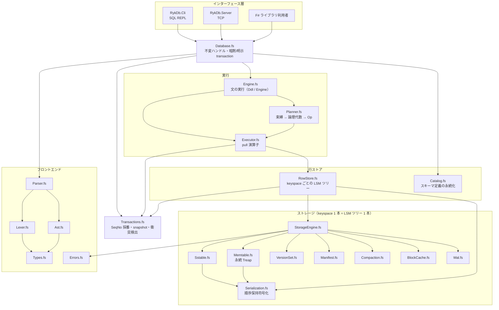
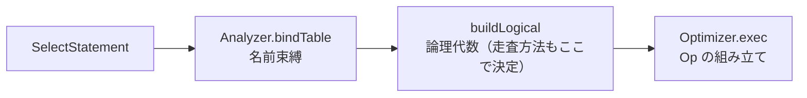

# アーキテクチャ

**net10.0 / F# 10** で実装された、**LSM-Tree + MVCC + WAL** 組込み RDBMS の内部設計です。
SQL の対応範囲は [`sql-reference.md`](sql-reference.md)、実装時に踏んだ落とし穴は [`gotchas.md`](gotchas.md) を参照してください。

---

## 目次

1. [全体像](#1-全体像)
2. [プロジェクト構成](#2-プロジェクト構成)
3. [コーディング規約](#3-コーディング規約)
4. [フロントエンド](#4-フロントエンド)
5. [型と順序保持エンコーディング](#5-型と順序保持エンコーディング)
6. [実行層](#6-実行層)
7. [行ストア層](#7-行ストア層)
8. [MVCC](#8-mvcc)
9. [ストレージ層](#9-ストレージ層)
10. [データフロー](#10-データフロー)
11. [ファイルレイアウト](#11-ファイルレイアウト)
12. [インターフェース層](#12-インターフェース層)
13. [テスト構成](#13-テスト構成)
14. [ビルドと品質ゲート](#14-ビルドと品質ゲート)
15. [設計上の制約](#15-設計上の制約)

---

## 1. 全体像



### 設計原則

1. **不変性** — `StorageEngine` / `Version` / `Memtable` / `Catalog` などはすべて値。更新は「新しい値を返す」。読み取りはロックを取らず、snapshot は自然に固定される。
2. **失敗は値** — 例外を制御フローに使わず、すべて `Result<'T, DbError>` で返す（§3.1）。
3. **keyspace シャーディング** — テーブル・索引・カタログがそれぞれ独立した LSM ツリーを持ち、並列性はこの分離で確保する（§7.1）。
4. **バイト順 = SQL 比較順** — キーのエンコーディングが順序保持であることが、LSM の merge・索引・走査すべての前提（§5.2）。
5. **末尾再帰 / 明示スタック** — 要素数に比例する処理はスタックを積まない形で書く（§3.3）。

### 採用している手法（サマリ）

| 領域           | 手法・アルゴリズム                                                                   | 詳細       |
| -------------- | ------------------------------------------------------------------------------------ | ---------- |
| ストレージ     | LSM-Tree + **Leveled compaction**（LevelDB / RocksDB 方式）                          | §9         |
| memtable       | **永続 Treap**（優先度はハッシュ由来・決定的）                                       | §9.1       |
| SSTable        | ブロック + **restart 配列 + 接頭辞共有** + Bloom filter + Footer 80 バイト           | §9.2       |
| キャッシュ     | **LRU**（ブロック単位、不変実装）                                                    | §9.3       |
| 障害回復       | **WAL（論理ログ）** + MANIFEST / CURRENT の原子的更新                                | §9.5–9.6   |
| GC             | **版単位**の SeqNo 判定（ファイル単位では判定しない）                                | §9.7       |
| 並行制御       | **ロックレス**: 不変ハンドル + **MVCC（Snapshot Isolation）** + first-committer-wins | §8         |
| キー符号化     | **順序保持エンコーディング**（型タグ・escape・タプル）                               | §5         |
| 索引           | 複合キー（索引列 ++ 主キー）の prefix 走査                                           | §7         |
| 実行           | **Volcano 方式の pull 演算子**（不変 `Op`）                                          | §6.2       |
| 構文解析       | 手書き Lexer + 再帰下降 Parser（式規則は **CPS** で末尾再帰）                        | §4         |
| エラー処理     | `Result` ベース（`>>=` / `result { }` / `protect`）                                  | §3.1       |
| ハッシュ       | **FNV-1a 64bit** + **splitmix64**（Bloom filter・Treap の優先度）                    | §5.2, §9.1 |
| 末尾再帰の監査 | 3 層（FS3569 / TailAudit / 深さテスト）                                              | §3.3, §14  |

### 依存の向き

**上から下への一方向のみ。** 下位モジュールは上位を知りません。

| 層               | モジュール                               | 知っている層                          |
| ---------------- | ---------------------------------------- | ------------------------------------- |
| インターフェース | `Database.fs` `RykDb.Cli` `RykDb.Server` | 全部                                  |
| 実行             | `Engine.fs` `Planner.fs` `Executor.fs`   | `RowStore` `Catalog` `Transactions`   |
| 行ストア         | `RowStore.fs` `Catalog.fs`               | `StorageEngine` `Transactions`        |
| MVCC             | `Transactions.fs`                        | `Memtable`（`Entry`）`Errors` `Types` |
| ストレージ       | `StorageEngine.fs` とその下              | `Errors` `Types` `Serialization`      |
| フロントエンド   | `Lexer` `Parser` `Ast`                   | `Types` `Errors`                      |

> **Transactions と RowStore の依存方向**: `Transactions.fs` は `RowStore` を参照しません。
> 依存は **`RowStore` → `Transactions` → `Memtable`** の向きで、 `RowStore` の DML ヘルパ（`insert` / `updateByPrimaryKey` / `deleteByPrimaryKey`）が `Transaction` のバッファへ行・索引を積みます。
> commit 時に `TransactionManager.commit` の出力を `RowStore.writeBatches` に渡すのは `Database` / `Engine` / `Catalog` です（§8.4）。

### なぜ不変（immutable）か

`StorageEngine` `Version` `Memtable` `Catalog` `BlockCache` のすべてが**不変レコード**で、操作は「新しい状態を返す」形です。
これは 3 つの要求を同時に満たすための選択です。

1. **読み取りが lock を取らない。** スナップショットを掴むだけだから。
2. **MVCC の snapshot が自然に固定される。** 読み取り中に状態が書き換わらない。
3. **型のレベルで「更新を忘れる」ミスを防ぐ。** ハンドルは `Database` だけ。

ただし `Executor` の集約処理・`Op.toArray` と `Database.fs` のクライアント層だけは `ResizeArray` / `Dictionary` を使います（§3.2）。

---

## 2. プロジェクト構成

```
RykDb.slnx
├── src/RykDb.Core/     22 ファイル / 10 080 行   ← DB 本体（名前空間 RykDb.Core）
├── src/RykDb.Cli/       1 ファイル /    238 行   ← SQL REPL
├── src/RykDb.Server/    3 ファイル /    311 行   ← TCP サーバ + クライアント
└── tests/RykDb.Tests/  22 ファイル /  5 945 行   ← xUnit（対象ソースと 1:1 対応）
```

`Directory.Build.props` は全プロジェクトに共通の設定を流します（`TreatWarningsAsErrors` などのゲートは §14）。

### モジュール一覧（`src/RykDb.Core/`）

| ファイル           | 役割                                                                              |
| ------------------ | --------------------------------------------------------------------------------- |
| `Errors.fs`        | `DbError` / `ErrorKind` / `Result` 合成演算子（`>>=` / `result { }` / `protect`） |
| `Types.fs`         | `SqlValue` / `DataType` / `TruthValue`（3 値論理）/ `SqlLiteral`                  |
| `Serialization.fs` | 順序保持エンコーディング / `Writer` / `Cursor` / `KeyBuilder` / `Hashing`         |
| `Memtable.fs`      | 永続 Treap の memtable（`apply` / `getVisible` / `rangeScan`）                    |
| `Wal.fs`           | 論理ログ WAL（Begin / Batch / Commit / Abort と redo）                            |
| `BloomFilter.fs`   | SSTable 用 Bloom filter（double hashing）                                         |
| `Sstable.fs`       | SSTable の構築と読み取り（ブロック / index / Bloom / Footer）                     |
| `VersionSet.fs`    | `Version`（レベルの不変スナップショット）と `VersionEdit`                         |
| `Manifest.fs`      | MANIFEST / CURRENT の読み書き（原子的更新）                                       |
| `Compaction.fs`    | Leveled compaction・k-way merge・版単位 GC・孤児ファイルの特定                    |
| `BlockCache.fs`    | `(fileNumber, blockId)` → ブロックの LRU キャッシュ                               |
| `StorageEngine.fs` | LSM ツリー 1 本の公開層（open / put / flush / scan / compact / close）            |
| `Transactions.fs`  | SeqNo 採番・snapshot・write-write 競合検出                                        |
| `Ast.fs`           | 式 `Expr` / 文 `Statement` の判別可能共用体                                       |
| `Lexer.fs`         | 手書きトークナイザ（読み位置は値が持つ）                                          |
| `Parser.fs`        | CPS 化した再帰下降パーサ（`MaxExpressionDepth = 200`）                            |
| `RowStore.fs`      | keyspace 束と DML ヘルパ（`Transaction` のバッファへ行・索引を積む）              |
| `Catalog.fs`       | テーブル・索引定義の永続化                                                        |
| `Executor.fs`      | pull 演算子 `Op` / `Ops` / `Scan`・式評価 `Eval`・DML `DmlOps`                    |
| `Planner.fs`       | 名前束縛 → 論理代数 → `Op`                                                        |
| `Engine.fs`        | 文の実行（`Ddl` / `Engine.runStatement`）                                         |
| `Database.fs`      | 公開 API（不変ハンドル・transaction・`StatementResult`）                          |

### F# のコンパイル順

```
Errors → Types → Serialization → Memtable → Wal → BloomFilter
       → Sstable → VersionSet → Manifest → Compaction → BlockCache
       → StorageEngine → Transactions → Ast → Lexer → Parser
       → RowStore → Catalog → Executor → Planner → Engine → Database
```

F# はファイルを**コンパイル順に評価する**ため、上から下へ一方向の依存になるよう `.fsproj` の `Compile` を手で並べます
（新しいファイルもこの順に追加する）。

---

## 3. コーディング規約

### 3.1 例外を使わない

**このプロジェクトは例外を制御フローに使いません。**
失敗は必ず `Result<'T, DbError>` として返します。
`exception` 定義は **0 件**です。

`Errors.fs` の `[<AutoOpen>] module ResultOps` が合成に必要なものを全部揃えます。

| 提供                                            | 用途                                                 |
| ----------------------------------------------- | ---------------------------------------------------- |
| `( >>= )` `( *> )`                              | monadic な合成                                       |
| `ret` `err` `tryGet` `valueOr` `ofOption` `all` | 単発・畳み込み                                       |
| `result { ... }`                                | `DbResultBuilder` による計算式                       |
| `protect`                                       | .NET I/O API 境界の例外捕捉（`try`/`with` の主経路） |

`protect` は `IOException` / `UnauthorizedAccessException` を `IoError`、
`InvalidDataException` / `FormatException` / `OverflowException` を `CorruptionError` に写します。
ファイル内容の問題を `InternalError`（バグの兆候）にしないためです。
`try` / `with` は `protect` のほかに `Manifest.readRecord` と `RowStore.tryFromDirName` の 2 箇所だけで、どちらも `DbError` へ写して例外は外へは出ません。
`unwrap` / `raiseDb` 相当は持ちません。

失敗は `ErrorKind`（`DbError.Kind`）で分類されます。

| `ErrorKind`                                          | 意味                                     |
| ---------------------------------------------------- | ---------------------------------------- |
| `SyntaxError` / `NameError` / `TypeError`            | 字句・構文 / 名前解決 / 型の失敗         |
| `ConstraintViolation` / `NotFound` / `AlreadyExists` | DML / DDL の失敗                         |
| `CapacityError`                                      | memtable・バッファのメモリ上限           |
| `CorruptionError`                                    | チェックサム不一致などファイル内容の問題 |
| `ConflictError`                                      | MVCC の write-write 競合                 |
| `IoError` / `InternalError`                          | I/O 失敗 / 内部不整合（バグの兆候）      |

### 3.2 命令形要素を使わない

`src/RykDb.Core/` では **`mutable` / `while` / `ref` を 0 件**に保っています。
`ResizeArray` / `Dictionary` を使うのは次の 3 箇所だけで、いずれもホットパスなので理由をコメントに残しています（CLI / Server は対象外）。

- `Executor.Op.toArray` の行の蓄積
- `Executor.Ops.aggregate` のグループ表
- `Database.fs` のクライアント層（応答の組み立て）

| やりたいこと   | 命令形の代わりに使うもの       |
| -------------- | ------------------------------ |
| 書き込み       | `Writer` = 不変のチャンク列    |
| 読み取り       | `Cursor` = 読み位置を値に持つ  |
| パーサの状態   | `PState`（読み位置は値が持つ） |
| 走査・畳み込み | `Result` を返す末尾再帰        |
| 平衡木の再構築 | 明示スタック（`list` を積む）  |

### 3.3 末尾再帰を前提にする

**.NET には tail call 命令がありません。**
`[<TailCall>]` がループ化できるのは「自分自身を呼ぶ」場合だけで、相互再帰する構文規則は 1 フレーム残ります。

採用した手法は次のとおりです。

- **構文規則は CPS（継続渡し）** — 引数を「読むもの」ではなく「読んだ後どうするか」に変える。
- **継続は名前付きの `and` グループメンバーへ hoist** する（ラムダだと FS3569 が出る）。
- **実行時のスタック増加は `PState.Depth` で数えて `MaxExpressionDepth = 200` で止める。**
  `.NET` に tail call 命令が無い分、これは「構文上の末尾性」以上の意味を持ちます。
- **`result { }` 計算式はループする関数では使わない。**
  `Delay` でクロージャに閉じられるため末尾最適化が効かず、50 万トークンで Lexer が `StackOverflow` した実測があります。
- **`[<TailCall>]` は「その関数本体の自己再帰が全部末尾位置」のときだけ付ける。**
  1 つでも外れると FS3569 になり、`TreatWarningsAsErrors` のせいでビルドエラーになる
  （違反箇所の一覧は [`gotchas.md`](gotchas.md) §8.16）。
  構造上末尾にできないものは**付けない理由を呼び出しの直前にコメントで残す**:
  - `Eval.eval` / `Eval.inferType` / `collectAggs` / `rewriteAggs` / `hasAggregate` —
    結果を `>>=` / `match` で「消費してから」分岐するため末尾にならない。
    深さは式の深さ（`MaxExpressionDepth = 200`）で頭打ちになる。
  - `Planner.exec` — 子ノードの `Result` を `Result.map` / `>>=` で消費する。
  - `Op.map` / `Op.take` / `Op.append` — 再帰が `Compute` の中身の中にある。
    次の 1 行を取りに来たときに 1 段だけ評価されるのでフレームは積み上がらない。
  - 逆に**要素数に比例する反復は `match` に直して末尾再帰にした**
    （`IN` の候補リストと `CASE` の WHEN 節。`eval ... >>= fun` だと候補の数だけスタックが積まれる）。
    `Catalog.readColumns` / `readNames` は `acc` を積む形にした。

### 3.4 予約語に注意

`key` / `base` / `begin` / `new` / `old` / `type` / `value` は F# の予約語で、匿名レコードのフィールド名にも使えません。
衝突例と回避策は [`gotchas.md`](gotchas.md) §8.10 を参照してください。

---

## 4. フロントエンド

`Lexer.fs` → `Parser.fs` → `Ast.fs` → `Planner.fs` という一方向のパイプラインです。

### 4.1 Lexer — 状態スレッドの字句解析

- `LexState` は `{ Index; Line; Column }` の不変レコード。
  **前進すると新しい値を返す**ので mutable なインデックスを持ちません。
- 予約語は `Lexer.keywords`、型名は `Lexer.typeNames` の 2 つの `Set` に分けてます
  （`INTEGER` などを予約語にすると列名に使えなくなるため）。
- Blob リテラル `X'0A1B'` の判定は**識別子より前**に置きます。
  順序を逆にすると `'ABCD'` が文字列になります。
- コメントは `--`（行末）と `/* … */`（**入れ子可**）です。

### 4.2 Parser — CPS 化した再帰下降

式構文規則は定義上お互いを呼び合う（`parseExpr → parseOr → parseAnd → … → parsePrimary`）ため、
普通の再帰下降では相互再帰が必ず非末尾再帰になります。
引数を継続に変えて末尾化しています。

```fsharp
type private K<'r> = Expr -> PState -> Result<'r, DbError>

[<TailCall>]
let rec private parseExprC<'r> (k: K<'r>) (st: PState) : Result<'r, DbError> =
    // >>= で繋ぐとラムダが 1 フレーム残るので、match に書いて直接末尾呼び出しにする。
    match enterExpr st with
    | Error e -> Error e
    | Ok st -> parseOrC (fun e st -> k e (exitExpr st)) st   // 末尾位置

and [<TailCall>] private parseOrC<'r> (k: K<'r>) (st: PState) : Result<'r, DbError> =
    parseAndC (fun left st -> parseOrLoop k left st.Depth st) st

// ループ本体は名前の付いた and メンバーに持たせる（ラムダ内の同グループ呼び出しは非末尾になる）。
and [<TailCall>] private parseOrLoop<'r> (k: K<'r>) left baseDepth (st: PState) =
    if isKeyword st "OR" then
        match enterExpr (advance st) with
        | Error e -> Error e
        | Ok st ->
            parseAndC (fun right st -> parseOrLoop k (Expr.Binary(BinaryOp.Or, left, right)) baseDepth st) st
    else
        k left { st with Depth = baseDepth }
```

**継続を名前付きメンバーに hoist するのが要点**です。
ラムダで書くとその中の同グループ呼び出しが「末尾以外」に見え、`[<TailCall>]` を付けた関数に FS3569 が出ます。

実行時のスタックは `PState.Depth` で数え、`MaxExpressionDepth = 200` を超えたら `SyntaxError` にして止めます
（`.NET` に tail call 命令は無く、CPS では継続の数だけフレームが積もるため。§3.3）。

### 4.3 Ast

判別可能共用体 `Expr` / `Statement`。
式は**列参照の修飾子を保持したまま**持ち、束縛（`Binder.qualify`）の段階で解決します。

`Expr.ColumnRefs` と `Expr.isAggregate` は**明示スタック**で走査します。
`go a @ go b` とすると再帰呼び出しが末尾位置に来ないうえ O(n²) になります。
`Expr.toDisplayString` も継続の連列表（`PrintStep`）で末尾再帰にしてます。

---

## 5. 型と順序保持エンコーディング

### 5.1 10 の型

`NULL` / `BOOLEAN` / `INTEGER` / `REAL` / `DECIMAL` / `TEXT` / `BLOB` / `DATE` / `TIMESTAMP` / `UUID`。

`SqlValue` は実行時の値を表し、`NULL` は他のすべての型と区別できる特別なケースです。
`TruthValue` で SQL の 3 値論理（`True` / `False` / `Unknown`）を表現します。

### 5.2 順序保持符号化（LSM 採用の最大の制約）

LSM はキーのマージを**バイト列比較**で行います。
したがって**「バイト順 == SQL 比較順」** でなければならず、これが設計の中心制約です。

型タグを SQL 照合順に単調増加させています。

| 型        |   タグ |     | 型          |   タグ |
| --------- | -----: | --- | ----------- | -----: |
| `Null`    | `0x00` |     | `Date`      | `0x30` |
| `Bool`    | `0x10` |     | `Timestamp` | `0x40` |
| `Int`     | `0x20` |     | `Text`      | `0x50` |
| `Real`    | `0x21` |     | `Blob`      | `0x60` |
| `Decimal` | `0x22` |     | `Uuid`      | `0x70` |

型タグの後は「型ごとのペイロード + 終端 `0x00`」が続きます
（`Serialization.fs` の `OrderPreserving` が実装）。

| 型          | ペイロード                                                                                                    |
| ----------- | ------------------------------------------------------------------------------------------------------------- |
| `NULL`      | なし（タグ + 終端のみ）                                                                                       |
| `BOOLEAN`   | 1 バイト（0 / 1）                                                                                             |
| `INTEGER`   | 8 バイト BE。`v + 2⁶³` の単調写像（`mapInt64`）                                                               |
| `REAL`      | 8 バイト BE。IEEE-754 ビットの順序写像（負は全ビット反転、正は符号ビット反転）。NaN は正の quiet NaN に正規化 |
| `DECIMAL`   | 符号（負数は反転）+ 指数 8 バイト（順序写像）+ 桁列 29 バイト（右詰め。負数は 9 − 桁で反転）                  |
| `DATE`      | `DateOnly.DayNumber`（0001-01-01 基準の日数）を `INTEGER` と同じ写像で                                        |
| `TIMESTAMP` | `DateTime.UtcTicks` を同じ写像で                                                                              |
| `TEXT`      | UTF-8 バイト列を escape（0x00 → 0x00 0xFF）                                                                   |
| `BLOB`      | 生バイト列を escape                                                                                           |
| `UUID`      | RFC 4122 の 16 バイト BE 順                                                                                   |

- `TEXT` / `BLOB` は埋め込み `0x00` を `0x00 0xFF` に escape し、終端に `0x00` を置きます。
  型タグはすべて `0xFF` 未満なので escape 列が「並びがここで終わった」作用を持ち、正しい大小関係になります。
- この escape により、**生のバイト列の前方一致 = 正しい接頭辞一致**になり、 range scan の下限と索引の prefix 走査に使える。
- 複合キーは escape 付きタプル符号化（`("a","bc") < ("ab","c")` を満たす）。

escape の正しさをバイト列で確認した例（フィールド `["ab", "z"]` と `["ab\0", "a"]`）:

```
["ab","z"]   = 50 'a' 'b' 00 50 'z' 00
["ab\0","a"] = 50 'a' 'b' 00 FF 00 50 'a' 00
              位置 4: 0x50 < 0xFF なので前者が小さい -> "ab" < "ab\0" で正しい
```

`Serialization.fs` は書き込み用の `Writer`（不変のチャンク列）と読み込み用の `Cursor`（読み位置を値に持つ）、ハッシュ（FNV-1a + splitmix64）を持ちます。

---

## 6. 実行層

### 6.1 Planner — 束縛 → 論理代数 → Op



パイプラインの実装は `Planner.fs` の 3 段です。

1. `Analyzer.bindTable` — FROM / JOIN の各テーブルを `TableBinding`（スキーマ + 識別名）にする。
2. `Optimizer.buildLogical` — 式を `Binder.qualify` で束縛し、`Predicate.splitConjuncts` で WHERE を分解、
   `Analyzer.chooseScanMethod` で走査方法を決めて論理代数を組む。
3. `Optimizer.exec` — 論理代数を `Op` に落とす（`execScan` / `execJoin` など）。

#### 束縛（Binder）

- パーサは裸の名前を `Expr.Name` として作ります。
  `Binder.qualify` が**一意に決まる場合だけ**修飾名（`t.age`）へ直し、曖昧なら修飾せず残して実行時に「列 'age' が曖昧です（該当: …）」で落とします。
- `FROM t AS x` の別名は、テーブル名の解決用に実名と別名の両方で `ExecContext.Schemas` に登録されます。
  列の修飾子は**別名**（`x.id`）になり、比較は大文字小文字を区別しません。
- WHERE は `Predicate.splitConjuncts` で AND を平坦化してから扱います。

#### 論理代数の構築（buildLogical）

1. FROM が無ければ `Values`（`SELECT 1` は 1 行の定数）。
2. WHERE を全テーブル連結のスキーマで束縛 → conjunct へ分解し、先頭テーブルを `buildScan`。
3. JOIN を FROM の順に**左深く**積みます。
   右は `buildScan`（INNER は右ローカルの WHERE を pushdown、LEFT は null 供給側なので JOIN の上へ回す）。
   ON は「左の連結 + 右」のスキーマで束縛。
4. どのテーブルにも属さない conjunct（例 `a.v = b.v`）は JOIN の上の `Filter` にします。
5. 集約 → 並び替え → 射影 → DISTINCT → LIMIT の順に被せます。

補足:

- **集約の検出**は SELECT 項目と ORDER BY から（`Ops.aggCalls`）。
  GROUP BY があるか集約呼び出しがあれば `Aggregate` を作り、HAVING があればその上に `Having` を置きます。
- **ORDER BY に書けるのは列の直接参照だけ**です（式は実行時にエラー）。
- **LIMIT / OFFSET は整数リテラルのみ**（それ以外は 0 = 制限なし扱い）。
  `LIMIT` は最外層に置き、`OFFSET` を先、`LIMIT` を後に適用します。

#### 最適化ルール（実装済みの範囲）

| ルール          | 内容                                                                                                                                                                                                 |
| --------------- | ---------------------------------------------------------------------------------------------------------------------------------------------------------------------------------------------------- |
| Filter pushdown | WHERE の conjunct を「そのテーブルのみを参照するもの」だけそのテーブルの直下の `Filter` へ落とす（`buildScan`）。LSM はレベル間で k-way merge するので常に安全。ただし **JOIN の ON 句は落とさない** |
| 走査方法の選択  | 下記「走査方法の選択」                                                                                                                                                                               |
| 評価順の固定    | 集約 → 並び替え → **射影** → DISTINCT → LIMIT                                                                                                                                                        |

> `DISTINCT` を射影の**前**に置いてしまうと `(id, g)` の組を重複排除してしまいます。
> `LIMIT` は常に最外層に置き、`OFFSET` を先に `LIMIT` を後に適用します。

#### WHERE の置き場所（JOIN があるとき）

| 述語                                       | 置き場所                                                               |
| ------------------------------------------ | ---------------------------------------------------------------------- |
| 先頭テーブルに局所                         | そのスキャンの直下（`Filter`）                                         |
| INNER JOIN の右に局所                      | 右部分木の直下（`rTree` に含めて実行する）                             |
| LEFT JOIN の右に局所                       | **JOIN の上**（null 供給側。入力へ落とすと NULL 拡張行の可否が変わる） |
| どのテーブルにも属さない（例 `a.v = b.v`） | JOIN の上                                                              |

#### 走査方法の選択（`chooseScanMethod`）

```
WHERE に「列 = 定数」の等価述語があるか（AND を平坦化し、左から順に最初の 1 つを見る）
  ├─ 主キー列なら          → PkLookup
  ├─ 単一列索引と完全一致なら → IndexLookup
  └─ それ以外              → SeqScan
```

**範囲走査は使いません。**
`ScanMethod.RangeScan` は型としては存在しますが Planner から返されることはなく、万一 `Optimizer.exec` に届いても `SeqScan` に落ちます。

- 定数側に使えるのは**リテラルだけ**です（`-1` のような符号つきリテラルは可。式・関数は不可）。
- 対象になるのは **`columns` が 1 列の索引**だけ（複合索引は Leftmost prefix も考慮しません）。
- 主キーは列名で判定し、値を 1 つだけ持つ `PkLookup` を作ります。

#### 結合アルゴリズム

実行時の結合は **入れ子ループ（`Ops.innerJoin` / `Ops.leftJoin`）だけ**です。
hash join / index nested loop など**結合アルゴリズムの自動選択は未実装**で、
`Optimizer.exec` から呼ばれる演算子もこの 2 つだけです。

結合順序は `FROM` に書かれた順です（選択性による並べ替えも未実装）。

#### 論理代数 → Op（`Optimizer.exec`）

- `Scan` は `execScan` が `ScanMethod` に応じて `Scan.table` / `Scan.byPrimaryKey` / `Scan.byIndex` へ振り分けます。
- `Join` は左を「現在のスキーマから右テーブルを除いたもの」、右を「右テーブル 1 つだけのスキーマ」で実行し、`Ops.innerJoin` / `Ops.leftJoin` に渡します（ON は左行 ++ 右行で評価）。
- `Filter` / `Sort` / `Project` は子の**出力スキーマ**（`outputOf`）を求めてから掛けます。
  集約の後は行の並びが「groupBy の値 ++ 各集約の結果」に変わるため、「入力スキーマ（テーブル定義）」と取り違えると `SELECT SUM(age)` が引数を評価できず `NULL` になります。
- `Having` は集約後の行を**位置で読み替えて**から評価します（`Ops.havingFilter`）。
- `Limit` は `Op.skip`（OFFSET）→ `Op.take`（LIMIT）の順、`limit = 0` は「LIMIT なし」です。
- 最後に `Plan.runSelect` が `Op.toArray` で行を集め、ヘッダは `Schema.projectHeader`（別名優先、`*` は列名）で組み立てます。

### 6.2 Executor — pull 演算子

#### なぜ pull 方式か

push（差し出し）だと「1 行だけ欲しいのに全行計算した」ことになり、`LIMIT 1` や `WHERE` の早期打ち切りが効きません。
pull は「次の 1 行」を上流に要求するので、上流が自然に止まります。
F# の `seq { }` は内部に mutable な列挙子を持つので、本実装では使わず Pitt–Patel 型の不変な `Op` で組みます。

`Step` は**即値**（計算済みの 1 行 + 続き）、`Compute` のみが遅延します。
`Compute` は「次に 1 行を返す関数」なので、要求されるまで計算しません。
`Op.ofArray` は 1 行ずつ `Compute` を繋ぐので、行数ぶんのスタックを積みません。

一方で、**ソート・集約・結合・スキャンは Op を組み立てる時点で入力を materialize** します
（下表の「遅延」列を参照）。

`Ops` モジュールの演算子は以下のとおりです。

| 演算子                                    | 役割                                          |
| ----------------------------------------- | --------------------------------------------- |
| `Op.ofArray` / `ofList` / `ofRow`         | 材料化済みの行を流す                          |
| `Op.map` / `filter`                       | 1 対 1 / 1 対 0 の変換                        |
| `Ops.project`                             | 射影（`*` / `t.*` の展開を含む）              |
| `Ops.sortBy`                              | ソート（メモリ上に実体化）                    |
| `Op.take` / `Op.skip`                     | LIMIT / OFFSET                                |
| `Ops.innerJoin` / `leftJoin`              | 入れ子ループ結合                              |
| `Ops.aggregate`                           | 集約（`groupBy` 値 ++ 各集約結果 の行を生成） |
| `Ops.distinct`                            | 重複除去                                      |
| `Scan.table` / `byPrimaryKey` / `byIndex` | 走査                                          |

遅延の持ち方が演算子ごとに違います。

| 演算子                                         | 遅延                                                                         |
| ---------------------------------------------- | ---------------------------------------------------------------------------- |
| `Op.ofArray` / `ofList` / `ofRow`              | `ofArray` は `Compute` で 1 行ずつ（組み立て時に全行分のスタックを積まない） |
| `Op.map` / `Op.filter` / `Op.take` / `Op.skip` | `Compute`。LIMIT / WHERE の早期打ち切りが効く                                |
| `Ops.project`                                  | `Compute`（1 行ずつ）                                                        |
| `Ops.sortBy` / `Ops.aggregate`                 | **Op 構築時**に全件をメモリに読む（実体化）                                  |
| `Ops.distinct`                                 | 既出キーの `Set` を持ち回る（出現順を保持）                                  |
| `Ops.innerJoin` / `leftJoin`                   | 右を materialize し、左を 1 行ずつ流す入れ子ループ                           |
| `Scan.*`                                       | スキャン結果を配列で受け `Op.ofArray` で流す（snapshot は生成時に固定）      |

`DISTINCT` と集約のグループ化は同じキー（`Row.keyOf` = 値の SQL リテラル表記を `U+0001` で連結。NULL 同士は等しい扱い）で行います。

#### 演算子の共通規約

- `Op.map` / `filter` / `take` / `skip` / `append` は「次を要求されたときだけ 1 段進む」形で、残りの継続も自分自身へ繋ぎ直します
  （継続をそのまま渡すと変換が 1 行だけに効くバグになります）。
- エラーは `Error` をそのまま返して列挙を打ち切ります（例外は使いません）。
- `Op.toArray` / `Op.count` は `ResizeArray` + `match` 直下の再帰で回します
  （`>>=` を重ねると末尾呼び出しが効かず 10 万行でスタックオーバーフロー。§3.3）。

#### 走査（`Scan` / `ExecContext`）

- `ExecContext` は `{ Store; Visible; Schemas; Catalog }`。
  `Visible`（snapshot の SeqNo）は Op を作るときに 1 回だけ決まります。
- `Scan.table` = `Dml.scanByPrimaryKey`（`RowStore.fs` の Dml ヘルパ。主キー順の全走査）。
  `Scan.byPrimaryKey` = `Dml.getByPrimaryKey`（点検索、無ければ空 Op）。
  `Scan.byIndex` = `Dml.scanByIndexPrefix`（索引の prefix 走査。非一意索引でも全行を返します）。
- **スキャンは結果を配列で受け取ります**（遅延イテレータではない）。
  Op としては 1 行ずつ流れるので `LIMIT` は後段を早期に打ち切れますが、ストレージの読み出しはスキャン生成時に終わっています（§15.2）。

#### 集約・ソート・射影の内部

- 集約（`Ops.aggregate`）は全行を読み、グループキー → 行リストの表を作って**最初に現れた順**に 1 行ずつ返します。
  出力は「GROUP BY の値 ++ 各集約の結果」の並びです。
- `SUM` / `AVG` は `decimal` で累積します（`REAL` 混在時は `double`）。
  `COUNT(列)` は NULL を数えず、`COUNT(*)` は数えます。
  空グループの `SUM` / `AVG` / `MIN` / `MAX` は `NULL`、`COUNT` は 0。
- `SUM` は数値列なら `DECIMAL`（`REAL` 混在時のみ `REAL`）、`AVG` は常に `REAL` を返します。
  `COUNT(DISTINCT …)` の DISTINCT フラグは現状無視されます（`COUNT(列)` と同じ）。
- ソート（`Ops.sortBy`）はキーを「列インデックス + 向き」に解決して `Array.sortWith` で並べます。
  ORDER BY に書けるのは**列の直接参照だけ**（式はエラー）。
  解決は修飾つき（`t.age`）を優先するので、集約後の出力（列名が `SUM(t.age)` になる）でも動きます。
- 射影（`Ops.project`）は `*` / `t.*` を列参照へ展開します。
  入力が集約結果のときは `substituteAggs` で位置に読み替えてから評価します。

#### DML（`DmlOps`）

DML は pull 演算子ではなく、`Transaction` を積み上げて件数を返す実行関数です（§10.2）。

- `insert` — 列順・`DEFAULT` / `NULL` の充足・`SqlValue.coerce` による型強制を行い、
  行ごとに `Dml.insert` でバッファへ積みます（最終確認は `TableSchema.validateRow`）。
- `update` — 全行をスキャンして WHERE を評価し、代入式は「現在の行」で評価して `Dml.updateByPrimaryKey` へ。
  **主キー列の書き換えは未対応**です（`sql-reference.md` 参照）。
- `delete` — 全行をスキャンし、WHERE に合う行の**主キー + 全索引に tombstone** を書きます。

いずれも書き込みは `Transaction` のバッファに溜まり、**commit 時にだけ** RowStore へ届きます。

#### snapshot は Op 生成時に 1 回だけ固定する

各演算子は実行中に「今この瞬間の DB の時刻」を見てはいけません。
途中で他トランザクションが commit すると、同じクエリの前半と後半で見えるデータが変わる（read committed になり、JOIN が壊れる）からです。
よって `ExecContext.Visible` は Op を作る時点で確定させ、渡された値だけを使います。

### 6.3 式の評価

`Eval` モジュールがスカラー式を 3 値論理つきで評価します。
集約呼び出しはここでは評価せず、`Ops.aggregate` / `Ops.project` が先に計算してから結果を定数として読み替えます
（`Ops.substituteAggs`）。

**3 値論理と NULL**

- 比較はオペランドに NULL があると `NULL`（UNKNOWN）を返します。
  `AND` は左が `FALSE` なら右を評価せず `FALSE`、`OR` は左が `TRUE` なら右を評価せず `TRUE`（短絡評価）。
- `WHERE` / `HAVING` は UNKNOWN を**偽**として扱います（`Eval.matches`）。
- `BETWEEN` は `>=` と `<=` の AND として 3 値論理で評価します。
- `IN` は「一致する要素があれば TRUE、
  一致せず NULL（UNKNOWN）を 1 つでも見れば UNKNOWN、それ以外は FALSE」。
  空の `IN` は FALSE です（`NOT IN` は真偽が反転）。
- `CASE` の WHEN は `TRUE` のときだけ THEN を返し、`NULL` / UNKNOWN は次の WHEN へ進みます。

**演算と関数**

- 算術は NULL を伝播します。`0` による除算・剰余は `ConstraintViolation` エラーです。
- 型決定: `INTEGER` x `INTEGER` → `INTEGER`、`DECIMAL` x `DECIMAL` → `DECIMAL`、片方が `REAL` なら `REAL`。
- `||`（`Concat`）は両辺の表示文字列を連結します（NULL は NULL）。
- `LIKE` は `%` / `_` の手書き照合です（ESCAPE 非対応、大文字小文字は区別。
  バックトラックしない 1 パスの照合なので、`%` が多いパターンでも無限ループしません）。
- スカラー関数は `UPPER` / `LOWER` / `LENGTH` / `ABS` / `COALESCE` / `TRIM` / `ROUND` の 7 つ。
  未知の関数・引数個数の不一致はエラーです（`ROUND` は `INTEGER` / `REAL` のみ対応）。
- 集約のエラーは握り潰され `NULL` になります（`Ops.aggregate` の `| Error _ -> SqlValue.Null`）。
- `AVG` は `SUM ÷ COUNT` を実行時に計算します（結果は `REAL`）。

---

## 7. 行ストア層

### 7.1 keyspace シャーディング

1 つのテーブルは「主キーの LSM ツリー」+「索引ごとの LSM ツリー」で構成されます。
それぞれが**独立したディレクトリ・独立した WAL・独立した memtable** を持ちます。

| keyspace      | 中身                     | キー                                           |
| ------------- | ------------------------ | ---------------------------------------------- |
| `t:<table>`   | テーブルの行（主キー順） | `KeyBuilder.ofValues 主キー列`                 |
| `i:<index>`   | 索引エントリ             | `KeyBuilder.ofIndexAndPrimary 索引列 主キー列` |
| `__catalog__` | スキーマ定義             | `table:<名前>` / `index:<名前>`                |

```
<root>/<base64(keyspace)>/
  MANIFEST-000001     世代ごとの VersionSet 定義
  CURRENT             有効な MANIFEST 番号
  000123.sst          データファイル
  000002.wal          先行ログ
```

`base64` にするのは keyspace 名（`t:people`）がそのままではディレクトリ名に使えないためで、
`t:` / `i:` 以外の接頭辞は keyspace とみなさず無視します。

**シャーディングの意味:**

- テーブル間の書き込みは完全に並列（ツリーが別だから lock が衝突しない）
- 各ツリーが独立に flush / compaction できる
- 1 つのテーブルが壊れても他に影響しない
- Bloom filter による独立な枝刈り

### 7.2 行の削除

削除は**主キー + 全索引に墓碑（tombstone）**を書きます
（keyspace を分けた代償として必要な処理。書き忘れると何が起きるかは [`gotchas.md`](gotchas.md) §11.3）。

### 7.3 Catalog

カタログは `__catalog__` keyspace に「1 キー = 1 定義」で保存されます。

```
[table:lenPrefixed][unique:1][colCount:varint] ...
[flags]  bit0 = NOT NULL / bit1 = PRIMARY KEY / bit2 = UNIQUE
```

**SQL テキストではなく構造化した定義を保存する**理由は 2 つです。

1. `DEFAULT` の式や制約をあとから変えられる。
   SQL テキストだと「定義が 1 つ変わっただけで全部のパースをやり直す」になる。
2. 復元した型が `TableSchema` として**同じ形**になる。
   AST を復元してから `TableSchema.ofCreateTable` に戻すと、 DEFAULT のリテラル表現が往復で壊れる可能性がある。

既存の LSM（Treap / SSTable / WAL / Compaction）を全部流用できるので、DDL 用の永続化層を別に書かなくて済みます。
書き込みと commit の一貫性も既存エンジンからそのまま得られます。

- キーは `table:<名前>` / `index:<名前>`（索引定義は属するテーブル名を含む）。
- `TableDefinition`（永続化形）と `TableSchema`（実行用）を相互変換します。
- `Catalog.eqName` は `OrdinalIgnoreCase` — **SQL の識別子は大文字小文字を区別しません**。
- **注意** `Catalog.toSchema` は `Indexes = []` で埋まります。
  実行系には `Catalog.indexSchemasOf` 経由で載せ直す必要があります（忘れると索引検索が常に SeqScan になります）。
- **DDL は即時に効きます。**
  `CREATE TABLE` はカタログを書き換えた時点で反映され、暗黙 transaction の開始時にカタログを読み直して直前の DDL を受け取ります。

---

## 8. MVCC

`Transactions.fs` が担うのは 3 つです。

### 8.1 採番

コミット済みの論理時計を 1 つに並べます。**「DB の時刻」** はこれです。

- 採番は `TransactionManager.NextSeqNo` が一元管理し、commit 時に `Transaction.toEntries` がバッファの各エントリへ 1 つずつ SeqNo を振ります（1 から単調増加）。
- 最後に振った番号が `LastCommitSeqNo`（= DB の現在時刻）になり、次の snapshot の値になります。
- 起動時は保存済みの SeqNo（`RowStore.lastSeqNo`）から `TransactionManager` を作り直します。
  **巻き戻すと、新しい書き込みが古い SeqNo として隠されます。**

### 8.2 可視性

> snapshot とは「SeqNo が S 以下の書き込みだけ見える」こと。

実装は `StorageEngine.getAt` / `scanAt` に `visible: uint64 option` を渡すだけで、中身を SeqNo フィルタ 1 つで絞ります。
永続データ構造 versioning は使いません。

`Snapshot.noLimit`（`uint64 option` の `None`）が「制限なし」を表します。
`Some s` のときだけ `SeqNo <= s` で判定し、`None` ならフィルタを省きます（§8.2 の `visible`）。

### 8.3 競合検出

2 つの transaction が同じキーに書いたら、**後から commit した方を失敗**させます（first-committer-wins）。
`LastCommitted : Map<keyspace:key, SeqNo>` を commit 時に更新し、transaction の snapshot より大きい SeqNo の同一キーがあれば `ConflictError` にします。

競合キーの照合は `keyspace + ":" + base64(キー)` の文字列で行います。
`LastCommitted` はプロセス内の状態で、ディスクには残しません
（commit 済みのデータは再起動後も WAL / SSTable から読めます）。

### 8.4 書き込みは commit 時にしかエンジンへ届かない

```
BEGIN
  ├─ Transaction.Buffers : Map<keyspace, Map<key, SqlValue array option>>
  └─ （読みはバッファを見る → read-your-writes）
COMMIT
  ├─ TransactionManager.commit → 競合検出 → WriteBatch
  └─ RowStore.writeBatches → StorageEngine.writeBatch（keyspace ごとに 1 本）
```

これにより次の 3 つが同時に保証されます。

- commit order の一意性
- abort した transaction の書き込みが DB に一切残らない
- 自分の書き込みを commit 前に読める

読み取りは lock を取らず（`StorageEngine` が不変だから）、書き込みの直列化はこのモジュールの中だけに閉じています。
**keyspace 単位の並列性は `RowStore` が持ちます** — keyspace が違えば commit も衝突もしません。

### 8.5 .Database の transaction モデル

`Execute` / `Query` は**暗黙の transaction**で実行し、自動的に commit します。
`Begin()` 以降は `Commit()` / `Rollback()` するまで同じ transaction を使います。

> **注意** SQL 文としての `BEGIN` / `COMMIT` / `ROLLBACK` は**構文としては受理されますが、実行しても何も起きません**（`Engine.runStatement` が no-op）。
> 明示 transaction はライブラリ API の `db.Begin()` / CLI の `.commit` `.rollback` を使ってください。

### 8.6 同時実行制御 — ロックは 1 つもない

`src/` 全体に `lock` / `Monitor` / `SemaphoreSlim` / `Mutex` / `Interlocked` は存在しません。
同時実行制御は次の 4 層の組み合わせで成り立っています。

| 層                         | 役割                           | 詳細                                                                                                                    |
| -------------------------- | ------------------------------ | ----------------------------------------------------------------------------------------------------------------------- |
| 1. 不変レコード            | **読み取りがロックを取らない** | `StorageEngine` / `RowStore` / `DbState` はすべて値。読むときは掴んだスナップショットをそのまま見る（§1「なぜ不変か」） |
| 2. `Database` ハンドル     | **書き込みの直列化の単位**     | `Execute` は新しい `Database` を返す。直列化は「ハンドルを持ち替える」ことで行われ、ロックは介在しない                  |
| 3. MVCC + 競合検査         | **commit の一意性**            | 採番と first-committer-wins の競合検査が `TransactionManager.commit` の 1 経路を通る（§8.1–8.4）                        |
| 4. keyspace シャーディング | **並列性の供給源**             | `t:` / `i:` / `__catalog__` は独立ツリー。lock-free 構造を採用しなくてよい理由（§7.1, §15.1）                           |

重要な含意は 2 つです。

1. **並行利用は「スレッド / セッションごとに `Database` ハンドルを持つ」のが正**。
   同じハンドルを複数スレッドで `Execute` すると状態はマージされず、**後から書き換えた方だけが残ります**（片方が黙って失われる）。
2. **commit の直列化は「その経路を単一に通る」という規約**であって、mutex による保護ではありません。
   ハンドルの受け渡し規約が破られた場合に保護されるものはない、と理解してください。

外周はすべて逐次処理です。

- **compaction は同期**（バックグラウンドスレッドなし）なので、reader とファイル削除を争わない（§15.2）
- **WAL は `FileMode.Append, FileShare.Read`** のみ（`Wal.fs`）。書き込み側は常に 1 本の経路
- **TCP サーバは完全逐次** — `AcceptTcpClient` → 1 接続を処理 → 次の accept（§12.3）
- **プロセス間アクセスは非対応**（1 プロセス前提）。**ロックファイルは作成しません**（§11）

---

## 9. ストレージ層

`StorageEngine` が **LSM ツリー 1 本**を公開する層です。

| 既定値                        | 値     |
| ----------------------------- | ------ |
| `DefaultMemLimitBytes`        | 64 MiB |
| `DefaultCacheFiles`           | 32     |
| `BloomFalsePositiveRate`      | 0.01   |
| `Levels.Count` / `Levels.Max` | 7 / 6  |

### 9.1 Memtable — 永続 Treap

memtable は追記のみなので、レベルごとの insertion buffer として使います。
構造は「キー昇順・同一キーは SeqNo 降順」で探索・全順序走査できる平衡二分探索木です。

**なぜスキップリストではなく Treap なのか。**
永続スキップリストも書けますが、パスコピー（探索パスだけを複製する方式）では次の問題があります。

1. 挿入点の「前」ノードが探索パス上に無く、level 0 の鎖が壊れる。
2. head は全レベルに現れるので、レベルごとに別々にコピーすると `Memtable.Head` として採用する側だけが未更新になる。
3. 前ノードも複製すれば O(n) になり、スキップリストの意味を失う。

Treap は根から再構築するのでこの問題は構造的に発生しません。
優先度は乱数ではなく**ハッシュから決める**（決定的で、シードの取り違えが起きません）。

> 点検索に `rangeScan` を使うと O(n) になる話は [`gotchas.md`](gotchas.md) §4.1 を参照。

走査時は逆順のまま蓄積して最後に一度だけ `List.rev` します
（途中で反転すると再帰の各段で向きが変わり並びが崩れます）。

- **不変条件**: 「キー昇順・同一キーは SeqNo 降順」。`compareKeys` がこの全順序を定義します。
- **優先度**: `mix(mix(FNV-1a(key) ^ (SeqNo × 0x9E3779B97F4A7C15)))`。
  乱数シードを使わないため、同じ入力からは常に同じ木になります（決定的）。
- **更新**: `split` / `insertNode` はたどったノードを明示スタックに積み、引き返しながら組み直して末尾再帰にします（§3.3）。
- **走査**: 左→自身→右を 1 本の作業リスト（`Work`）に並べ、`List.rev` は最後に 1 回だけ。
- **点検索**: `getVisible` が「snapshot 以下で SeqNo 最大の版」を O(log n) で返します。
  点検索に `rangeScan` を使うと O(n) になるため使いません。

### 9.2 SSTable

```
[Block 0][Block 1]...[Block N-1]
[Meta block]        min_key / max_key（長さ付き）
[Bloom filter]
[Index block]       ブロックごとに (最終キー, オフセット, 長さ)
[Footer 80 bytes]   各セクションの位置・長さ・エントリ数・チェックサム
```

各ブロックは LevelDB 風の restart 配列を持ちます。

```
[entry]*
[restartOffset:4]...*
[numRestarts:4]

entry = [shared:varint][nonShared:varint][valueLen:varint][key の非共有部分][value]
```

同じ接頭辞を持つ連続エントリは共有して圧縮します。
可変長キーのため slotted page / overflow ページの仕組みは不要です。

**並び**は「キー昇順・同一キーは SeqNo 降順」（`SstEntry.compare`）です。
検証時の注意は [`gotchas.md`](gotchas.md) §11.5 を参照してください。

定数と実装の要点:

| 項目                 | 値・内容                                                                                                                                      |
| -------------------- | --------------------------------------------------------------------------------------------------------------------------------------------- |
| ブロックのエントリ数 | `EntriesPerBlock = 128`                                                                                                                       |
| restart 間隔         | `RestartInterval = 16`                                                                                                                        |
| チェックサム         | **FNV-1a 32bit**（CRC32C ではない。Footer は Footer より前の全バイトを対象）                                                                  |
| Footer               | `magic(8) version(4) maxSeqNo(8) indexOff(8) indexLen(8) bloomOff(8) bloomLen(8) metaOff(8) metaLen(8) entryCount(8) checksum(4)` = 80 バイト |
| `maxSeqNo`           | ファイル内の最大 SeqNo（記録用。GC の判定はエントリ単位。§9.7）                                                                               |
| Bloom filter         | 件数と誤検出率から m と k を決める double hashing（`h1 + i × step`、step は奇数）。読む側は `Sstable.mayContain`                              |
| 点検索の順路         | Bloom filter → meta（min/max）→ index block → data block                                                                                      |

ファイルは `Sstable.build` が組み立て、`Sstable.openTable` が読み出します。
読み出しは `BlockCache`（ブロック番号 → 復号済みバイト列）を経由します。

### 9.3 BlockCache

`(fileNumber, blockId) -> byte[]` の LRU。
**不変実装**で、順序は「新しい順」の `list` として持ち、要素数は `Map` で数えます。
上限は**ブロック数**で数えます（バイト数で数えると全ブロックを走査することになるため）。

SSTable はブロック圧縮しない（設計方針）ので、読んだブロックをそのままメモリに載せます。

- 既定の上限は `DefaultCacheFiles = 32`。カウントするのは**ブロック数**です。
- compaction で入力ファイルを消したら `invalidateFile` で該当ファイルのブロックを捨てます。

### 9.4 VersionSet

`Version` は「レベルごとのファイル集合の**不変スナップショット**」です。

- `MightContain key` は Bloom より粗い判定（`Smallest ≤ key ≤ Largest`）。
- `filesForPointLookup` は点ルックアップ用のファイル順（新しい順）を返します。
- **ファイル追加・削除は新しい `Version` を返す**ので、読み取り中に状態が書き換わりません。

`VersionEdit` は Version の変更履歴で、直列化されて MANIFEST に書かれます。
**`NextFileNumber` は MANIFEST に残りません**（`applyAll` は `Version.empty` から作り直すので 1 に戻ります）。
復旧時には `maxFileNumberOnDisk + 1` で必ず上へ進める必要があります
（巻き戻すとデータを失う話は [`gotchas.md`](gotchas.md) §4.4 / §11.2）。

レベル構成と容量上限（`CompactionOptions.defaults`）:

| レベル | 役割                                   | 容量上限                                    |
| ------ | -------------------------------------- | ------------------------------------------- |
| L0     | flush の出力先（キー域の重なりを許す） | なし                                        |
| L1〜L5 | 1 ファイル = 1 キー域                  | 10 MiB / 100 MiB / 1 GiB / 10 GiB / 100 GiB |
| L6     | 最下位                                 | 1 TiB                                       |

`pickCompaction` は L1 から順に「そのレベルの総バイト数 > 上限」の最初のレベル L を選び、出力先を L+1 にします。
実際の入力は `Compaction.selectInputs` が「レベル L の全ファイル
（最大 `MaxInputFiles = 32`）」+「次レベルでキー域が重なるファイル」として確定します。
点検索のファイル順は「新しいレベルのほうが先（L0 が最新）、同レベルではファイル番号の降順」です（`filesForPointLookup`）。

### 9.5 Manifest — 唯一 atomic 更新を要するファイル

```
CURRENT           「1 行の有効な MANIFEST 番号」
MANIFEST-000001   追記専用の VersionSet 定義
```

`CURRENT` の更新は「`CURRENT.tmp` へ書き込んでから `File.Move(上書き)` で置き換える」原子的な書き換えです
（`Manifest.writeCurrent`）。書きかけの `CURRENT` が残らないので、クラッシュ後も
`CURRENT` は**有効な** manifest 番号のどちらかを指します。
なお **fsync はしていない**ので、電源断に対しては「rename 済みか否か」までが保証範囲です。

`Manifest.openOrCreate` が返すのは「**有効な** manifest 番号」で `+1` しません。
`+1` すると別ファイルを指し、追記先がずれて復旧が空になります。

復旧時は `applyAll` が `Version.empty` から VersionEdit 列を再適用して Version を作り直すため、`NextFileNumber` は 1 に戻ります。
`openDatabase` が `maxFileNumberOnDisk + 1` まで進め直すのはこのためです（§9.4）。

### 9.6 WAL — 論理ログ

ページイメージではなく更新内容を記録します。

```
Begin(txnId) / Batch(txnId, entries) / Commit(txnId) / Abort(txnId)
```

1 レコードのファイルレイアウト:

```
[payloadLength:u32LE][checksum:u32LE(FNV-1a)][payload]
```

- `payloadLength` が残りバイト数を超える → 書きかけ（torn write）なので打ち切る
- `checksum` が一致しない → 書きかけなので打ち切る

追記は「最後に完了する」性質があるので、壊れたレコードの後ろは読まなくてよい。
途中でクラッシュしても open できる理由はここです。

- **1 トランザクション分（Begin + Batch + Commit）を 1 回の `append` でまとめて書き**、 `Flush(true)` でディスクまで落とします。
  Begin / Commit が中途半端に分かれません。
- open 時は `committedEntries` が「Commit まで到達した Batch」だけを再生します。
  未コミットと `Abort` は捨てます。
- flush / close の後は `rotate` します（旧ファイルを先に全部消してから、新番号で再作成）。
  **削除 → 作成の順**でないと、作ったばかりのファイルが削除対象に入ります。

### 9.7 Compaction — Leveled + GC

```
L0  … flush の出力先。複数のファイルがキー域が重なる
L1〜 … 1 ファイル = 1 キー域で互いに重ならない（RocksDB/LevelDB と同じ）
```

1 回の compaction:

1. 過剰レベル `L` を選ぶ（`Version.pickCompaction`）
2. `L` の全ファイル + `L+1` でキー域が重なるファイルを**入力**にする
3. 入力をメモリで読み、k-way merge（各ファイルは既にソート済みなので O(N log k)）
4. **同一キーの版を SeqNo が新しい 1 件に畳む** → ここに墓碑も落ちる
5. **GC**: 全 active snapshot の SeqNo より小さい版を落とす
6. 出力ファイルを `L+1` に書き、MANIFEST に記録、入力ファイルを削除

GC は**版（エントリ）単位**で行います。ファイル単位の SeqNo 判定は**しません**
（snapshot S の読み手は `SeqNo <= S` の版を見るので、**SeqNo が小さい版こそ**まだ読まれ得ます）。

| 条件                                   | 措置                                                                                |
| -------------------------------------- | ----------------------------------------------------------------------------------- |
| 同一キーの最新版                       | **必ず残す**                                                                        |
| 最新版以外で `SeqNo < ActiveSnapshot`  | 捨てる（どの snapshot からも見えない）                                              |
| 最新版以外で `SeqNo >= ActiveSnapshot` | 残す（将来の snapshot から見える）                                                  |
| tombstone                              | 出力が最下位レベル（`DropTombstonesBelowLevel = Levels.Max`）に達したときだけ捨てる |

ファイル単位の回収は「**Version が参照していないファイル**」だけです
（`deleteOrphans`: MANIFEST 反映前にクラッシュして残ったファイルの掃除）。
`FileMetaData.MaxSeqNo` は記録として持ちますが、削除の根拠にはしません。

> **`VACUUM` は不要です。** スペース回収はコンパクション時の自動 GC が行います。

**MANIFEST を先に、ファイル削除を後にする**のが重要です
（逆順だとデータ損失になる話は [`gotchas.md`](gotchas.md) §11.4）。

---

## 10. データフロー

### 10.1 読み取り（`SELECT`）

```
SQL 文字列
  → Lexer.tokenize          トークン列
  → Parser.parseStatements  Statement list
  → Analyzer.bindTable      名前束縛（修飾子を解決）
  → Planner.buildLogical    論理代数
  → 物理化                 走査方法・結合アルゴリズムを決定
  → Executor.execute        Op の木
  → Op.toArray              結果行
```

走査の探索順は **memtable → L0（新しい順）→ 各レベル（新しい順）**。
各ステップで Bloom filter と `FileMetaData.MightContain` で枝刈りします。

### 10.2 書き込み（`INSERT` / `UPDATE` / `DELETE`）

```
1. Planner が DML を RowStore の更新に変換
2. Transaction.Buffers に積む（まだ DB には見えない）
3. commit 時:
   ├─ TransactionManager.commit → 競合検出（first-committer-wins）
   ├─ Transaction.toEntries    → WriteBatch
   └─ RowStore.writeBatches    → keyspace ごとに StorageEngine.writeBatch
                                    ├─ Wal.append (Begin/Batch/Commit)
                                    └─ Memtable.apply
4. memtable が MemLimitBytes に達したら flush → L0 の SSTable
5. レベルが閾値を超えたら compactOnce
```

### 10.3 DB を開くとき

```
Database.openWith root
  → RowStore.openStore root          既存の keyspace ディレクトリを**全部**開く
  → Catalog.load                     __catalog__ keyspace からスキーマを読む
  → RowStore.lastSeqNo               ディスク上の最大 SeqNo を採る
  （各 keyspace で）StorageEngine.openDatabase dir
      ├─ Manifest.openOrCreate       CURRENT を読む / なければ作る
      ├─ dropMissingFiles            MANIFEST が参照するファイルが無いなら除去
      ├─ deleteOrphans               MANIFEST が参照しないファイルを削除
      ├─ Wal.read                    コミット済みの Batch を memtable へ再生
      └─ NextFileNumber をディスク上の最大番号 + 1 へ進める
```

> **既存の keyspace を全部開いておくこと。**
> 開かないまま後始末すると `LastCommitSeqNo = 0` から始まり、reopen 直後に 0 行になります
> （症状と修正の詳細は [`gotchas.md`](gotchas.md) §5.2）。

### 10.4 閉じるとき

`Database.Close()` は **全 keyspace の `StorageEngine.close`** を行い、memtable を flush してから WAL を削除します。
これを省くと再起動時にデータが読めません。

---

## 11. ファイルレイアウト

```
<root>/
├── dDpwZW9wbGU=                 ← base64("t:people")   主キー行
│   ├── MANIFEST-000001
│   ├── CURRENT
│   ├── 000002.wal
│   ├── 000003.sst
│   └── 000004.sst
├── aTppZHhfZGVwdA==             ← base64("i:idx_dept")  索引エントリ
│   └── ...
└── X19jYXRhbG9nX18=             ← base64("__catalog__")
    └── ...
```

各 keyspace ディレクトリの中身:

| ファイル        | 役割                              |
| --------------- | --------------------------------- |
| `MANIFEST-%06d` | VersionSet の変更履歴（追記専用） |
| `CURRENT`       | 有効な MANIFEST 番号（1 行）      |
| `%06d.wal`      | 先行ログ                          |
| `%06d.sst`      | データファイル                    |

ロックファイルは作成しません（1 プロセス前提。§8.6）。

---

## 12. インターフェース層

3 つのインターフェースが**すべて `Database.fs` だけ**を見ます。

### 12.1 ライブラリ API

```fsharp
open RykDb.Core

// Result から中身を取り出す例示用のヘルパー。
let ok =
    function
    | Ok v -> v
    | Error e -> failwith (DbError.toDisplayString e)

let db = ok (Database.openWith "./mydata")

// Execute / Query は「新しい Database」と結果のペアを返す。戻り値を持ち替えること。
let db, _ = ok (db.Execute "CREATE TABLE t (id INTEGER PRIMARY KEY, v INTEGER)")
let db, _ = ok (db.Execute "INSERT INTO t VALUES (1, 10), (2, 20)")

let db, result = ok (db.Query "SELECT id, v FROM t ORDER BY id")
result.Rows        // [|[|Int 1L; Int 10L|]; [|Int 2L; Int 20L|]|]
result.Columns     // [|"id"; "v"|]
```

> **重要**: ハンドルは**不変**なので、書き込むたびに新しいハンドルを持ち替える必要があります。
> 持ち替えを忘れると書き込みが失われます。

### 12.2 CLI REPL

```bash
dotnet run --project src/RykDb.Cli -- ./mydata                # 対話モード
dotnet run --project src/RykDb.Cli -- -f script.sql ./mydata  # スクリプト実行
```

対話モードでは `.tables` / `.commit` / `.rollback` / `.help` / `.exit`（`.quit`）が使えます。
エラーは表示するだけで終了しません。

### 12.3 TCP サーバ

```bash
dotnet run --project src/RykDb.Server -- -p 7090 ./mydata
```

1 接続 = 1 クライアント、逐次処理。1 行のテキストを 1 行ずつ交換します。

**並行性に関する制約（§8.6 参照）:**

- `serve` の accept ループは **接続を 1 つずつ処理します**（接続ごとの `Task` / スレッドは起こしません）。
  1 接続内も while で逐次です。
- 各接続は `handleClient` 内で `let mutable current = db` に**初期ハンドルをコピー**して始め、実行のたびに `current <- next` で持ち替えます。
- **接続をまたいでハンドルは引き継がれません。**
  次の接続は `serve` に渡された初期 `db` から始まるので、前の接続が変更した後の状態（カタログ・transaction 状態）は見えません。

| 応答                                       | 意味                                                     |
| ------------------------------------------ | -------------------------------------------------------- |
| `OK <行数>\t<列1>,<列2>,…` + `<値>,<値>` … | 成功（結果が 0 行なら `OK <行数>` のみ。DML は常にこれ） |
| `ERR <メッセージ>`                         | 失敗                                                     |
| `HALT`                                     | 終了                                                     |

値は `SqlLiteral.toSqlLiteral` のまま（引用符つき）で返るので、クライアント側でそのまま SQL の入力に使える設計です。

対話例:

```
> SELECT id, name FROM t ORDER BY id
< OK 2\tid,name
< 1,'alice'
< 2,'bob'
> .tables
< OK 1\ttables
< 't'
> .exit
< HALT
```

セッションコマンド: `.exit` / `.quit` / `.ping` / `.tables`

`Server.fs` は `serve` のみを公開しています（`handleClient` は `private`）。
テストは `Program.fs` ではなく `Server.serve` を直接呼べます。

---

## 13. テスト構成

xUnit。**テスト対象のソースファイルごとに 1 ファイル**に分けてあります
（`src/RykDb.Core/Executor.fs` → `tests/RykDb.Tests/ExecutorTests.fs`）。

```bash
dotnet test                                 # 全件
dotnet test --filter "RykDb.ServerTests"    # Server のみ
```

**テスト方針**: `DatabaseTests` / `ServerTests` は「SQL 文字列 → 結果」の通し経路しか検証しません。
Parser / Planner / Executor / Catalog の連携バグはそこだけで分かります。

`TestHealthTests.fs` には「Fact が 0 件のテストモジュールが無い」ことを検出するテストがあります。
F# 10 の FS0842 への対策です（[`gotchas.md`](gotchas.md) §9.1）。
モジュール数が 21 個以上あること、`DatabaseTests` に `E2E` / `性能`、`ServerTests` に `TCP` のテスト名が残っていることも検査します。

**乱数生成のテストは退行に注意**（[`gotchas.md`](gotchas.md) §9.6）。

---

## 14. ビルドと品質ゲート

```bash
dotnet build -t:Rebuild       # ビルド
dotnet test                   # テスト
dotnet tool restore           # fantomas インストール
dotnet fantomas src/ tests/   # 整形
```

| ゲート                  | 設定                                                             |
| ----------------------- | ---------------------------------------------------------------- |
| `TreatWarningsAsErrors` | **有効**                                                         |
| `LangVersion`           | `10.0`（`Preview` は採用しない。再現ビルドを犠牲にできないため） |
| `WarningLevel`          | `3`                                                              |
| Core の命令形要素       | `mutable` / `while` / `ref` = 0 件                               |

> **fantomas 整形後は必ず `dotnet build -t:Rebuild` で FS0020 を確認してください**
> （[`gotchas.md`](gotchas.md) §10.4）。

> **dotnet build / dotnet test を並行して走らせないでください**
> （幻影エラーの詳細は [`gotchas.md`](gotchas.md) §9.4）。

### tail call 監査（3 層）

再帰が末尾位置から外れるとスタックオーバーフローに直結するため、3 層で検出します。

1. **ビルド** — `[<TailCall>]` 属性付き関数の非末尾再帰を FS3569 として検出（`TreatWarningsAsErrors` によりエラー）。
2. **TailAudit** — `dotnet run --project tools/TailAudit` が構文木を走査し、属性の無い 関数（ローカル `let rec` を含む）の非末尾再帰を検出。
   既知分は `tools/TailAudit/TailAudit.baseline` と差分し、**新規があれば exit 1**。
   （ベースラインは `dotnet run --project tools/TailAudit -- --update` で生成する。
   **未生成なら全件を新規とみなして exit 1 になる**ので、内容を確認のうえ生成しておく。）
3. **テスト** — スタック深度の実測（`末尾再帰:` 系テスト）。

`[<TailCall>]` は構文上の検査にすぎません。
CPS 化したパーサでは継続 1 つにつき 1 フレーム積もるため、実行時の深さは `Parser.MaxExpressionDepth = 200` が守ります（§3.3）。

---

## 15. 設計上の制約

### 15.1 採用しなかったもの

| もの                  | 理由                                                    |
| --------------------- | ------------------------------------------------------- |
| B-Tree                | LSM を採用したため。range scan と書き込みの線形化が方針 |
| 永続スキップリスト    | パスコピーでは level 0 の鎖が壊れる（§9.1）             |
| ページイメージ WAL    | 論理ログのほうが安全（§9.6）                            |
| ブロック圧縮 / 暗号化 | スコープ外                                              |
| lock-free データ構造  | keyspace シャーディングで十分（§8.4）                   |

### 15.2 既知の制約

- **compaction は同期**（バックグラウンドスレッド化していない）。
  入力はメモリに全部読むので、1回の compaction が大きいと OOM します。
- **`scan` は結果を全部メモリに載せて返す**（遅延イテレータではない）。
- **ソート・集約・DISTINCT もメモリに実体化**します。spilling する外部マージは未実装です。
- **範囲走査を使わない**ので、`>` / `<` / `BETWEEN` / `LIKE` は索引を要求しません。
- **`CREATE INDEX` の backfill は排他を取りません。**
- **複数プロセスからの同時アクセスは非対応**（1 プロセス前提。ロックファイルを作成しない）。
- **TCP サーバは接続ごとに逐次処理で、ハンドルを接続間で引き継がない**（§12.3）。
  前の接続の書き込み後の状態は次の接続から見えない。
- **同一 `Database` ハンドルを複数スレッドで使うと書き込みが失われる**（状態はマージされない。§8.6）。
  並行利用はスレッドごとにハンドルを分ける。
- **`UNIQUE` 制約・索引は宣言されるだけで重複を検査しません。**
- **MVCC の版は compaction を跨ぐまでは圧縮も再利用もされません**
  （GC は `SeqNo < ActiveSnapshot` の版を捨てるだけ。ファイル単位では判定しません）。
- **結合アルゴリズムの自動選択は未実装**（§6.1）。実行時の結合は常に入れ子ループ。
- **明示 transaction の状態はプロセス内のみ**（`Database` ハンドルが持つ `Manager`）。
  未コミットの書き込みは WAL に残っていても再生されません。

---

## 関連ドキュメント

- [`sql-reference.md`](sql-reference.md) — SQL 文法・型・関数・エラー・制限
- [`gotchas.md`](gotchas.md) — 実際に踏んだ落とし穴の記録
- [`../README.md`](../README.md) — クイックスタート・性能の目安
