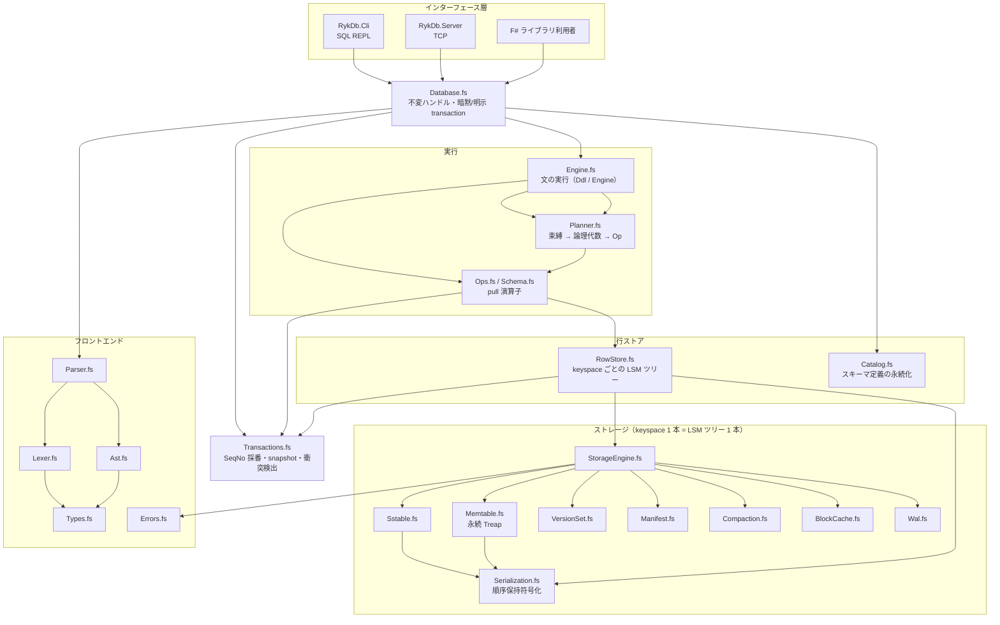
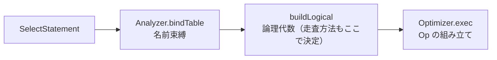

# アーキテクチャ

**.NET 10 / F# 10** で実装された、**LSM-Tree + MVCC + WAL** 組込み RDBMS の内部設計。
SQL の対応範囲は [`sql-reference.md`](sql-reference.md)、
実装時に踏んだ落とし穴は [`gotchas.md`](gotchas.md)、
コーディング規約は [`coding-conventions.md`](coding-conventions.md)、
ビルド・テスト・品質ゲートは [`development.md`](development.md) を参照。

---

## 目次

1. [全体像](#1-全体像)
2. [プロジェクト構成](#2-プロジェクト構成)
3. [フロントエンド](#3-フロントエンド)
4. [型と順序保持エンコーディング](#4-型と順序保持エンコーディング)
5. [実行層](#5-実行層)
6. [行ストア層](#6-行ストア層)
7. [MVCC](#7-mvcc)
8. [ストレージ層](#8-ストレージ層)
9. [データフロー](#9-データフロー)
10. [ファイルレイアウト](#10-ファイルレイアウト)
11. [インターフェース層](#11-インターフェース層)
12. [設計上の制約](#12-設計上の制約)

---

## 1. 全体像



### 設計原則

1. **不変性** — `StorageEngine` / `Version` / `Memtable` / `Catalog` などはすべて値。
   更新は「新しい値を返す」。読み取りはロックを取らず、snapshot は自然に固定される。
2. **失敗は値** — 例外を制御フローに使わず、すべて `Result<'T, DbError>` で返す（[`coding-conventions.md`](coding-conventions.md) §1）。
3. **keyspace シャーディング** — テーブル・索引・カタログがそれぞれ独立した LSM ツリーを持ち、並列性はこの分離で確保する（§6.1）。
4. **バイト順 = SQL 比較順** — キーのエンコーディングが順序保持であることが、LSM の merge・索引・走査すべての前提（§4.2）。
5. **末尾再帰 / 明示スタック** — 要素数に比例する処理はスタックを積まない形で書く（[`coding-conventions.md`](coding-conventions.md) §3）。

### 採用している手法（サマリ）

| 領域       | 手法・アルゴリズム                                                                   | 詳細                                                |
| ---------- | ------------------------------------------------------------------------------------ | --------------------------------------------------- |
| ストレージ | LSM-Tree + **Leveled compaction**（LevelDB / RocksDB 方式）                          | §8                                                  |
| memtable   | **永続 Treap**（優先度はハッシュ由来・決定的）                                       | §8.1                                                |
| SSTable    | ブロック + **restart 配列 + 接頭辞共有** + Bloom filter + Footer 80 バイト           | §8.2                                                |
| キャッシュ | **LRU**（ブロック単位、不変実装）                                                    | §8.3                                                |
| 障害回復   | **WAL（論理ログ）** + MANIFEST / CURRENT の原子的更新                                | §8.5–8.6                                            |
| GC         | **版単位**の SeqNo 判定（ファイル単位では判定しない）                                | §8.7                                                |
| 並行制御   | **ロックレス**: 不変ハンドル + **MVCC（Snapshot Isolation）** + first-committer-wins | §7                                                  |
| キー符号化 | **順序保持エンコーディング**（型タグ・escape・タプル）                               | §4                                                  |
| 索引       | 複合キー（索引列 + 主キー）の prefix 走査                                            | §6                                                  |
| 実行       | **Volcano 方式の pull 演算子**（不変 `Op`）                                          | §5.2                                                |
| 構文解析   | 手書き Lexer + 再帰下降 Parser（式規則は **CPS** で末尾再帰）                        | §3                                                  |
| エラー処理 | `Result` ベース（`>>=` / `result { }` / `protect`）                                  | [`coding-conventions.md`](coding-conventions.md) §1 |
| ハッシュ   | **FNV-1a 64bit** + **splitmix64**（Bloom filter・Treap の優先度）                    | §4.2, §8.1                                          |

### 依存の向き

**上から下への一方向のみ**。
下位モジュールは上位を知らない。

| 層               | モジュール                                    | 知っている層                         |
| ---------------- | --------------------------------------------- | ------------------------------------ |
| インターフェース | `Database.fs` `RykDb.Cli` `RykDb.Server`      | 全部                                 |
| 実行             | `Engine.fs` `Planner.fs` `Ops.fs` `Schema.fs` | `RowStore` `Catalog` `Transactions`  |
| 行ストア         | `RowStore.fs` `Catalog.fs`                    | `StorageEngine` `Transactions`       |
| MVCC             | `Transactions.fs`                             | `Memtable`(`Entry`) `Errors` `Types` |
| ストレージ       | `StorageEngine.fs` とその下                   | `Errors` `Types` `Serialization`     |
| フロントエンド   | `Lexer` `Parser` `Ast`                        | `Types` `Errors`                     |

> **Transactions と RowStore の依存方向**: `Transactions.fs` は `RowStore` を参照しない。
> 依存は **`RowStore` → `Transactions` → `Memtable`** の向きで、 `RowStore` の DML ヘルパ（`insert` / `updateByPrimaryKey` / `deleteByPrimaryKey`）が `Transaction` のバッファへ行・索引を積む。
> commit 時に `TransactionManager.commit` の出力を `RowStore.writeBatches` に渡すのは `Database` / `Engine` / `Catalog`（§7.4）。

### なぜ不変（immutable）か

`StorageEngine` `Version` `Memtable` `Catalog` `BlockCache` のすべてが**不変レコード**で、操作は「新しい状態を返す」形。
これは 3つの要求を同時に満たすための選択。

1. **読み取りが lock を取らない**。
   スナップショットを掴むだけだから。
2. **MVCC の snapshot が自然に固定される**。
   読み取り中に状態が書き換わらない。
3. **型のレベルで「更新を忘れる」ミスを防ぐ**。
   ハンドルは `Database` だけ。

ただし `Ops` の集約処理・`Op.toArray` と `Database.fs` のクライアント層だけは `ResizeArray` / `Dictionary` を使う（[`coding-conventions.md`](coding-conventions.md) §2）。

---

## 2. プロジェクト構成

`Directory.Build.props` は全プロジェクトに共通の設定を流す（`TreatWarningsAsErrors` などのゲートは [`development.md`](development.md) §1）。

### モジュール一覧（`src/RykDb.Core/`）

| ファイル           | 役割                                                                                              |
| ------------------ | ------------------------------------------------------------------------------------------------- |
| `Errors.fs`        | `DbError` / `ErrorKind` / `Result` 合成演算子（`>>=` / `result { }` / `protect`）                 |
| `Types.fs`         | `SqlValue` / `DataType` / `TruthValue`（3 値論理）/ `SqlLiteral` / `Bytes`（バイト列比較）        |
| `Serialization.fs` | 順序保持エンコーディング / `Writer` / `Cursor` / `KeyBuilder` / `Hashing`                         |
| `Memtable.fs`      | 永続 Treap の memtable（`apply` / `getVisible` / `rangeScan`）                                    |
| `Wal.fs`           | 論理ログ WAL（Begin / Batch / Commit / Abort と redo）                                            |
| `BloomFilter.fs`   | SSTable 用 Bloom filter（double hashing）                                                         |
| `Sstable.fs`       | SSTable の構築・読み取り・k-way merge（ブロック / index / Bloom / Footer）                        |
| `VersionSet.fs`    | `Version`（レベルの不変スナップショット）と `VersionEdit`                                         |
| `Manifest.fs`      | MANIFEST / CURRENT の読み書き（原子的更新）                                                       |
| `Compaction.fs`    | Leveled compaction・版単位 GC・孤児ファイルの特定                                                 |
| `BlockCache.fs`    | `(fileNumber, blockId)` → ブロックの LRU キャッシュ                                               |
| `StorageEngine.fs` | LSM ツリー 1 本の公開層（open / put / flush / scan / compact / close）                            |
| `Transactions.fs`  | SeqNo 採番・snapshot・write-write 競合検出                                                        |
| `Ast.fs`           | 式 `Expr` / 文 `Statement` の判別可能共用体                                                       |
| `Lexer.fs`         | 手書きトークナイザ（読み位置は値が持つ）                                                          |
| `Parser.fs`        | CPS 化した再帰下降パーサ（`MaxExpressionDepth = 200`）                                            |
| `RowStore.fs`      | keyspace 束と DML ヘルパ（`Transaction` のバッファへ行・索引を積む）                              |
| `Catalog.fs`       | テーブル・索引定義の永続化                                                                        |
| `Schema.fs`        | 出力列 `OutputColumn` と演算子の出力スキーマ `Schema`                                             |
| `Eval.fs`          | スカラー関数 `Scalar` と式評価器 `Eval`                                                           |
| `Ops.fs`           | pull 演算子 `Op` / `Row` と演算子の組み立て `Ops`（フィルタ・ソート・結合・集約・射影・DISTINCT） |
| `ExecContext.fs`   | 実行時文脈 `ExecContext` とテーブル走査（`table` / `byPrimaryKey` / `byIndex`）                   |
| `DmlOps.fs`        | DML `DmlOps`（INSERT / UPDATE / DELETE）                                                          |
| `Planner.fs`       | 名前束縛 → 論理代数 → `Op`                                                                        |
| `Engine.fs`        | 文の実行（`Ddl` / `Engine.runStatement`）                                                         |
| `Database.fs`      | 公開 API（不変ハンドル・transaction・`StatementResult`）                                          |

### F# のコンパイル順

```
Errors → Types → Serialization → Memtable → Wal → BloomFilter
       → Sstable → VersionSet → Manifest → Compaction → BlockCache
       → StorageEngine → Transactions → Ast → Lexer → Parser
       → RowStore → Catalog → Schema → Eval → Ops → ExecContext
       → Planner → DmlOps → Engine → Database
```

F# はファイルを**コンパイル順に評価する**ため、上から下へ一方向の依存になるよう `.fsproj` の `Compile` を手で並べる
（新しいファイルもこの順に追加する）。

---

## 3. フロントエンド

`Lexer.fs` → `Parser.fs` → `Ast.fs` → `Planner.fs` という一方向のパイプライン。

### 3.1 Lexer — 状態スレッドの字句解析

- `LexState` は `{ Index; Line; Column }` の不変レコード。
  **前進すると新しい値を返す**ので mutable なインデックスを持たない。
- 予約語は `Lexer` の private `keywords` Set、型名は `Parser.typeNames`（`Parser.typeTable` から導出）の Set に分ける
  （`INTEGER` などを予約語にすると列名に使えなくなるため）。
- Blob リテラル `X'0A1B'` の判定は**識別子より前**に置く。
  順序を逆にすると `'ABCD'` が文字列になる。
- コメントは `--`（行末）と `/* … */`（**入れ子可**）。

### 3.2 Parser — CPS 化した再帰下降

式構文規則は定義上お互いを呼び合う（`parseExpr → parseOr → parseAnd → … → parsePrimary`）ため、
普通の再帰下降では相互再帰が必ず非末尾再帰になる。
引数を継続に変えて末尾化する。
CPS・継続の hoist・深さ制限の一般則は [`coding-conventions.md`](coding-conventions.md) §3 を参照。

### 3.3 Ast

判別可能共用体 `Expr` / `Statement`。
式は**列参照の修飾子を保持したまま**持ち、束縛（`Binder.qualify`）の段階で解決する。

`Expr.columnRefs` と `Expr.isAggregate` は**明示スタック**で走査する。
`go a @ go b` とすると再帰呼び出しが末尾位置に来ないうえ O(n²) になる。
`Expr.toDisplayString` も継続の連列表（`PrintStep`）で末尾再帰にしている。

---

## 4. 型と順序保持エンコーディング

### 4.1 10 の型

`NULL` / `BOOLEAN` / `INTEGER` / `REAL` / `DECIMAL` / `TEXT` / `BLOB` / `DATE` / `TIMESTAMP` / `UUID`。

`SqlValue` は実行時の値を表し、`NULL` は他のすべての型と区別できる特別なケース。
`TruthValue` で SQL の 3値論理（`True` / `False` / `Unknown`）を表現する。

### 4.2 順序保持符号化（LSM 採用の最大の制約）

LSM はキーのマージを**バイト列比較**で行う。
したがって **「バイト順 = SQL 比較順」** でなければならず、これが設計の中心制約。

型タグを SQL 照合順に単調増加させている。

| 型        |   タグ |     | 型          |   タグ |
| --------- | -----: | --- | ----------- | -----: |
| `Null`    | `0x00` |     | `Date`      | `0x30` |
| `Bool`    | `0x10` |     | `Timestamp` | `0x40` |
| `Int`     | `0x20` |     | `Text`      | `0x50` |
| `Real`    | `0x21` |     | `Blob`      | `0x60` |
| `Decimal` | `0x22` |     | `Uuid`      | `0x70` |

型タグの後は「型ごとのペイロード + 終端 `0x00`」が続く
（`Serialization.fs` の `OrderPreserving` が実装）。

| 型          | ペイロード                                                                                                   |
| ----------- | ------------------------------------------------------------------------------------------------------------ |
| `NULL`      | なし（タグ + 終端のみ）                                                                                      |
| `BOOLEAN`   | 1バイト（0 / 1）                                                                                             |
| `INTEGER`   | 8バイト BE。`v + 2⁶³` の単調写像（`mapInt64`）                                                               |
| `REAL`      | 8バイト BE。IEEE-754 ビットの順序写像（負は全ビット反転、正は符号ビット反転）。NaN は正の quiet NaN に正規化 |
| `DECIMAL`   | 符号（負数は反転）+ 指数 8バイト（順序写像）+ 桁列 29バイト（右詰め。負数は 9 − 桁で反転）                   |
| `DATE`      | `DateOnly.DayNumber`（0001-01-01 基準の日数）を `INTEGER` と同じ写像で                                       |
| `TIMESTAMP` | `DateTime.UtcTicks` を同じ写像で                                                                             |
| `TEXT`      | UTF-8 バイト列を escape（0x00 → 0x00 0xFF）                                                                  |
| `BLOB`      | 生バイト列を escape                                                                                          |
| `UUID`      | RFC 4122 の 16バイト BE 順                                                                                   |

- `TEXT` / `BLOB` は埋め込み `0x00` を `0x00 0xFF` に escape し、終端に `0x00` を置く。
  型タグはすべて `0xFF` 未満なので escape 列が「並びがここで終わった」作用を持ち、正しい大小関係になる。
- この escape により、**生のバイト列の前方一致 = 正しい接頭辞一致**になり、 range scan の下限と索引の prefix 走査に使える。
- 複合キーは escape 付きタプル符号化（`("a","bc") < ("ab","c")` を満たす）。

escape の正しさをバイト列で確認した例（フィールド `["ab", "z"]` と `["ab\0", "a"]`）:

```
["ab","z"]   = 50 'a' 'b' 00 50 'z' 00
["ab\0","a"] = 50 'a' 'b' 00 FF 00 50 'a' 00
              位置 4: 0x50 < 0xFF なので前者が小さい -> "ab" < "ab\0" で正しい
```

`Serialization.fs` は書き込み用の `Writer`（不変のチャンク列）と読み込み用の `Cursor`（読み位置を値に持つ）、ハッシュ（FNV-1a + splitmix64）を持つ。

---

## 5. 実行層

### 5.1 Planner — 束縛 → 論理代数 → Op



パイプラインの実装は `Planner.fs` の 3 段。

1. `Analyzer.bindTable` — FROM / JOIN の各テーブルを `TableBinding`（スキーマ + 識別名）にする。
2. `Optimizer.buildLogical` — 式を `Binder.qualify` で束縛し、`Predicate.splitConjuncts` で WHERE を分解、
   `Analyzer.chooseScanMethod` で走査方法を決めて論理代数を組む。
3. `Optimizer.exec` — 論理代数を `Op` に落とす（`execScan` / `execJoin` など）。

#### 束縛（Binder）

- パーサは裸の名前を `Expr.Name` として作る。
  `Binder.qualify` が**一意に決まる場合だけ**修飾名（`t.age`）へ直し、曖昧なら修飾せず残して実行時に「列 'age' が曖昧です（該当: …）」で落とす。
- `FROM t AS x` の別名は、テーブル名の解決用に実名と別名の両方で `ExecContext.Schemas` に登録される。
  列の修飾子は**別名**（`x.id`）になり、比較は大文字小文字を区別しない。
- WHERE は `Predicate.splitConjuncts` で AND を平坦化してから扱う。

#### 論理代数の構築（buildLogical）

1. FROM が無ければ `Values`（`SELECT 1` は 1行の定数）。
2. WHERE を全テーブル連結のスキーマで束縛 → conjunct へ分解し、先頭テーブルを `buildScan`。
3. JOIN を FROM の順に**左深く**積む。
   右は `buildScan`（INNER は右ローカルの WHERE を pushdown、LEFT は null 供給側なので JOIN の上へ回す）。
   ON は「左の連結 + 右」のスキーマで束縛。
4. どのテーブルにも属さない conjunct（例 `a.v = b.v`）は JOIN の上の `Filter` にする。
5. 集約 → 並び替え → 射影 → DISTINCT → LIMIT の順に被せる。

補足:

- **集約の検出**は SELECT 項目と ORDER BY から（`Ops.aggCalls`）。
  GROUP BY があるか集約呼び出しがあれば `Aggregate` を作り、HAVING があればその上に `Having` を置く。
- **ORDER BY に書けるのは列の直接参照だけ**（式は実行時にエラー）。
- **LIMIT / OFFSET は整数リテラルのみ**（それ以外は 0 = 制限なし扱い）。
  `LIMIT` は最外層に置き、`OFFSET` を先、`LIMIT` を後に適用する。

#### 最適化ルール（実装済みの範囲）

| ルール          | 内容                                                                                                                                                                                                 |
| --------------- | ---------------------------------------------------------------------------------------------------------------------------------------------------------------------------------------------------- |
| Filter pushdown | WHERE の conjunct を「そのテーブルのみを参照するもの」だけそのテーブルの直下の `Filter` へ落とす（`buildScan`）。LSM はレベル間で k-way merge するので常に安全。ただし **JOIN の ON 句は落とさない** |
| 走査方法の選択  | 下記「走査方法の選択」                                                                                                                                                                               |
| 評価順の固定    | 集約 → 並び替え → **射影** → DISTINCT → LIMIT                                                                                                                                                        |

> `DISTINCT` を射影の**前**に置いてしまうと `(id, g)` の組を重複排除してしまう。
> `LIMIT` は常に最外層に置き、`OFFSET` を先に `LIMIT` を後に適用する。

#### WHERE の置き場所（JOIN があるとき）

| 述語                                       | 置き場所                                                               |
| ------------------------------------------ | ---------------------------------------------------------------------- |
| 先頭テーブルに局所                         | そのスキャンの直下（`Filter`）                                         |
| INNER JOIN の右に局所                      | 右部分木の直下（`rTree` に含めて実行する）                             |
| LEFT JOIN の右に局所                       | **JOIN の上**（null 供給側。入力へ落とすと NULL 拡張行の可否が変わる） |
| どのテーブルにも属さない（例 `a.v = b.v`） | JOIN の上                                                              |

#### 走査方法の選択（`chooseScanMethod`）

```
WHERE に「列 = 定数」の等価述語があるか（AND を平坦化し、左から順に最初の 1つを見る）
  ├─ 主キー列なら          → PkLookup
  ├─ 単一列索引と完全一致なら → IndexLookup
  └─ それ以外              → SeqScan
```

**範囲走査は使わない**。
`ScanMethod.RangeScan` は型としては存在するが Planner から返されることはなく、万一 `Optimizer.exec` に届いても `SeqScan` に落ちる。

- 定数側に使えるのは**リテラルだけ**（`-1` のような符号つきリテラルは可。式・関数は不可）。
- 対象になるのは **`columns` が 1列の索引**だけ（複合索引は Leftmost prefix も考慮しない）。
- 主キーは列名で判定し、値を 1つだけ持つ `PkLookup` を作る。

#### 結合アルゴリズム

実行時の結合は **入れ子ループ（`Ops.innerJoin` / `Ops.leftJoin`）だけ**。
hash join / index nested loop など**結合アルゴリズムの自動選択は未実装**で、
`Optimizer.exec` から呼ばれる演算子もこの 2つだけ。

結合順序は `FROM` に書かれた順（選択性による並べ替えも未実装）。

#### 論理代数 → Op（`Optimizer.exec`）

- `Scan` は `execScan` が `ScanMethod` に応じて `ExecContext.table` / `ExecContext.byPrimaryKey` / `ExecContext.byIndex` へ振り分ける。
- `Join` は左を「現在のスキーマから右テーブルを除いたもの」、右を「右テーブル 1つだけのスキーマ」で実行し、`Ops.innerJoin` / `Ops.leftJoin` に渡す（ON は左行 + 右行で評価）。
- `Filter` / `Sort` / `Project` は子の**出力スキーマ**（`outputOf`）を求めてから掛ける。
  集約の後は行の並びが「groupBy の値 + 各集約の結果」に変わるため、「入力スキーマ（テーブル定義）」と取り違えると `SELECT SUM(age)` が引数を評価できず `NULL` になる。
- `Having` は集約後の行を**位置で読み替えて**から評価する（`Ops.havingFilter`）。
- `Limit` は `Op.skip`（OFFSET）→ `Op.take`（LIMIT）の順、`limit = 0` は「LIMIT なし」。
- 最後に `Plan.runSelect` が `Op.toArray` で行を集め、ヘッダは `Schema.projectHeader`（別名優先、`*` は列名）で組み立てる。
  `*` / `t.*` の列展開は `Schema.expandStar` に一本化している（ヘッダと射影の式が同じ列を共有するため）。
  `*` は修飾なしの列名、`t.*` は修飾つきの表示名で出す。

### 5.2 Ops — pull 演算子

#### なぜ pull 方式か

push（差し出し）だと「1行だけ欲しいのに全行計算した」ことになり、`LIMIT 1` や `WHERE` の早期打ち切りが効かない。
pull は「次の 1行」を上流に要求するので、上流が自然に止まる。
F# の `seq { }` は内部に mutable な列挙子を持つので、本実装では使わず、「残りの計算」を値として持ち回る不変な pull 演算子 `Op`（Volcano 方式 / イテレータモデル）で組む。

`Step` は**即値**（計算済みの 1行 + 続き）、`Compute` のみが遅延する。
`Compute` は「次に 1行を返す関数」なので、要求されるまで計算しない。
`Op.ofArray` は 1行ずつ `Compute` を繋ぐので、行数ぶんのスタックを積まない。

一方で、**ソート・集約・結合・スキャンは Op を組み立てる時点で入力を materialize** する
（下表の「遅延」列を参照）。

`Ops` モジュールの演算子は以下のとおり。

| 演算子                                           | 役割                                         |
| ------------------------------------------------ | -------------------------------------------- |
| `Op.ofArray` / `ofRow`                           | 材料化済みの行を流す                         |
| `Op.map` / `filter`                              | 1 対 1 / 1 対 0 の変換                       |
| `Ops.project`                                    | 射影（`*` / `t.*` の展開を含む）             |
| `Ops.sortBy`                                     | ソート（メモリ上に実体化）                   |
| `Op.take` / `Op.skip`                            | LIMIT / OFFSET                               |
| `Ops.innerJoin` / `leftJoin`                     | 入れ子ループ結合                             |
| `Ops.aggregate`                                  | 集約（`groupBy` 値 + 各集約結果 の行を生成） |
| `Ops.distinct`                                   | 重複除去                                     |
| `ExecContext.table` / `byPrimaryKey` / `byIndex` | 走査                                         |

遅延の持ち方が演算子ごとに違う。

| 演算子                                         | 遅延                                                                        |
| ---------------------------------------------- | --------------------------------------------------------------------------- |
| `Op.ofArray` / `ofRow`                         | `ofArray` は `Compute` で 1行ずつ（組み立て時に全行分のスタックを積まない） |
| `Op.map` / `Op.filter` / `Op.take` / `Op.skip` | `Compute`。LIMIT / WHERE の早期打ち切りが効く                               |
| `Ops.project`                                  | `Compute`（1行ずつ）                                                        |
| `Ops.sortBy` / `Ops.aggregate`                 | **Op 構築時**に全件をメモリに読む（実体化）                                 |
| `Ops.distinct`                                 | 既出キーの `Set` を持ち回る（出現順を保持）                                 |
| `Ops.innerJoin` / `leftJoin`                   | 右を materialize し、左を 1行ずつ流す入れ子ループ                           |
| `ExecContext.*`                                | スキャン結果を配列で受け `Op.ofArray` で流す（snapshot は生成時に固定）     |

`DISTINCT` と集約のグループ化は同じキー（`Row.keyOf` = 値の SQL リテラル表記を `U+0001` で連結。
NULL 同士は等しい扱い）で行う。

#### 演算子の共通規約

- `Op.map` / `filter` / `take` / `skip` は「次を要求されたときだけ 1段進む」形で、残りの継続も自分自身へ繋ぎ直す
  （継続をそのまま渡すと変換が 1行だけに効くバグになる）。
- エラーは `Error` をそのまま返して列挙を打ち切る（例外は使わない）。
- `Op.toArray` は `ResizeArray` + `match` 直下の再帰で回す
  （`>>=` を重ねると末尾呼び出しが効かず 10万行でスタックオーバーフロー。[`coding-conventions.md`](coding-conventions.md) §3）。

#### 走査（`ExecContext`）

- `ExecContext` は `{ Store; Visible; Schemas; Catalog }`。
  `Visible`（snapshot の SeqNo）は Op を作るときに 1回だけ決まる。
- `ExecContext.table` = `Dml.scanByPrimaryKey`（`RowStore.fs` の Dml ヘルパ。主キー順の全走査）。
  `ExecContext.byPrimaryKey` = `Dml.getByPrimaryKey`（ポイント検索、無ければ空 Op）。
  `ExecContext.byIndex` = `Dml.scanByIndexPrefix`（索引の prefix 走査。非一意索引でも全行を返す）。
- **スキャンは結果を配列で受け取る**（遅延イテレータではない）。
  Op としては 1行ずつ流れるので `LIMIT` は後段を早期に打ち切れるが、ストレージの読み出しはスキャン生成時に終わっている（§12.2）。

#### 集約・ソート・射影の内部

- 集約（`Ops.aggregate`）は全行を読み、グループキー → 行リストの表を作って**最初に現れた順**に 1行ずつ返す。
  出力は「GROUP BY の値 + 各集約の結果」の並び。
- `SUM` / `AVG` は `decimal` で累積する（`REAL` 混在時は `double`）。
  `COUNT(列)` は NULL を数えず、`COUNT(*)` は数える。
  空グループの `SUM` / `AVG` / `MIN` / `MAX` は `NULL`、`COUNT` は 0。
- `SUM` は数値列なら `DECIMAL`（`REAL` 混在時のみ `REAL`）、`AVG` は常に `REAL` を返す。
  `COUNT(DISTINCT …)` の DISTINCT フラグは現状無視される（`COUNT(列)` と同じ）。
- ソート（`Ops.sortBy`）はキーを「列インデックス + 向き」に解決して `Array.sortWith` で並べる。
  ORDER BY に書けるのは**列の直接参照だけ**（式はエラー）。
  解決は修飾つき（`t.age`）を優先するので、集約後の出力（列名が `SUM(t.age)` になる）でも動く。
- 射影（`Ops.project`）は `*` / `t.*` を列参照へ展開する。
  入力が集約結果のときは `substituteAggs` で位置に読み替えてから評価する。

#### DML（`DmlOps`）

DML は pull 演算子ではなく、`Transaction` を積み上げて件数を返す実行関数（§9.2）。

- `insert` — 列順・`DEFAULT` / `NULL` の充足・`SqlValue.coerce` による型強制を行い、
  行ごとに `Dml.insert` でバッファへ積む（最終確認は `TableSchema.validateRow`）。
- `update` — 全行をスキャンして WHERE を評価し、代入式は「現在の行」で評価して `Dml.updateByPrimaryKey` へ。
  **主キー列の書き換えは未対応**（`sql-reference.md` 参照）。
- `delete` — 全行をスキャンし、WHERE に合う行の**主キー + 全索引に tombstone** を書く。

いずれも書き込みは `Transaction` のバッファに溜まり、**commit 時にだけ** RowStore へ届く。

#### snapshot は Op 生成時に 1回だけ固定する

各演算子は実行中に「今この瞬間の DB の時刻」を見てはいけない。
途中で他トランザクションが commit すると、同じクエリの前半と後半で見えるデータが変わる（read committed になり、JOIN が壊れる）から。
よって `ExecContext.Visible` は Op を作る時点で確定させ、渡された値だけを使う。

### 5.3 式の評価

`Eval` モジュールがスカラー式を 3値論理つきで評価する。
集約呼び出しはここでは評価せず、`Ops.aggregate` / `Ops.project` が先に計算してから結果を定数として読み替える
（`Ops.substituteAggs`）。

**3値論理と NULL**

- 比較はオペランドに NULL があると `NULL`（UNKNOWN）を返す。
  `AND` は左が `FALSE` なら右を評価せず `FALSE`、`OR` は左が `TRUE` なら右を評価せず `TRUE`（短絡評価）。
- `WHERE` / `HAVING` は UNKNOWN を**偽**として扱う（`Eval.matches`）。
- `BETWEEN` は `>=` と `<=` の AND として 3値論理で評価する。
- `IN` は「一致する要素があれば TRUE、
  一致せず NULL（UNKNOWN）を 1 つでも見れば UNKNOWN、それ以外は FALSE」。
  空の `IN` は FALSE（`NOT IN` は真偽が反転）。
- `CASE` の WHEN は `TRUE` のときだけ THEN を返し、`NULL` / UNKNOWN は次の WHEN へ進む。

**演算と関数**

- 算術は NULL を伝播する。`0` による除算・剰余は `ConstraintViolation` エラー。
- 型決定: `INTEGER` x `INTEGER` → `INTEGER`、`DECIMAL` x `DECIMAL` → `DECIMAL`、片方が `REAL` なら `REAL`。
- `||`（`Concat`）は両辺の表示文字列を連結する（NULL は NULL）。
- `LIKE` は `%` / `_` の手書き照合（ESCAPE 非対応、大文字小文字は区別。
  バックトラックしない 1パスの照合なので、`%` が多いパターンでも無限ループしない）。
- スカラー関数は `UPPER` / `LOWER` / `LENGTH` / `ABS` / `COALESCE` / `TRIM` / `ROUND`。
  未知の関数・引数個数の不一致はエラー（`ROUND` は `INTEGER` / `REAL` のみ対応）。
- 集約のエラーは握り潰され `NULL` になる（`Ops.aggregate` の `| Error _ -> SqlValue.Null`）。
- `AVG` は `SUM ÷ COUNT` を実行時に計算する（結果は `REAL`）。

---

## 6. 行ストア層

### 6.1 keyspace シャーディング

1つのテーブルは「主キーの LSM ツリー」+「索引ごとの LSM ツリー」で構成される。
それぞれが**独立したディレクトリ・独立した WAL・独立した memtable** を持つ。

| keyspace      | 中身                     | キー                                           |
| ------------- | ------------------------ | ---------------------------------------------- |
| `t:<table>`   | テーブルの行（主キー順） | `KeyBuilder.ofValues 主キー列`                 |
| `i:<index>`   | 索引エントリ             | `KeyBuilder.ofIndexAndPrimary 索引列 主キー列` |
| `__catalog__` | スキーマ定義             | `table:<名前>` / `index:<名前>`                |

```
<root>/<base64(keyspace)>/
  MANIFEST-000001     世代ごとの VersionSet 定義
  CURRENT             有効な MANIFEST 番号
  000123.sst          データファイル
  000002.wal          先行ログ
```

`base64` にするのは keyspace 名（`t:people`）がそのままではディレクトリ名に使えないためで、
`t:` / `i:` 以外の接頭辞は keyspace とみなさず無視する。

**シャーディングの意味:**

- テーブル間の書き込みは完全に並列（ツリーが別だから lock が衝突しない）
- 各ツリーが独立に flush / compaction できる
- 1つのテーブルが壊れても他に影響しない
- Bloom filter による独立な枝刈り

### 6.2 行の削除

削除は **主キー + 全索引に墓碑（tombstone）** を書く
（keyspace を分けた代償として必要な処理。書き忘れると何が起きるかは [`gotchas.md`](gotchas.md) §11.3）。

### 6.3 Catalog

カタログは `__catalog__` keyspace に「1キー = 1定義」で保存される。

```
[table:lenPrefixed][unique:1][colCount:varint] ...
[flags]  bit0 = NOT NULL / bit1 = PRIMARY KEY / bit2 = UNIQUE
```

**SQL テキストではなく構造化した定義を保存する**理由は 2つ。

1. `DEFAULT` の式や制約をあとから変えられる。
   SQL テキストだと「定義が 1つ変わっただけで全部のパースをやり直す」になる。
2. 復元した型が `TableSchema` として**同じ形**になる。
   AST を復元してから `TableSchema.ofCreateTable` に戻すと、 DEFAULT のリテラル表現が往復で壊れる可能性がある。

既存の LSM（Treap / SSTable / WAL / Compaction）を全部流用できるので、DDL 用の永続化層を別に書かなくて済む。
書き込みと commit の一貫性も既存エンジンからそのまま得られる。

- キーは `table:<名前>` / `index:<名前>`（索引定義は属するテーブル名を含む）。
- `TableDefinition`（永続化形）と `TableSchema`（実行用）を相互変換する。
- `Catalog.eqName` は `OrdinalIgnoreCase` — **SQL の識別子は大文字小文字を区別しない**。
- **注意** `Catalog.toSchema` は `Indexes = []` で埋まる。
  実行系には `Catalog.indexSchemasOf` 経由で載せ直す必要がある（忘れると索引検索が常に SeqScan になる）。
- **DDL は即時に効く**。
  `CREATE TABLE` はカタログを書き換えた時点で反映され、暗黙 transaction の開始時にカタログを読み直して直前の DDL を受け取る。

---

## 7. MVCC

`Transactions.fs` が担うのは 3つ。

### 7.1 採番

コミット済みの論理時計を 1つに並べる。**「DB の時刻」** はこれ。

- 採番は `TransactionManager.NextSeqNo` が一元管理し、commit 時に `Transaction.toEntries` がバッファの各エントリへ 1つずつ SeqNo を振る（1 から単調増加）。
- 最後に振った番号が `LastCommitSeqNo`（= DB の現在時刻）になり、次の snapshot の値になる。
- 起動時は保存済みの SeqNo（`RowStore.lastSeqNo`）から `TransactionManager` を作り直す。
  **巻き戻すと、新しい書き込みが古い SeqNo として隠される**。

### 7.2 可視性

> snapshot とは「SeqNo が S 以下の書き込みだけ見える」こと。

実装は `StorageEngine.getAt` / `scanAt` に `visible: uint64 option` を渡すだけで、中身を SeqNo フィルタ 1つで絞る。
永続データ構造 versioning は使わない。

`Snapshot.noLimit`（`uint64 option` の `None`）が「制限なし」を表す。
`Some s` のときだけ `SeqNo <= s` で判定し、`None` ならフィルタを省く（§7.2 の `visible`）。

### 7.3 競合検出

2つの transaction が同じキーに書いたら、**後から commit した方を失敗**させる（first-committer-wins）。
`LastCommitted : Map<keyspace:key, SeqNo>` を commit 時に更新し、transaction の snapshot より大きい SeqNo の同一キーがあれば `ConflictError` にする。

競合キーの照合は `keyspace + ":" + base64(キー)` の文字列で行う。
`LastCommitted` はプロセス内の状態で、ディスクには残さない
（commit 済みのデータは再起動後も WAL / SSTable から読める）。

### 7.4 書き込みは commit 時にしかエンジンへ届かない

```
BEGIN
  ├─ Transaction.Buffers : Map<keyspace, Map<key, SqlValue array option>>
  └─ （読みはバッファを見る → read-your-writes）
COMMIT
  ├─ TransactionManager.commit → 競合検出 → WriteBatch
  └─ RowStore.writeBatches → StorageEngine.writeBatch（keyspace ごとに 1本）
```

これにより次の 3つが同時に保証される。

- commit order の一意性
- abort した transaction の書き込みが DB に一切残らない
- 自分の書き込みを commit 前に読める

読み取りは lock を取らず（`StorageEngine` が不変だから）、書き込みの直列化はこのモジュールの中だけに閉じている。
**keyspace 単位の並列性は `RowStore` が持つ** — keyspace が違えば commit も衝突もしない。

### 7.5 .Database の transaction モデル

`Execute` / `Query` は**暗黙の transaction**で実行し、自動的に commit する。
`Begin()` 以降は `Commit()` / `Rollback()` するまで同じ transaction を使う。

> **注意** SQL 文としての `BEGIN` / `COMMIT` / `ROLLBACK` は**構文としては受理されるが、実行しても何も起きない**（`Engine.runStatement` が no-op）。
> 明示 transaction はライブラリ API の `db.Begin()` / CLI の `.commit` `.rollback` を使う。

### 7.6 同時実行制御 — ロックは 1つもない

`src/` 全体に `lock` / `Monitor` / `SemaphoreSlim` / `Mutex` / `Interlocked` は存在しない。
同時実行制御は次の 4層の組み合わせで成り立っている。

| 層                         | 役割                           | 詳細                                                                                                                    |
| -------------------------- | ------------------------------ | ----------------------------------------------------------------------------------------------------------------------- |
| 1. 不変レコード            | **読み取りがロックを取らない** | `StorageEngine` / `RowStore` / `DbState` はすべて値。読むときは掴んだスナップショットをそのまま見る（§1「なぜ不変か」） |
| 2. `Database` ハンドル     | **書き込みの直列化の単位**     | `Execute` は新しい `Database` を返す。直列化は「ハンドルを持ち替える」ことで行われ、ロックは介在しない                  |
| 3. MVCC + 競合検査         | **commit の一意性**            | 採番と first-committer-wins の競合検査が `TransactionManager.commit` の 1経路を通る（§7.1–7.4）                         |
| 4. keyspace シャーディング | **並列性の供給源**             | `t:` / `i:` / `__catalog__` は独立ツリー。lock-free 構造を採用しなくてよい理由（§6.1, §12.1）                           |

重要な含意は 2つ。

1. **並行利用は「スレッド / セッションごとに `Database` ハンドルを持つ」のが正**。
   同じハンドルを複数スレッドで `Execute` すると状態はマージされず、**後から書き換えた方だけが残る**
   （片方が黙って失われる）。
2. **commit の直列化は「その経路を単一に通る」という規約**であって、mutex による保護ではない。
   ハンドルの受け渡し規約が破られた場合に保護されるものはない、と理解する。

外周はすべて逐次処理。

- **compaction は同期**（バックグラウンドスレッドなし）なので、reader とファイル削除を争わない（§12.2）
- **WAL は `FileMode.Append, FileShare.Read`** のみ（`Wal.fs`）。書き込み側は常に 1本の経路
- **TCP サーバは完全逐次** — `AcceptTcpClient` → 1接続を処理 → 次の accept（§11.3）
- **プロセス間アクセスは非対応**（1プロセス前提）。**ロックファイルは作成しない**（§10）

---

## 8. ストレージ層

`StorageEngine` が **LSM ツリー 1本**を公開する層。

| 既定値                        | 値     |
| ----------------------------- | ------ |
| `DefaultMemLimitBytes`        | 64 MiB |
| `DefaultCacheFiles`           | 32     |
| `BloomFalsePositiveRate`      | 0.01   |
| `Levels.Count` / `Levels.Max` | 7 / 6  |

### 8.1 Memtable — 永続 Treap

memtable は追記のみなので、レベルごとの insertion buffer として使う。
構造は「キー昇順・同一キーは SeqNo 降順」で探索・全順序走査できる平衡二分探索木。

**なぜスキップリストではなく Treap なのか**。
永続スキップリストも書けるが、パスコピー（探索パスだけを複製する方式）では次の問題がある。

1. 挿入点の「前」ノードが探索パス上に無く、level 0 の鎖が壊れる。
2. head は全レベルに現れるので、レベルごとに別々にコピーすると採用する側だけが未更新になる。
3. 前ノードも複製すれば O(n) になり、スキップリストの意味を失う。

Treap は根から再構築するのでこの問題は構造的に発生しない。
優先度は乱数ではなく**ハッシュから決める**
（決定的で、シードの取り違えが起きない）。

> ポイント検索に `rangeScan` を使うと O(n) になる話は [`gotchas.md`](gotchas.md) §4.1 を参照。

走査は結果を溜めない。左→自身→右を 1本の作業リスト（`Work`）に積んで回り、
それを `Seq.unfold` の状態として持ち回る遅延 seq を返す（`scanFrom`）。
`rangeScan` はそれをそのまま返し、`toArray` だけが `Seq.toArray` で実体化する。
余分なメモリは作業リスト＝木の高さ分（期待 O(log n)）だけで、`limit` を付ければ必要な分しか辿らない。

- **不変条件**: 「キー昇順・同一キーは SeqNo 降順」。
  `compareKeys` がこの全順序を定義する。
- **優先度**: `mix(mix(FNV-1a(key) ^ (SeqNo × 0x9E3779B97F4A7C15)))`。
  乱数シードを使わないため、同じ入力からは常に同じ木になる（決定的）。
- **更新**: `split` / `insertNode` はたどったノードを明示スタックに積み、引き返しながら組み直して末尾再帰にする
  （[`coding-conventions.md`](coding-conventions.md) §3）。
- **走査**: `scanFrom` が左→自身→右を作業リスト（`Work`）に並べた遅延 seq を返す
  （状態は `struct (Work list * int)`＝作業リストと出した件数。結果の蓄積も `List.rev` も無い）。
- **ポイント検索**: `getVisible` が「snapshot 以下で SeqNo 最大の版」を O(log n) で返す。
  ポイント検索に `rangeScan` を使うと O(n) になるため使わない。

### 8.2 SSTable

```
[Block 0][Block 1]...[Block N-1]
[Meta block]        min_key / max_key（長さ付き）
[Bloom filter]
[Index block]       ブロックごとに (最終キー, オフセット, 長さ)
[Footer 80 bytes]   各セクションの位置・長さ・エントリ数・チェックサム
```

各ブロックは LevelDB 風の restart 配列を持つ。

```
[entry]*
[restartOffset:4]...*
[numRestarts:4]

entry = [shared:varint][nonShared:varint][valueLen:varint][key の非共有部分][value]
```

同じ接頭辞を持つ連続エントリは共有して圧縮する。
可変長キーのため slotted page / overflow ページの仕組みは不要。

**並び**は「キー昇順・同一キーは SeqNo 降順」（`SstEntry.compare`）。
検証時の注意は [`gotchas.md`](gotchas.md) §11.5 を参照。

定数と実装の要点:

| 項目                 | 値・内容                                                                                                                                     |
| -------------------- | -------------------------------------------------------------------------------------------------------------------------------------------- |
| ブロックのエントリ数 | `EntriesPerBlock = 128`                                                                                                                      |
| restart 間隔         | `RestartInterval = 16`                                                                                                                       |
| チェックサム         | **FNV-1a 32bit**（CRC32C ではない。Footer は Footer より前の全バイトを対象）                                                                 |
| Footer               | `magic(8) version(4) maxSeqNo(8) indexOff(8) indexLen(8) bloomOff(8) bloomLen(8) metaOff(8) metaLen(8) entryCount(8) checksum(4)` = 80バイト |
| `maxSeqNo`           | ファイル内の最大 SeqNo（記録用。GC の判定はエントリ単位。§8.7）                                                                              |
| Bloom filter         | 件数と誤検出率から m と k を決める double hashing（`h1 + i × step`、step は奇数）。読む側は `Sstable.mayContain`                             |
| ポイント検索の順路   | Bloom filter → index block（`LastKey` の二分探索）→ 該当ブロックだけ（`next` を呼ぶまでブロックを読まない）                                  |

ファイルは `Sstable.build` が組み立て、`Sstable.openTable` が読み出す。
読み出しは `BlockCache`（ブロック番号 → 復号済みバイト列）を経由する。

走査は `SstScan`（`next` を呼ぶまでブロックを 1個も読まない遅延 pull）で行い、
`rangeScan` は `LastKey` の二分探索で `startKey` を含み得る最初のブロックへ飛ぶ
（ブロックの解析失敗は、そのブロックが必要になった `next` が `Error` を返す）。
`Sstable.entries`（= `rangeScan` + `SstScan.toArray`）だけが全件を配列に実体化する。
下限の適用は `Memtable.rangeScan` と同じく「読む側」が担い、merge 後に絞り直さない（§8.1）。

### 8.3 BlockCache

`(fileNumber, blockId) -> byte[]` の LRU。
**不変実装**で、順序は「新しい順」の `list` として持ち、要素数は `Map` で数える。
上限は**ブロック数**で数える（バイト数で数えると全ブロックを走査することになるため）。

SSTable はブロック圧縮しない（設計方針）ので、読んだブロックをそのままメモリに載せる。

- 既定の上限は `DefaultCacheFiles = 32`。カウントするのは**ブロック数**。
- compaction で入力ファイルを消したら `invalidateFile` で該当ファイルのブロックを捨てる。

### 8.4 VersionSet

`Version` は「レベルごとのファイル集合の**不変スナップショット**」。

- `FileMetaData.mightContain key` は Bloom より粗い判定（`Smallest ≤ key ≤ Largest`）。
- `filesForPointLookup` はポイントルックアップ用のファイル順（新しい順）を返す。
- **ファイル追加・削除は新しい `Version` を返す**ので、読み取り中に状態が書き換わらない。

`VersionEdit` は Version の変更履歴で、直列化されて MANIFEST に書かれる。
**`NextFileNumber` は MANIFEST に残らない**
（`applyAll` は `Version.empty` から作り直すので 1に戻る）。
復旧時には `maxFileNumberOnDisk + 1` で必ず上へ進める必要がある
（巻き戻すとデータを失う話は [`gotchas.md`](gotchas.md) §4.4 / §11.2）。

レベル構成と容量上限（`CompactionOptions.defaults`）:

| レベル | 役割                                   | 容量上限                                    |
| ------ | -------------------------------------- | ------------------------------------------- |
| L0     | flush の出力先（キー域の重なりを許す） | なし                                        |
| L1〜L5 | 1 ファイル = 1 キー域                  | 10 MiB / 100 MiB / 1 GiB / 10 GiB / 100 GiB |
| L6     | 最下位                                 | 1 TiB                                       |

`pickCompaction` は L1 から順に「そのレベルの総バイト数 > 上限」の最初のレベル L を選び、出力先を L+1 にする。
実際の入力は `Compaction.selectInputs` が「レベル L の全ファイル
（最大 `MaxInputFiles = 32`）」+「次レベルでキー域が重なるファイル」として確定する。
ポイント検索のファイル順は「新しいレベルのほうが先（L0 が最新）、同レベルではファイル番号の降順」（`filesForPointLookup`）。

### 8.5 Manifest — 唯一 atomic 更新を要するファイル

```
CURRENT           「1行の有効な MANIFEST 番号」
MANIFEST-000001   追記専用の VersionSet 定義
```

`CURRENT` の更新は「`CURRENT.tmp` へ書き込んでから `File.Move(上書き)` で置き換える」原子的な書き換え
（`Manifest.writeCurrent`）。書きかけの `CURRENT` が残らないので、クラッシュ後も
`CURRENT` は**有効な** manifest 番号のどちらかを指す。
なお **fsync はしていない**ので、電源断に対しては「rename 済みか否か」までが保証範囲。

`Manifest.openOrCreate` が返すのは「**有効な** manifest 番号」で `+1` しない。
`+1` すると別ファイルを指し、追記先がずれて復旧が空になる。

復旧時は `applyAll` が `Version.empty` から VersionEdit 列を再適用して Version を作り直すため、`NextFileNumber` は 1 に戻る。
`openDatabase` が `maxFileNumberOnDisk + 1` まで進め直すのはこのため（§8.4）。

### 8.6 WAL — 論理ログ

ページイメージではなく更新内容を記録する。

```
Begin(txnId) / Batch(txnId, entries) / Commit(txnId) / Abort(txnId)
```

1レコードのファイルレイアウト:

```
[payloadLength:u32LE][checksum:u32LE(FNV-1a)][payload]
```

- `payloadLength` が残りバイト数を超える → 書きかけ（torn write）なので打ち切る
- `checksum` が一致しない → 書きかけなので打ち切る

追記は「最後に完了する」性質があるので、壊れたレコードの後ろは読まなくてよい。
途中でクラッシュしても open できる理由はここ。

- **1トランザクション分（Begin + Batch + Commit）を 1 回の `append` でまとめて書き**、`Flush(true)` でディスクまで落とす。
  Begin / Commit が中途半端に分かれない。
- open 時は `committedEntries` が「Commit まで到達した Batch」だけを再生する。
  未コミットと `Abort` は捨てる。
- flush / close の後は `rotate` する（旧ファイルを先に全部消してから、新番号で再作成）。
  **削除 → 作成の順**でないと、作ったばかりのファイルが削除対象に入る。

### 8.7 Compaction — Leveled + GC

```
L0  … flush の出力先。複数のファイルがキー域が重なる
L1〜 … 1ファイル = 1キー域で互いに重ならない（RocksDB/LevelDB と同じ）
```

1回の compaction:

1. 過剰レベル `L` を選ぶ（`Compaction.pickCompaction`）
2. `L` の全ファイル + `L+1` でキー域が重なるファイルを**入力**にする
3. 入力をメモリで読み、k-way merge（各ファイルは既にソート済みなので O(N log k)）
4. **同一キーの版を SeqNo が新しい 1件に畳む** → ここに墓碑も落ちる
5. **GC**: 全 active snapshot の SeqNo より小さい版を落とす
6. 出力ファイルを `L+1` に書き、MANIFEST に記録、入力ファイルを削除

GC は**版（エントリ）単位**で行う。ファイル単位の SeqNo 判定は**しない**
（snapshot S の読み手は `SeqNo <= S` の版を見るので、**SeqNo が小さい版こそ**まだ読まれ得る）。

| 条件                                   | 措置                                                                                |
| -------------------------------------- | ----------------------------------------------------------------------------------- |
| 同一キーの最新版                       | **必ず残す**                                                                        |
| 最新版以外で `SeqNo < ActiveSnapshot`  | 捨てる（どの snapshot からも見えない）                                              |
| 最新版以外で `SeqNo >= ActiveSnapshot` | 残す（将来の snapshot から見える）                                                  |
| tombstone                              | 出力が最下位レベル（`DropTombstonesBelowLevel = Levels.Max`）に達したときだけ捨てる |

ファイル単位の回収は「**Version が参照していないファイル**」だけ。
（`deleteOrphans`: MANIFEST 反映前にクラッシュして残ったファイルの掃除）。
`FileMetaData.MaxSeqNo` は記録として持つが、削除の根拠にはしない。

> **`VACUUM` は不要**。スペース回収はコンパクション時の自動 GC が行う。

**MANIFEST を先に、ファイル削除を後にする**のが重要。
（逆順だとデータ損失になる話は [`gotchas.md`](gotchas.md) §11.4）。

---

## 9. データフロー

### 9.1 読み取り（`SELECT`）

```
SQL 文字列
  → Lexer.tokenize          トークン列
  → Parser.parseStatements  Statement list
  → Analyzer.bindTable      名前束縛（修飾子を解決）
  → Planner.buildLogical    論理代数
  → 物理化                 走査方法・結合アルゴリズムを決定
  → Ops / Planner          Op の木
  → Op.toArray              結果行
```

走査の探索順は **memtable → L0（新しい順）→ 各レベル（新しい順）**。
各ステップで Bloom filter と `FileMetaData.mightContain` で枝刈りする。

### 9.2 書き込み（`INSERT` / `UPDATE` / `DELETE`）

```
1. Planner が DML を RowStore の更新に変換
2. Transaction.Buffers に積む（まだ DB には見えない）
3. commit 時:
   ├─ TransactionManager.commit → 競合検出（first-committer-wins）
   ├─ Transaction.toEntries    → WriteBatch
   └─ RowStore.writeBatches    → keyspace ごとに StorageEngine.writeBatch
                                    ├─ Wal.append (Begin/Batch/Commit)
                                    └─ Memtable.apply
4. memtable が MemLimitBytes に達したら flush → L0 の SSTable
5. レベルが閾値を超えたら compact（`maybeCompact`）
```

### 9.3 DB を開くとき

```
Database.openWith root
  → RowStore.openStore root          既存の keyspace ディレクトリを全部開く
  → Catalog.load                     __catalog__ keyspace からスキーマを読む
  → RowStore.lastSeqNo               ディスク上の最大 SeqNo を採る
  （各 keyspace で）StorageEngine.openDatabase dir
      ├─ Manifest.openOrCreate       CURRENT を読む / なければ作る
      ├─ dropMissingFiles            MANIFEST が参照するファイルが無いなら除去
      ├─ deleteOrphans               MANIFEST が参照しないファイルを削除
      ├─ Wal.read                    コミット済みの Batch を memtable へ再生
      └─ NextFileNumber をディスク上の最大番号 + 1 へ進める
```

> **既存の keyspace を全部開いておくこと**。
> 開かないまま後始末すると `LastCommitSeqNo = 0` から始まり、reopen 直後に 0 行になる
> （症状と修正の詳細は [`gotchas.md`](gotchas.md) §5.2）。

### 9.4 閉じるとき

`Database.Close()` は **全 keyspace の `StorageEngine.close`** を行い、memtable を flush してから WAL を削除する。
これを省くと再起動時にデータが読めない。

---

## 10. ファイルレイアウト

```
<root>/
├── dDpwZW9wbGU=                 ← base64("t:people")   主キー行
│   ├── MANIFEST-000001
│   ├── CURRENT
│   ├── 000002.wal
│   ├── 000003.sst
│   └── 000004.sst
├── aTppZHhfZGVwdA==             ← base64("i:idx_dept")  索引エントリ
│   └── ...
└── X19jYXRhbG9nX18=             ← base64("__catalog__")
    └── ...
```

各 keyspace ディレクトリの中身:

| ファイル        | 役割                              |
| --------------- | --------------------------------- |
| `MANIFEST-%06d` | VersionSet の変更履歴（追記専用） |
| `CURRENT`       | 有効な MANIFEST 番号（1行）       |
| `%06d.wal`      | 先行ログ                          |
| `%06d.sst`      | データファイル                    |

ロックファイルは作成しない（1プロセス前提。§7.6）。

---

## 11. インターフェース層

3つのインターフェースが**すべて `Database.fs` だけ**を見る。

### 11.1 ライブラリ API

```fsharp
open RykDb.Core

// Result から中身を取り出す例示用のヘルパー。
let ok =
    function
    | Ok v -> v
    | Error e -> failwith (DbError.toDisplayString e)

let db = ok (Database.openWith "./mydata")

// Execute / Query は「新しい Database」と結果のペアを返す。戻り値を持ち替えること。
let db, _ = ok (db.Execute "CREATE TABLE t (id INTEGER PRIMARY KEY, v INTEGER)")
let db, _ = ok (db.Execute "INSERT INTO t VALUES (1, 10), (2, 20)")

let db, result = ok (db.Query "SELECT id, v FROM t ORDER BY id")
result.Rows        // [|[|Int 1L; Int 10L|]; [|Int 2L; Int 20L|]|]
result.Columns     // [|"id"; "v"|]
```

> **重要**: ハンドルは**不変**なので、書き込むたびに新しいハンドルを持ち替える必要がある。
> 持ち替えを忘れると書き込みが失われる。

### 11.2 CLI REPL

```bash
dotnet run --project src/RykDb.Cli -- ./mydata                # 対話モード
dotnet run --project src/RykDb.Cli -- -f script.sql ./mydata  # スクリプト実行
```

対話モードでは `.tables` / `.commit` / `.rollback` / `.help` / `.exit`（`.quit`）が使える。
エラーは表示するだけで終了しない。

### 11.3 TCP サーバ

```bash
dotnet run --project src/RykDb.Server -- -p 7090 ./mydata
```

1接続 = 1クライアント、逐次処理。1行のテキストを 1行ずつ交換する。

**並行性に関する制約（§7.6 参照）**:

- `serve` の accept ループは **接続を 1 つずつ処理する**
  （接続ごとの `Task` / スレッドは起こさない）。
  1接続内も while で逐次。
- 各接続は `handleClient` 内で `let mutable current = db` に**初期ハンドルをコピー**して始め、
  実行のたびに `current <- next` で持ち替える。
- **接続をまたいでハンドルは引き継がれない**。
  次の接続は `serve` に渡された初期 `db` から始まるので、前の接続が変更した後の状態（カタログ・transaction 状態）は見えない。

| 応答                                       | 意味                                                    |
| ------------------------------------------ | ------------------------------------------------------- |
| `OK <行数>\t<列1>,<列2>,…` + `<値>,<値>` … | 成功（結果が 0行なら `OK <行数>` のみ。DML は常にこれ） |
| `ERR <メッセージ>`                         | 失敗                                                    |
| `HALT`                                     | 終了                                                    |

値は `SqlLiteral.toSqlLiteral` のまま（引用符つき）で返るので、クライアント側でそのまま SQL の入力に使える設計。

対話例:

```
> SELECT id, name FROM t ORDER BY id
< OK 2\tid,name
< 1,'alice'
< 2,'bob'
> .tables
< OK 1\ttables
< 't'
> .exit
< HALT
```

セッションコマンド: `.exit` / `.quit` / `.ping` / `.tables`

`Server.fs` は `serve` のみを公開している（`handleClient` は `private`）。
テストは `Program.fs` ではなく `Server.serve` を直接呼べる。

---

## 12. 設計上の制約

### 12.1 採用しなかったもの

| もの                  | 理由                                                    |
| --------------------- | ------------------------------------------------------- |
| B-Tree                | LSM を採用したため。range scan と書き込みの線形化が方針 |
| 永続スキップリスト    | パスコピーでは level 0 の鎖が壊れる（§8.1）             |
| ページイメージ WAL    | 論理ログのほうが安全（§8.6）                            |
| ブロック圧縮 / 暗号化 | スコープ外                                              |
| lock-free データ構造  | keyspace シャーディングで十分（§7.4）                   |

### 12.2 既知の制約

- **compaction は同期**（バックグラウンドスレッド化していない）。
  入力はメモリに全部読むので、1回の compaction が大きいと OOM する。
- **`scan` は結果を全部メモリに載せて返す**
  （`SstScan` は遅延だが、SQL レベルの `scan` は merge のために実体化する）。
- **ソート・集約・DISTINCT もメモリに実体化**する。spilling する外部マージは未実装。
- **範囲走査を使わない**ので、`>` / `<` / `BETWEEN` / `LIKE` は索引を要求しない。
- **`CREATE INDEX` の backfill は排他を取らない**。
- **複数プロセスからの同時アクセスは非対応**（1プロセス前提。ロックファイルを作成しない）。
- **TCP サーバは接続ごとに逐次処理で、ハンドルを接続間で引き継がない**（§11.3）。
  前の接続の書き込み後の状態は次の接続から見えない。
- **同一 `Database` ハンドルを複数スレッドで使うと書き込みが失われる**（状態はマージされない。§7.6）。
  並行利用はスレッドごとにハンドルを分ける。
- **`UNIQUE` 制約・索引は宣言されるだけで重複を検査しない**。
- **MVCC の版は compaction を跨ぐまでは圧縮も再利用もされない**
  （GC は `SeqNo < ActiveSnapshot` の版を捨てるだけ。ファイル単位では判定しない）。
- **結合アルゴリズムの自動選択は未実装**（§5.1）。実行時の結合は常に入れ子ループ。
- **明示 transaction の状態はプロセス内のみ**（`Database` ハンドルが持つ `Manager`）。
  未コミットの書き込みは WAL に残っていても再生されない。
